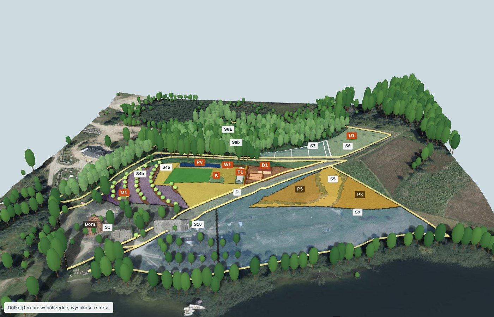

# Samowystarczalny system do życia

Repozytorium zawiera projekt gospodarstwa, które daje 4 osobom żywność, ciepło, wodę pitną i energię elektryczną bez sieci. Gospodarstwo ma 4,27 ha i leży w Olsztynie przy ul. Młodzieżowej 1 (Gutkowo). Projekt zawiera obliczenia, źródła, model 3D i listę braków. Data projektu: 2026-11-11.

> Legenda: tekst stosuje zapis [Polszczyzny Kontrolowanej](https://github.com/maciejszulia/polszczyzna-kontrolowana) (PK). „Lub” znaczy co najmniej 1 z członów. „Albo” znaczy dokładnie 1 z członów. Znacznik w nawiasie kwadratowym podaje źródło informacji. Znacznik `[DO USTALENIA: …]` oznacza brak danych.

## Słownik

| Termin | Definicja | Nie pisz |
|---|---|---|
| samowystarczalność | Udział własnych zasobów gospodarstwa w energii diety, w cieple, w wodzie i w energii elektrycznej. | niezależność |
| system | Zbiór 4 części: dokument projektu, raporty, obliczenia, model 3D. | pakiet |
| dzień pusty | Dzień kalendarzowy, w którym magazyn energii osiąga dolną granicę rozładowania 20%. | blackout |
| stado pełne | Stado drobiu, które liczy co najwyżej 100 sztuk w szczycie sezonu. | duże stado |

Dokument projektu zawiera pełny słownik: 22 terminy.

## Wynik

| Cel | Wynik projektu |
|---|---|
| Żywność | Gospodarstwo pokrywa od 66% do 92% energii diety 4 osób z własnego gruntu. |
| Drób | Stado pełne daje 10 260 jaj na rok i zużywa 3,4 t paszy z zakupu na rok. |
| Mleko i miód | 2 kozy dają od 1 200 kg do 2 800 kg mleka na rok. 3 ule dają od 33 kg do 51 kg miodu. |
| Ciepło | Drzewostan daje od 10 mp do 17 mp drewna na rok. Dom zużywa 16,0 mp na rok. |
| Energia elektryczna | Fotowoltaika 25 kWp, magazyn energii 30 kWh i agregat. Układ daje średnio 6,1 dnia pustego na rok. |
| Woda pitna | Gospodarstwo pobiera 2,0 m³ wody na dobę ze studni o głębokości 8 m. |
| Magazyn żywności | Piwnica ziemna i spichlerz mieszczą 2 604 kg zapasów. |
| Praca | Gospodarstwo wymaga od 1 099 h do 2 354 h pracy na rok. |
| Koszt | Infrastruktura kosztuje od 230 800 PLN do 565 000 PLN brutto w 7 etapach `[założenie]`. |

Znaczniki źródeł każdej liczby stoją w dokumencie projektu. Wynik 92% wymaga poprawy gleby i nawadniania.

## Zawartość

| Katalog albo plik | Zawartość |
|---|---|
| [`projekt/PROJEKT.md`](projekt/PROJEKT.md) | Dokument projektu: 20 sekcji, 6 rysunków, tabela „Decyzje i braki”, 47 źródeł. |
| [`raporty/`](raporty/) | 4 raporty z pełnymi obliczeniami: R1 teren i klimat, R2 żywność, R3 energia i woda, R4 horyzont stelaża. |
| [`model-3d/`](model-3d/README.md) | Model 3D: teren, strefy, obiekty, cień Słońca. |
| [`obliczenia/`](obliczenia/README.md) | Skrypty Pythona i dane wejściowe. |
| [`LICENCJE.md`](LICENCJE.md) | Licencje treści i kodu oraz dostawcy danych obcych. |

Raporty R1, R2 i R3 pokazują stan sprzed odpowiedzi właściciela z 2026-11-11. Raport R4 w sekcji 9 i dokument projektu zawierają zmiany po tych odpowiedziach.

## Metoda dla innego gospodarstwa

Wykonaj każdy krok w tej kolejności:

1. Pobierz geometrię działek z usługi ULDK. Wzór: skrypt `obliczenia/koordynator/parcels.py`.
2. Pobierz wysokości terenu z numerycznego modelu terenu GUGiK. Policz spadek każdej komórki siatki.
3. Podziel grunt na strefy. Każda strefa ma 1 funkcję i zmierzoną powierzchnię.
4. Policz grunt orny: teren otwarty o spadku mniejszym niż 15%.
5. Ustal liczbę osób i dietę. Policz powierzchnię upraw 2 razy: dla plonu ostrożnego i dla plonu dobrego.
6. Dobierz stado. Policz jaja, mięso, paszę i obornik.
7. Policz ciepło: zużycie drewna w domu i pozysk drewna z drzewostanu.
8. Policz wodę: pobór na dobę, wysokość podnoszenia pompy, ciśnienie ze zbiornika górnego.
9. Policz profil horyzontu stelaża z numerycznego modelu pokrycia terenu.
10. Uruchom usługę SHScalc w PVGIS z profilem horyzontu. Odczytaj liczbę dni pustych na rok.
11. Zapisz każdy brak znacznikiem `[DO USTALENIA: …]`. Zapytaj właściciela o każdy brak.
12. Zapisz projekt w PK: słownik, liczba z jednostką, znacznik źródła, tabela „Decyzje i braki”.

Usługi GUGiK obejmują tylko Polskę. Gospodarstwo w innym kraju wymaga danych terenu od innego dostawcy.

## Braki

Projekt czeka na 5 pomiarów albo danych:

- wyniki analizy chemicznej gleby z 2025-04-08;
- powierzchnia ogrzewana domu i wskaźnik EU;
- typ, średnica i wydajność studni oraz wynik badania wody;
- inwentaryzacja drzewostanu w strefie S8a;
- kąty przeszkód na południe od stelaża fotowoltaiki.

Tabela „Decyzje i braki” w dokumencie projektu ma 20 pozycji.

## Ograniczenia

- Projekt nie zastępuje projektu budowlanego, projektu instalacji elektrycznej ani porady prawnika.
- Ceny pochodzą z 2026 r. i są założeniem.
- Formalności z sekcji 17 dokumentu opisują stan z 2026-11-11.
- Teren, drzewa i budynki w modelu 3D pochodzą z pomiaru z 2018-03-21.

## Autorzy

- Właściciel gospodarstwa i projektu: Maciej Szulia.
- Projekt, obliczenia i model 3D: Claude (model językowy firmy Anthropic) z 3 agentami badawczymi, na zlecenie właściciela.
- Zapis: [Polszczyzna Kontrolowana 0.1](https://github.com/maciejszulia/polszczyzna-kontrolowana).

## Licencja

Treść ma licencję CC0 1.0. Kod ma licencję The Unlicense. Dane obce zachowują warunki dostawcy. Plik [`LICENCJE.md`](LICENCJE.md) podaje zakres każdej licencji i listę dostawców danych.
