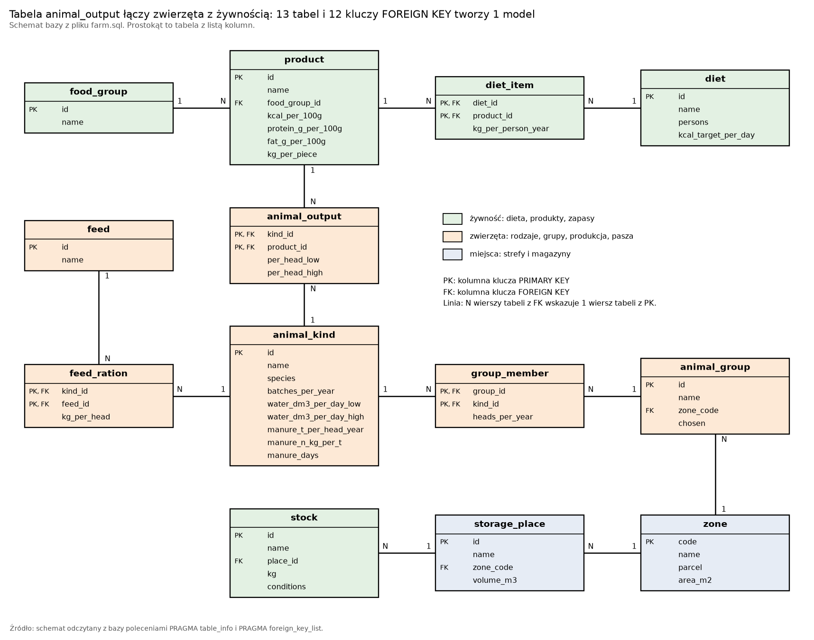

# Żywność i zwierzęta: przykład relacyjnej bazy danych

2026-11-13, Maciej Szulia

Baza zapisuje dane projektu o żywności i o zwierzętach w 13 tabelach. Każdy fakt stoi w 1 wierszu 1 tabeli. Zapytania odtwarzają liczby [dokumentu projektu](../projekt/PROJEKT.md). Test porównuje wyniki zapytań z obliczeniami raportu R2.

## 1. Wynik w skrócie

Baza ma 13 tabel, 12 kluczy FOREIGN KEY, 189 wierszy i 4 obiekty VIEW `[obliczenie: skrypt]`. Plik `queries.sql` zawiera 8 zapytań. Test potwierdza 17 wartości z funkcji raportu R2 `[obliczenie: skrypt]`. Baza odrzuca każde z 5 poleceń, które łamią reguły danych `[obliczenie: skrypt]`.

| Nr | Ustalenie | Liczba | Zapytanie |
| --- | --- | --- | --- |
| 1 | Baza odtwarza dietę i oba stada z dokumentu projektu. | 3 037 kcal na dobę; 100 sztuk w szczycie; 10 260 jaj; 3,37 t paszy | Q1, Q4, Q5 |
| 2 | Stado pełne daje mniej tuszek kurczaka, niż wynosi potrzeba 4 osób. | Produkcja: 65,5 kg. Potrzeba: 88,0 kg. Brak: 22,5 kg na rok. | Q6 |
| 3 | Stado pełne daje nadwyżkę tuszek kaczki i tuszek gęsi. | Kaczka: 18,1 kg na rok. Gęś: 35,6 kg na rok. | Q6 |
| 4 | 5 produktów daje 60,2% energii diety. | Żyto, mleko kozie, ziemniaki, owies nagi, olej lniankowy | Q3 |
| 5 | Piwnica ziemna M1 mieści 61,5% masy zapasów. | 1 602 kg z 2 604 kg | Q8 |
| 6 | Dokument projektu podaje 103 g tłuszczu na dobę. Baza i obliczenie R2 dają 102 g. | 102,4 g | Q1 |

Znacznik tabeli: `[obliczenie: skrypt]`.

## 2. Legenda i słownik

> Legenda: „lub” znaczy co najmniej 1 z członów. „Albo” znaczy dokładnie 1 z członów. MUSI to wymóg. Znacznik w nawiasie kwadratowym podaje źródło informacji. Znacznik `[obliczenie: skrypt]` odsyła do pliku `check.py`. Znacznik `[DO USTALENIA: …]` oznacza brak danych. Słowa PRIMARY KEY, FOREIGN KEY, CHECK, UNIQUE, NULL, JOIN, GROUP BY, WITH i VIEW są słowami języka SQL.

Dokument używa terminów ze słownika dokumentu projektu. Tabela zawiera tylko terminy nowe.

| Termin | Definicja | Nie pisz |
| --- | --- | --- |
| baza | Zawartość pliku `farm.sql` po wczytaniu do programu SQLite. | system |
| tabela | Zbiór wierszy, które mają te same kolumny. | arkusz |
| wiersz | Jeden zapis w tabeli: 1 obiekt albo 1 fakt. | rekord |
| kolumna | Jedna cecha każdego wiersza tabeli. | pole |
| PRIMARY KEY | Kolumna albo para kolumn, która wskazuje dokładnie 1 wiersz tabeli. | identyfikator |
| FOREIGN KEY | Kolumna, która przechowuje wartość PRIMARY KEY innej tabeli. | odnośnik |
| CHECK | Warunek, który każdy wiersz tabeli MUSI spełniać. | walidacja |
| NULL | Brak wartości w kolumnie. | puste pole |
| tabela łącząca | Tabela, której PRIMARY KEY składa się z 2 kolumn FOREIGN KEY. | tabela pośrednia |
| VIEW | Zapytanie zapisane w bazie pod nazwą. | perspektywa |
| zapytanie | Polecenie SELECT, które zwraca wiersze. | kwerenda |
| rodzaj zwierzęcia | Wiersz tabeli `animal_kind`: zwierzę o 1 zestawie parametrów. | gatunek |
| grupa zwierząt | Wiersz tabeli `animal_group`: stado domowe, stado pełne, kozy mleczne albo pasieka U1. | stado (dla kóz i dla pszczół) |

## 3. Zakres i źródła danych

Baza obejmuje 5 zbiorów danych projektu: dietę, produkty, zapasy, zwierzęta i paszę. Baza nie obejmuje 4 zbiorów: upraw, gruntu ornego, zakupów i kalendarza.

| Dane | Tabele | Źródło |
| --- | --- | --- |
| Dieta 1 osoby dorosłej: 49 produktów | `diet`, `diet_item` | Sekcja 6 dokumentu projektu; plik `obliczenia/R2/dane.py` |
| Wartości odżywcze produktów | `product`, `food_group` | `[źródło: Z25]` |
| Zapasy na 12 miesięcy: 12 pozycji | `stock`, `storage_place` | Sekcja 12 dokumentu projektu |
| Stado domowe i stado pełne | `animal_group`, `group_member` | Sekcja 8 dokumentu projektu |
| Kozy mleczne i pasieka U1 | `animal_group`, `group_member` | Sekcja 9 dokumentu projektu |
| Parametry 1 sztuki: woda, obornik, produkcja, pasza | `animal_kind`, `animal_output`, `feed`, `feed_ration` | Plik `obliczenia/R2/dane.py`; raport R3, sekcja C7 |
| Strefy gospodarstwa | `zone` | Sekcja 7 dokumentu projektu |

## 4. Model



Rysunek 1. Schemat bazy: 13 tabel i 12 kluczy FOREIGN KEY `[obliczenie: skrypt]`.

| Tabela | Wiersz tabeli opisuje | Liczba wierszy | PRIMARY KEY |
| --- | --- | --- | --- |
| `zone` | Strefę gospodarstwa. | 13 | `code` |
| `food_group` | Grupę produktów z tabeli diety. | 12 | `id` |
| `product` | Produkt z energią, z białkiem i z tłuszczem na 100 g. | 49 | `id` |
| `diet` | Dietę: liczbę osób i cel energii na dobę. | 1 | `id` |
| `diet_item` | Masę 1 produktu w diecie 1 osoby na rok. | 49 | `diet_id`, `product_id` |
| `storage_place` | Miejsce przechowywania zapasów. | 3 | `id` |
| `stock` | Pozycję zapasu: masę, miejsce i warunki. | 12 | `id` |
| `animal_kind` | Rodzaj zwierzęcia: wodę i obornik 1 sztuki. | 10 | `id` |
| `animal_output` | Produkt, który 1 sztuka daje na rok. | 9 | `kind_id`, `product_id` |
| `animal_group` | Grupę zwierząt i strefę grupy. | 4 | `id` |
| `group_member` | Liczbę sztuk 1 rodzaju w 1 grupie na rok. | 15 | `group_id`, `kind_id` |
| `feed` | Paszę: paszę treściwą albo siano. | 2 | `id` |
| `feed_ration` | Masę 1 paszy dla 1 sztuki. | 10 | `kind_id`, `feed_id` |

Znacznik tabeli: `[obliczenie: skrypt]`. Suma: 189 wierszy.

## 5. Reguły modelu

1. Jeden fakt stoi w 1 wierszu 1 tabeli. Przykład: energia żyta, 319 kcal na 100 g, stoi tylko w tabeli `product`.
2. Tabela wskazuje wiersz innej tabeli kolumną FOREIGN KEY. Przykład: tabela `diet_item` nie powtarza nazwy produktu.
3. Związek, w którym każda strona ma więcej niż 1 wiersz, dostaje tabelę łączącą. Przykład: stado pełne ma 6 rodzajów zwierząt, a rodzaj „Kogut” występuje w 2 grupach. Baza ma 4 tabele łączące: `diet_item`, `group_member`, `animal_output` i `feed_ration`.
4. Baza nie przechowuje liczby, którą zapytanie liczy z innych kolumn. Przykład: obiekt VIEW `v_group_output` liczy 10 260 jaj z 54 niosek i ze 190 jaj na nioskę.
5. Baza odrzuca wiersz, który łamie typ kolumny, CHECK, UNIQUE albo FOREIGN KEY. Sekcja 7 pokazuje 5 prób.
6. NULL ma 2 znaczenia, zależnie od kolumny. W kolumnie `kg_per_piece` NULL znaczy: produkt jest liczony w kilogramach.
7. W 7 pozostałych kolumnach z NULL wartość NULL znaczy: dokument projektu nie podaje wartości. Baza ma 11 wartości NULL o znaczeniu „brak danych” `[obliczenie: skrypt]`.

## 6. Zapytania

Każdy wynik pochodzi z uruchomienia skryptu `check.py`. Wartość „brak” w wyniku oznacza NULL.

### Q1. Energia i makroskładniki diety na 1 osobę na dobę

```sql
SELECT diet                                     AS "dieta",
       persons                                  AS "osoby",
       CAST(round(kcal_per_day) AS INTEGER)     AS "energia [kcal]",
       kcal_target_per_day                      AS "cel [kcal]",
       CAST(round(protein_g_per_day) AS INTEGER) AS "białko [g]",
       CAST(round(fat_g_per_day) AS INTEGER)    AS "tłuszcz [g]"
FROM v_diet_day;
```

| dieta | osoby | energia [kcal] | cel [kcal] | białko [g] | tłuszcz [g] |
| --- | --- | --- | --- | --- | --- |
| Dieta L: gleba lekka, kozy i pszczoły | 4 | 3 037 | 3 000 | 110 | 102 |

Zapytanie czyta obiekt VIEW `v_diet_day`. Obiekt VIEW łączy 3 tabele i sumuje 49 pozycji diety.

### Q2. Dieta roczna 1 osoby według grup

```sql
SELECT g.name                                                                   AS "grupa",
       count(*)                                                                 AS "produkty",
       round(sum(i.kg_per_person_year), 1)                                      AS "masa [kg na rok]",
       CAST(round(sum(i.kg_per_person_year * 10 * p.kcal_per_100g) / 365) AS INTEGER) AS "energia [kcal na dobę]"
FROM diet_item i
JOIN product p    ON p.id = i.product_id
JOIN food_group g ON g.id = p.food_group_id
WHERE i.diet_id = 1
GROUP BY g.id
ORDER BY g.id;
```

| grupa | produkty | masa [kg na rok] | energia [kcal na dobę] |
| --- | --- | --- | --- |
| Zboża | 5 | 112,0 | 1 041 |
| Ziemniaki | 1 | 170,0 | 312 |
| Strączkowe suche | 3 | 21,0 | 198 |
| Olej | 1 | 10,0 | 242 |
| Nasiona oleiste | 4 | 11,0 | 123 |
| Orzechy w łupinie | 2 | 8,0 | 64 |
| Warzywa | 17 | 238,0 | 155 |
| Owoce | 10 | 112,0 | 148 |
| Jaja | 1 | 17,4 | 66 |
| Mięso drobiowe (tuszki) | 3 | 31,5 | 151 |
| Mleko kozie | 1 | 250,0 | 473 |
| Miód | 1 | 8,0 | 65 |

Zapytanie łączy 3 tabele słowem JOIN i grupuje wiersze słowami GROUP BY. Wynik odtwarza tabelę diety z sekcji 6 dokumentu projektu.

### Q3. 5 produktów, które dają najwięcej energii

```sql
WITH energy AS (
  SELECT p.name, i.kg_per_person_year * 10 * p.kcal_per_100g / 365 AS kcal
  FROM diet_item i
  JOIN product p ON p.id = i.product_id
  WHERE i.diet_id = 1
)
SELECT name                                                                         AS "produkt",
       CAST(round(kcal) AS INTEGER)                                                 AS "energia [kcal na dobę]",
       round(100 * kcal / sum(kcal) OVER (), 1)                                     AS "udział [%]",
       round(100 * sum(kcal) OVER (ORDER BY kcal DESC, name) / sum(kcal) OVER (), 1) AS "udział narastający [%]"
FROM energy
ORDER BY kcal DESC, name
LIMIT 5;
```

| produkt | energia [kcal na dobę] | udział [%] | udział narastający [%] |
| --- | --- | --- | --- |
| Żyto: mąka razowa | 507 | 16,7 | 16,7 |
| Mleko kozie | 473 | 15,6 | 32,3 |
| Ziemniaki | 312 | 10,3 | 42,5 |
| Owies nagi: płatki, kasza | 295 | 9,7 | 52,3 |
| Olej lniankowy (rydzowy) tłoczony na zimno | 242 | 8,0 | 60,2 |

Funkcja okna `sum(…) OVER (…)` liczy udział narastający w 1 zapytaniu. 5 produktów daje 60,2% energii diety.

### Q4. Grupy zwierząt: sztuki, woda, pasza, obornik

```sql
SELECT l.animal_group                         AS "grupa",
       l.heads_at_peak                        AS "sztuki w szczycie",
       round(l.water_dm3_per_day_low, 1)      AS "woda od [dm³ na dobę]",
       round(l.water_dm3_per_day_high, 1)     AS "woda do [dm³ na dobę]",
       round(f.kg_per_year / 1000, 2)         AS "pasza treściwa [t na rok]",
       round(l.manure_t, 2)                   AS "obornik [t na rok]",
       CAST(round(l.manure_n_kg) AS INTEGER)  AS "azot [kg na rok]"
FROM v_group_load l
LEFT JOIN v_group_feed f ON f.group_id = l.group_id AND f.feed = 'Pasza treściwa'
ORDER BY l.group_id;
```

| grupa | sztuki w szczycie | woda od [dm³ na dobę] | woda do [dm³ na dobę] | pasza treściwa [t na rok] | obornik [t na rok] | azot [kg na rok] |
| --- | --- | --- | --- | --- | --- | --- |
| Stado domowe | 47 | 23,4 | 23,4 | 1,01 | 0,58 | 12 |
| Stado pełne | 100 | 47,2 | 47,2 | 3,37 | 2,03 | 42 |
| Kozy mleczne | 2 | 8,0 | 20,0 | 0,2 | brak | brak |
| Pasieka U1 | 3 | brak | brak | brak | brak | brak |

Słowa LEFT JOIN zostawiają w wyniku grupę bez paszy treściwej. Pasieka U1 dostaje w kolumnach bez danych wartość „brak”.

### Q5. Produkcja grup zwierząt na rok

```sql
SELECT animal_group           AS "grupa",
       product                AS "produkt",
       round(amount_low, 1)   AS "ilość od",
       round(amount_high, 1)  AS "ilość do",
       unit                   AS "jednostka"
FROM v_group_output
ORDER BY group_id, product_id;
```

| grupa | produkt | ilość od | ilość do | jednostka |
| --- | --- | --- | --- | --- |
| Stado domowe | Jaja kurze | 1 440,0 | 1 440,0 | szt. |
| Stado domowe | Kurczak: tuszka | 90,2 | 90,2 | kg |
| Stado domowe | Kaczka: tuszka | 21,4 | 21,4 | kg |
| Stado domowe | Gęś: tuszka | 22,3 | 22,3 | kg |
| Stado pełne | Jaja kurze | 10 260,0 | 10 260,0 | szt. |
| Stado pełne | Kurczak: tuszka | 65,5 | 65,5 | kg |
| Stado pełne | Kaczka: tuszka | 38,1 | 38,1 | kg |
| Stado pełne | Gęś: tuszka | 53,6 | 53,6 | kg |
| Kozy mleczne | Mleko kozie | 1 200,0 | 2 800,0 | kg |
| Pasieka U1 | Miód | 33,0 | 51,0 | kg |

Kolumna „jednostka” zależy od kolumny `kg_per_piece`. Baza liczy w sztukach tylko produkt, który ma masę 1 sztuki.

### Q6. Bilans produktów zwierzęcych: potrzeba 4 osób i produkcja grup wybranych przez właściciela

```sql
WITH need AS (
  SELECT i.product_id, i.kg_per_person_year * d.persons AS kg
  FROM diet_item i
  JOIN diet d ON d.id = i.diet_id
  WHERE d.id = 1
), made AS (
  SELECT o.product_id, sum(o.kg_low) AS kg_low, sum(o.kg_high) AS kg_high
  FROM v_group_output o
  JOIN animal_group g ON g.id = o.group_id
  WHERE g.chosen = 1
  GROUP BY o.product_id
)
SELECT p.name                      AS "produkt",
       round(n.kg, 1)              AS "potrzeba [kg na rok]",
       round(m.kg_low, 1)          AS "produkcja od [kg]",
       round(m.kg_high, 1)         AS "produkcja do [kg]",
       round(m.kg_low - n.kg, 1)   AS "bilans od [kg]",
       round(m.kg_high - n.kg, 1)  AS "bilans do [kg]"
FROM made m
JOIN need n    ON n.product_id = m.product_id
JOIN product p ON p.id = m.product_id
ORDER BY p.id;
```

| produkt | potrzeba [kg na rok] | produkcja od [kg] | produkcja do [kg] | bilans od [kg] | bilans do [kg] |
| --- | --- | --- | --- | --- | --- |
| Jaja kurze | 69,6 | 595,1 | 595,1 | 525,5 | 525,5 |
| Kurczak: tuszka | 88,0 | 65,5 | 65,5 | −22,5 | −22,5 |
| Kaczka: tuszka | 20,0 | 38,1 | 38,1 | 18,1 | 18,1 |
| Gęś: tuszka | 18,0 | 53,6 | 53,6 | 35,6 | 35,6 |
| Mleko kozie | 1 000,0 | 1 200,0 | 2 800,0 | 200,0 | 1 800,0 |
| Miód | 32,0 | 33,0 | 51,0 | 1,0 | 19,0 |

Słowo WITH nazywa 2 zapytania pomocnicze: potrzebę diety i produkcję grup wybranych. Stado pełne daje 65,5 kg tuszek kurczaka, a 4 osoby potrzebują 88,0 kg: brakuje 22,5 kg na rok. Tuszki kaczki dają nadwyżkę 18,1 kg, a tuszki gęsi nadwyżkę 35,6 kg.

### Q7. Nadwyżka jaj stada pełnego

```sql
SELECT CAST(o.amount_low AS INTEGER)                    AS "produkcja [szt. na rok]",
       CAST(round(n.pieces) AS INTEGER)                 AS "potrzeba 4 osób [szt. na rok]",
       CAST(round((o.amount_low - n.pieces) / 52) AS INTEGER) AS "nadwyżka [szt. na tydzień]"
FROM v_group_output o
JOIN (
  SELECT i.product_id, i.kg_per_person_year * d.persons / p.kg_per_piece AS pieces
  FROM diet_item i
  JOIN diet d    ON d.id = i.diet_id
  JOIN product p ON p.id = i.product_id
  WHERE d.id = 1 AND p.kg_per_piece IS NOT NULL
) n ON n.product_id = o.product_id
WHERE o.animal_group = 'Stado pełne';
```

| produkcja [szt. na rok] | potrzeba 4 osób [szt. na rok] | nadwyżka [szt. na tydzień] |
| --- | --- | --- |
| 10 260 | 1 200 | 174 |

Zapytanie w nawiasie przelicza masę jaj z diety na sztuki. Wynik 174 sztuki na tydzień zgadza się z sekcją 8 dokumentu projektu.

### Q8. Zapasy na 12 miesięcy według miejsca

```sql
SELECT s.name                                               AS "miejsce",
       s.zone_code                                          AS "strefa",
       count(*)                                             AS "pozycje",
       sum(t.kg)                                            AS "masa [kg]",
       round(100.0 * sum(t.kg) / sum(sum(t.kg)) OVER (), 1) AS "udział [%]"
FROM stock t
JOIN storage_place s ON s.id = t.place_id
GROUP BY s.id
ORDER BY sum(t.kg) DESC;
```

| miejsce | strefa | pozycje | masa [kg] | udział [%] |
| --- | --- | --- | --- | --- |
| Piwnica ziemna M1 | S4b | 5 | 1 602 | 61,5 |
| Spichlerz suchy | brak | 5 | 882 | 33,9 |
| Komora sucha | brak | 2 | 120 | 4,6 |

Piwnica ziemna M1 mieści 1 602 kg, czyli 61,5% masy zapasów. Wartość „brak” w kolumnie „strefa” oznacza, że dokument projektu nie podaje strefy.

## 7. Polecenia, które baza odrzuca

| Nr | Próba | Polecenie | Odpowiedź bazy |
| --- | --- | --- | --- |
| 1 | Pozycja diety z produktem, którego tabela `product` nie zawiera. | `INSERT INTO diet_item (diet_id, product_id, kg_per_person_year) VALUES (1, 999, 5)` | `FOREIGN KEY constraint failed` |
| 2 | Zapas o masie ujemnej. | `INSERT INTO stock (name, place_id, kg, conditions) VALUES ('Mąka', 1, -5, 'brak')` | `CHECK constraint failed: kg > 0` |
| 3 | Drugi wiersz dla tej samej pary: grupa i rodzaj zwierzęcia. | `INSERT INTO group_member (group_id, kind_id, heads_per_year) VALUES (2, 2, 10)` | `UNIQUE constraint failed: group_member.group_id, group_member.kind_id` |
| 4 | Usunięcie produktu, którego używa dieta. | `DELETE FROM product WHERE name = 'Jaja kurze'` | `FOREIGN KEY constraint failed` |
| 5 | Tekst w kolumnie liczbowej. | `UPDATE zone SET area_m2 = 'siedemset' WHERE code = 'S3'` | `cannot store TEXT value in INTEGER column zone.area_m2` |

Znacznik tabeli: `[obliczenie: skrypt]`. Skrypt `check.py` wykonuje każde polecenie i cofa transakcję.

## 8. Zgodność z dokumentem projektu

| Wielkość | Dokument projektu | Baza | Zapytanie |
| --- | --- | --- | --- |
| Energia diety na osobę na dobę | 3037 kcal | 3 037 kcal | Q1 |
| Białko diety na osobę na dobę | 110 g | 110 g | Q1 |
| Tłuszcz diety na osobę na dobę | 103 g | 102 g | Q1 |
| Dieta roczna według grup | 12 wierszy tabeli z sekcji 6 | 12 wierszy o tej samej masie | Q2 |
| Sztuki w szczycie: stado domowe; stado pełne | 47; 100 | 47; 100 | Q4 |
| Jaja na rok: stado domowe; stado pełne | 1 440; 10 260 | 1 440; 10 260 | Q5 |
| Tuszki na rok: stado domowe; stado pełne | 134 kg; 157 kg | 134 kg; 157 kg | Q5 |
| Pasza treściwa na rok: stado domowe; stado pełne | 1,01 t; 3,37 t | 1,01 t; 3,37 t | Q4 |
| Obornik na rok: stado domowe; stado pełne | 0,58 t; 2,03 t | 0,58 t; 2,03 t | Q4 |
| Azot w oborniku na rok: stado domowe; stado pełne | 12 kg; 42 kg | 12 kg; 42 kg | Q4 |
| Woda stada pełnego w szczycie | co najwyżej 47 dm³ na dobę | 47,2 dm³ na dobę | Q4 |
| Nadwyżka jaj stada pełnego | 174 sztuki na tydzień | 174 sztuki na tydzień | Q7 |
| Mleko 2 kóz na rok | od 1 200 kg do 2 800 kg | od 1 200 kg do 2 800 kg | Q5 |
| Miód 3 rodzin pszczelich na rok | od 33 kg do 51 kg | od 33 kg do 51 kg | Q5 |
| Siano dla 2 kóz na rok | 1 262 kg | 1 262 kg | VIEW `v_group_feed` |
| Zapas żywności na 12 miesięcy | 2 604 kg | 2 604 kg | Q8 |

Znaczniki tabeli: dokument projektu `[źródło: sekcje 6, 8, 9 i 12 dokumentu projektu]`; baza `[obliczenie: skrypt]`. Skrypt `check.py` sprawdza każdy wiersz tabeli. Tabela pokazuje 2 różnice: tłuszcz diety i wodę stada pełnego.

## 9. Uruchomienie

```sh
cd database && python3 check.py --check
```

Rozbicie:

- `cd database`: przechodzi do katalogu bazy.
- `&&`: uruchamia drugie polecenie tylko po sukcesie pierwszego polecenia.
- `python3 check.py`: buduje bazę w pamięci, wykonuje testy i wypisuje wyniki 8 zapytań.
- `--check`: porównuje wyniki z tekstem pliku `README.md`.

```sh
sqlite3 farm.db < farm.sql && sqlite3 -header -column farm.db < queries.sql
```

Rozbicie:

- `sqlite3 farm.db < farm.sql`: tworzy plik bazy `farm.db` z pliku `farm.sql`.
- `&&`: uruchamia drugie polecenie tylko po sukcesie pierwszego polecenia.
- `sqlite3 -header -column farm.db < queries.sql`: wykonuje 8 zapytań i pokazuje wyniki z nagłówkami kolumn.

Wymagania: Python 3 oraz SQLite w wersji co najmniej 3.37. Opcja `--erd` rysuje plik `erd.png` i wymaga pakietu `matplotlib`. Repozytorium nie przechowuje pliku `farm.db`.

## 10. Decyzje i braki

| Nr | Fragment | Reguła | Znaczenia lub brak | Wybór |
| --- | --- | --- | --- | --- |
| 1 | „przykład relacyjnej bazy danych” w zleceniu właściciela | A4 | Brak programu bazy danych. | SQLite: baza w 1 pliku, bez serwera. Python zawiera moduł `sqlite3`. |
| 2 | „z żywności i zwierząt” w zleceniu właściciela | A2 | Brak listy zbiorów danych. | 5 zbiorów z sekcji 3. Uprawy, grunt orny, zakupy i kalendarz zostają poza bazą. |
| 3 | Tłuszcz diety | F | Dokument projektu i raport R2 podają w tekście 103 g. Tabela obliczeń R2 podaje 102 g. | Baza daje 102,4 g. `[DO USTALENIA: poprawka tekstu dokumentu projektu]` |
| 4 | Woda stada pełnego | D2 | Dokument projektu podaje „co najwyżej 47 dm³”. Obliczenie daje 47,2 dm³. | Baza daje 47,2 dm³. `[DO USTALENIA: poprawka tekstu dokumentu projektu]` |
| 5 | „Młode kury z wylęgu na rok: 10” | A2 | 2 znaczenia: 10 kurek; 5 kurek i 5 kogutków. | Stado domowe: 5 kurek i 5 kogutków. Stado pełne: 10 kurek. Wybór odtwarza tuszki 134 kg i 157 kg. |
| 6 | Strefa spichlerza i strefa komory suchej | F | Dokument projektu nie podaje strefy. | NULL. `[DO USTALENIA: strefa obu miejsc]` |
| 7 | Objętość komory suchej | F | Dokument projektu nie podaje objętości. | NULL. `[DO USTALENIA: objętość]` |
| 8 | Obornik kóz i woda pszczół | F | Dokument projektu nie podaje wartości. | NULL. |
| 9 | Jednostka w tabeli `animal_output` | A1 | Obie kolumny ilości mają 2 jednostki: sztuki albo kilogramy. | Jednostkę wyznacza kolumna `kg_per_piece` produktu. |
| 10 | Nazwy tabel i kolumn | A1 | Nazwy są angielskie, a dane są polskie. | Kod po angielsku, treść projektu po polsku. |
| 11 | Suma powierzchni stref | F | Tabela stref daje 42 687 m². Geometria działek daje 42 689 m². | Baza przechowuje wartości z tabeli stref. |
