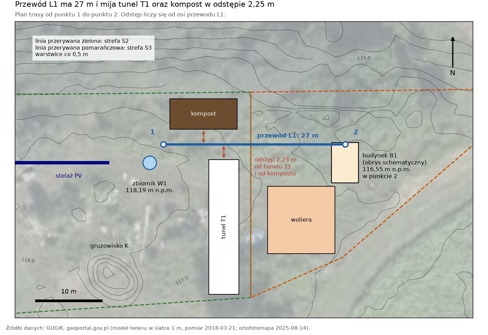
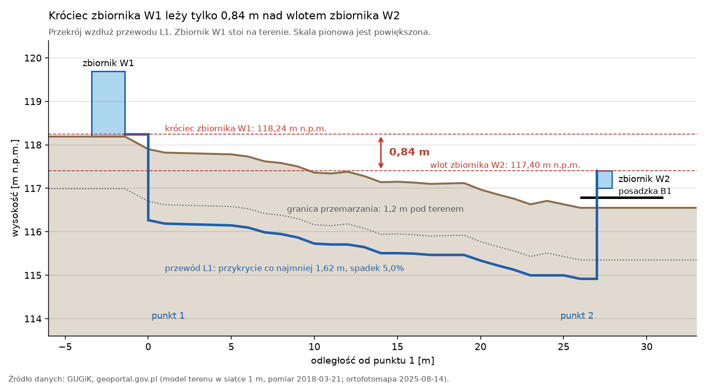
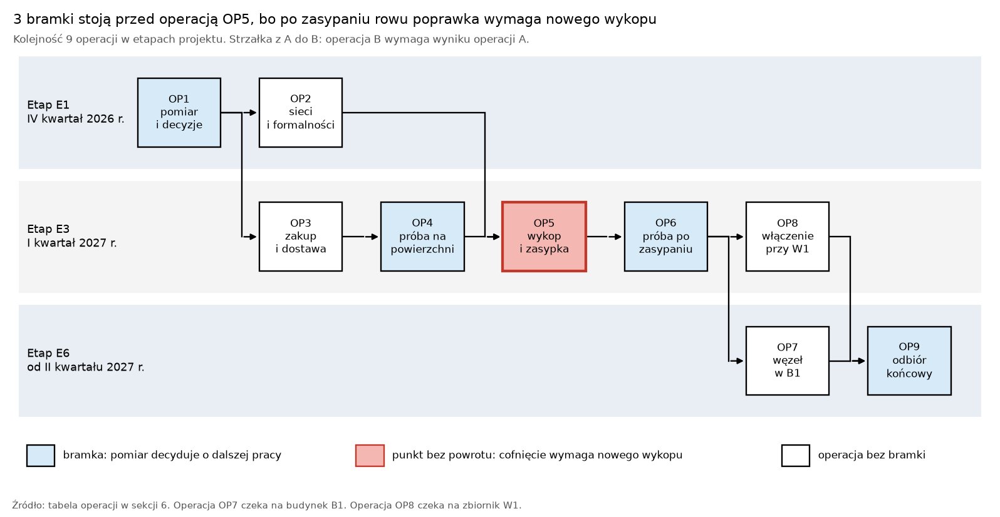

# Budowa wodociągu do kur jako przykład operacji wdrożenia

2026-11-13, Maciej Szulia

Dokument rozpisuje 1 pozycję projektu gospodarstwa na 9 operacji wdrożenia. Pozycja pochodzi z sekcji 8 [dokumentu projektu](../projekt/PROJEKT.md): „Zasilanie grawitacyjne ze zbiornika W1”. Dokument jest też wzorem dla kolejnych operacji: sekcja 10 zawiera kartę operacji.

## 1. Wynik w skrócie

Wodociąg do kur to przewód L1 o długości 27 m między zbiornikiem W1 a budynkiem B1 `[obliczenie: skrypt]`. Budowa wymaga 9 operacji, od 35 h do 67 h pracy własnej i kosztuje od 1 290 PLN do 4 100 PLN brutto `[obliczenie: skrypt; ceny: założenie]`. Rozpisanie pozycji na operacje wykryło 2 sprzeczności projektu (wiersz 2 i wiersz 4 tabeli) oraz 1 wadę pomiaru (wiersz 7).

| Nr | Ustalenie | Liczba | Skutek |
| --- | --- | --- | --- |
| 1 | Króciec pustego zbiornika W1 leży nad wlotem zbiornika W2. | Napór: 0,84 m. Przy błędzie modelu terenu: 0,54 m. | Zasilanie grawitacyjne działa z zapasem 0,54 m. Operacja OP1 mierzy wysokości przed zakupem. |
| 2 | Zbiornik W1 pod przykryciem gruntu 1,2 m leży niżej niż wlot zbiornika W2. | Napór: −0,41 m. | Zbiornik W1 stoi na terenie. Zbiornik W1 jest pusty w okresie mrozu. |
| 3 | W okresie mrozu wodę podaje rura tłoczna. | Nadciśnienie na wlocie zbiornika W2: od 2,0 bar do 3,0 bar. | Przewód L1 leży głębiej niż granica przemarzania. |
| 4 | Zbiornik W2 o pojemności 60 dm³ nie daje zapasu na 3 doby w okresie mrozu. | Zapas: od 1,6 doby do 2,7 doby. Potrzeba: 111 dm³. | Decyzja D3 w sekcji 11. |
| 5 | Rów ma 1,75 m głębokości w piasku. | Urobek: od 19 m³ do 61 m³. | Żaden człowiek nie wchodzi do rowu. Rura nie ma złączek w gruncie. |
| 6 | Dysza zaworu pływakowego decyduje o czasie napełniania zbiornika W2. | Czas napełnienia: 58 min dla dyszy 3 mm i 22 min dla dyszy 5 mm. | Kup zawór pływakowy z dyszą o średnicy co najmniej 5 mm. |
| 7 | Wodomierz nie mierzy przepływu mniejszego niż próg rozruchu. | Próg: 15,6 dm³/h. Średni pobór drobiu: 2,0 dm³/h. | Operacja OP9 sprawdza alarm „przepływ 0 przez 12 h”. |

Znacznik tabeli: `[obliczenie: skrypt]`. Sekcja 4 podaje wzory i założenia.

## 2. Legenda i słownik

> Legenda: „lub” znaczy co najmniej 1 z członów. „Albo” znaczy dokładnie 1 z członów. MUSI to wymóg. NIE WOLNO to zakaz. MOŻE to zezwolenie. Znacznik w nawiasie kwadratowym podaje źródło informacji. Znacznik `[źródło: Zn]` z numerem co najwyżej 47 odsyła do sekcji 20 dokumentu projektu. Znacznik `[źródło: Zn]` z numerem co najmniej 48 odsyła do sekcji 12. Znacznik `[obliczenie: skrypt]` odsyła do pliku `poultry_water_line.py`. Znacznik `[DO USTALENIA: …]` oznacza brak danych.

Dokument używa terminów ze słownika dokumentu projektu. Tabela zawiera tylko terminy nowe.

| Termin | Definicja | Nie pisz |
| --- | --- | --- |
| etap | Część projektu z zakresem, z kosztem i z terminem: od E1 do E7 w sekcji 18 dokumentu projektu. | faza |
| operacja wdrożenia | Część etapu, która ma 1 wynik i 1 kryterium odbioru. Skrót: operacja. | zadanie |
| krok | Jedno polecenie dla wykonawcy operacji. | czynność |
| warunek wejścia | Stan, który wykonawca sprawdza przed krokiem 1 operacji. | wymaganie wstępne |
| kryterium odbioru | Pomiar z liczbą graniczną, który zamyka operację. | test |
| bramka | Operacja, która tylko mierzy. Wynik pomiaru dopuszcza albo zatrzymuje kolejną operację. | kontrola |
| punkt bez powrotu | Operacja, której cofnięcie wymaga nowego rowu. | punkt krytyczny |
| cofnięcie | Powrót do stanu sprzed operacji. | wycofanie |
| wodociąg | Przewód L1 razem z zaworami V1 i V2 oraz z węzłem budynku B1. | instalacja |
| rura | Krąg 50 m rury PE100 SDR11 o wymiarach 32 mm × 3,0 mm, przed ułożeniem. | wąż |
| przewód L1 | Rura ułożona od punktu 1 do punktu 2 razem z pionem 1 i z pionem 2. | rurociąg |
| punkt 1 | Początek przewodu L1: 3,4 m od osi zbiornika W1 `[obliczenie: skrypt]`. | początek trasy |
| punkt 2 | Koniec przewodu L1 w obrysie budynku B1. | koniec trasy |
| trasa | Odcinek prosty od punktu 1 do punktu 2 na powierzchni terenu. | przebieg |
| rów | Wykop wzdłuż trasy o głębokości co najmniej 1,75 m. | wykop |
| pion | Część przewodu L1, która biegnie od dna rowu na wysokość 1,0 m nad terenem. Pion 1 stoi w punkcie 1. Pion 2 stoi w punkcie 2. | wyjście |
| przykrycie | Grubość gruntu od wierzchu przewodu L1 do powierzchni terenu. | głębokość rury |
| spadek | Nachylenie dna rowu w kierunku budynku B1, w procentach. | pochylenie |
| zbiornik W2 | Zbiornik 60 dm³ z zaworem pływakowym w budynku B1 (sekcja 8 dokumentu projektu). | zbiornik poideł |
| węzeł budynku B1 | Zbiór 6 części: zawór V2, filtr, wodomierz, zawór pływakowy, zbiornik W2, linia 10 smoczków. | armatura |
| dysza | Otwór zaworu pływakowego, przez który woda wpływa do zbiornika W2. | gniazdo |
| napór | Różnica wysokości między króćcem zbiornika W1 a wlotem zbiornika W2, w metrach słupa wody. | ciśnienie (dla różnicy wysokości) |
| rura tłoczna | Rura etapu E3, która prowadzi wodę ze studni do zbiornika W1. | przyłącze |
| zasilanie grawitacyjne | Stan, w którym zbiornik W1 zasila przewód L1 bez prądu. | tryb letni |
| zasilanie ciśnieniowe | Stan, w którym rura tłoczna zasila przewód L1 pod ciśnieniem zbiornika przeponowego. | tryb zimowy |
| okres mrozu | Czas od 5 listopada do 30 marca włącznie `[założenie: czas poza okresem wegetacyjnym z sekcji 4 dokumentu projektu]`. | zima |
| operator | Osoba z firmy zewnętrznej, która prowadzi koparkę. | koparkowy |
| pomocnik | Dorosła osoba z rodziny właściciela, która pracuje razem z właścicielem. | drugi pracownik |

## 3. Zakres i dane wejściowe

Operacje od OP1 do OP9 budują wodociąg od zbiornika W1 do linii smoczków w budynku B1. Wodociąg zasila też poidło kóz, bo budynek B1 mieści kurnik i koziarnię. Operacje nie obejmują 3 obiektów: zbiornika W1, rury tłocznej i budynku B1. Zbiornik W1 i rura tłoczna powstają w etapie E3. Budynek B1 powstaje w etapie E6.

| Dane | Wartość | Znacznik |
| --- | --- | --- |
| Zbiornik W1 | Od 3 m³ do 5 m³. Teren w miejscu zbiornika: 118,19 m n.p.m. | `[źródło: sekcja 15 dokumentu projektu]`; `[obliczenie: Z46]` |
| Budynek B1 | Teren w punkcie 2: 116,55 m n.p.m. Teren w miejscu zbiornika W1 leży 1,64 m wyżej. | `[obliczenie: Z46]` |
| Położenie obiektów | Punkty z planu stref. Dokładność: ± 3 m. | `[założenie: sekcja 7 dokumentu projektu]` |
| Węzeł budynku B1 | Zbiornik 60 dm³, linia 10 smoczków, skrzynia ocieplona, grzałka 50 W. | `[źródło: sekcja 8 dokumentu projektu]` |
| Pobór drobiu | 47,2 dm³ na dobę w szczycie sezonu. Kaczki i gęsi pobierają 26,0 dm³ z 47,2 dm³. | `[obliczenie: R2]` |
| Pobór 2 kóz | Od 8 dm³ do 20 dm³ na dobę. | `[założenie: R3, sekcja C7]` |
| Pobór budynku B1 w szczycie sezonu | Od 55,2 dm³ do 67,2 dm³ na dobę. | `[obliczenie: skrypt]` |
| Pobór budynku B1 w okresie mrozu | Od 22,5 dm³ do 37,0 dm³ na dobę: 58 kur, co najwyżej 10 młodych kur, 2 kozy. | `[obliczenie: skrypt]` |
| Zapas bez prądu | Co najmniej 3 doby. Alarm: przepływ 0 przez 12 h. | `[źródło: sekcja 16 dokumentu projektu]` |
| Granica przemarzania | 1,2 m pod terenem. | `[założenie: R3, sekcja C8.9]` |
| Przykrycie przewodu | Co najmniej 1,60 m: granica przemarzania i 0,40 m. | `[źródło: Z48]` |
| Sieci podziemne | Ewidencja nie pokazuje sieci w pasie 75 m × 50 m wokół trasy. | `[źródło: Z54, odczyt 2026-11-13]` |
| Rośliny na trasie | Rośliny miały co najwyżej 1,05 m wysokości w pasie 5 m wokół trasy. | `[obliczenie: Z46, pomiar 2018-03-21]` |



Rysunek 1. Trasa przewodu L1 na planie stref `[obliczenie: skrypt; źródło: Z1, Z3, Z46]`. Źródło danych: Główny Urząd Geodezji i Kartografii (GUGiK), geoportal.gov.pl.

Trasa biegnie między tunelem T1 a kompostem. Oś trasy leży 2,25 m od tunelu T1 i 2,25 m od kompostu `[obliczenie: skrypt]`. Oś trasy leży 7,6 m od granicy strefy S8b `[obliczenie: skrypt]`. Tunel T1 i kompost powstają w etapie E5, czyli po operacji OP5. Gruzowisko K leży 21,8 m od trasy `[obliczenie: skrypt]`.

## 4. Sprawdzenie zasilania grawitacyjnego

Dokument projektu podaje nadciśnienie 1,06 bar dla domu, który stoi 10,8 m niżej niż zbiornik W1. Budynek B1 stoi tylko 1,64 m niżej niż zbiornik W1. Sekcja 4 liczy napór dla budynku B1.

`H = (z_1 + a) − (z_2 + f + s + c + b)`

- H: napór \[m\]. z_1 = 118,19 m n.p.m.: teren w miejscu zbiornika W1 `[obliczenie: Z46]`.
- a = 0,05 m: wysokość króćca nad dnem zbiornika W1 `[założenie]`. Suma z_1 + a wynosi 118,24 m n.p.m.
- z_2 = 116,55 m n.p.m.: teren w punkcie 2 `[obliczenie: Z46]`. f = 0,20 m: wysokość posadzki nad terenem `[założenie]`.
- s = 0,40 m: wysokość linii smoczków nad posadzką `[założenie]`. c = 0,20 m: słup wody nad smoczkami `[źródło: Z50]`.
- b = 0,05 m: wysokość wlotu zbiornika W2 nad lustrem wody `[założenie]`. Wlot zbiornika W2 leży na wysokości 117,40 m n.p.m.

| Stan zbiornika W1 | Napór | Wniosek |
| --- | --- | --- |
| Zbiornik na terenie, lustro wody na wysokości króćca | 0,84 m, czyli 0,082 bar | Zasilanie grawitacyjne działa. |
| Zbiornik na terenie, lustro wody 1,5 m nad dnem | 2,29 m | Zasilanie grawitacyjne działa. |
| Zbiornik na terenie, błąd modelu terenu 0,15 m na obu końcach trasy | 0,54 m | Zasilanie grawitacyjne działa. Operacja OP1 mierzy wysokości. |
| Zbiornik pod przykryciem gruntu 1,2 m, lustro wody przy stropie | −0,41 m | Zasilanie grawitacyjne nie działa. |

Znacznik tabeli: `[obliczenie: skrypt]`. Błąd 0,15 m jest założeniem.



Rysunek 2. Przekrój wzdłuż przewodu L1 z wysokością króćca zbiornika W1 i wlotu zbiornika W2 `[obliczenie: skrypt; źródło: Z46]`. Źródło danych: GUGiK, geoportal.gov.pl.

`h = λ × (L / D) × v² / (2 × g) + ζ × v² / (2 × g) + h_w × (Q / Q_3)²`

- h: strata naporu w przewodzie L1 \[m\]. λ: współczynnik tarcia \[bez jednostki\]. L = 34 m: długość przewodu L1.
- D = 0,026 m: średnica wewnętrzna rury. v: prędkość wody \[m/s\]. g = 9,81 m/s².
- ζ = 10: suma oporów zaworów i kolan `[założenie]`. Q: przepływ \[m³/h\].
- h_w = 6,42 m: strata wodomierza przy przepływie Q_3 = 2,5 m³/h `[założenie: wodomierz o stracie ciśnienia 0,63 bar]`.

Strata wynosi 0,011 m przy przepływie 1 dm³/min i 0,17 m przy przepływie 5 dm³/min `[obliczenie: skrypt]`. Rura o średnicy 32 mm nie ogranicza przepływu. Przepływ ogranicza dysza.

`Q = C × A × √(2 × g × (H − h))`

- Q: przepływ przez dyszę \[m³/s\]. C = 0,6: współczynnik wypływu `[założenie]`. A: pole przekroju dyszy \[m²\].

| Dysza | Napór | Czas napełnienia zbiornika W2 od 0 dm³ do 60 dm³ |
| --- | --- | --- |
| 3 mm | 0,84 m | 58 min |
| 5 mm | 0,84 m | 22 min |
| 6 mm | 0,84 m | 16 min |
| 5 mm | 0,50 m | 28 min |

Znacznik tabeli: `[obliczenie: skrypt]`. Kryterium odbioru wodociągu to czas krótszy niż 60 min `[założenie]`. Linia 10 smoczków pobiera co najwyżej 0,6 dm³/min `[źródło: R3, sekcja E11.2]`.

Wnioski:

1. Zasilanie grawitacyjne działa tylko dla zbiornika W1, który stoi na terenie. Raport R3 wymaga dla zbiornika na terenie opróżnienia przed mrozem `[źródło: R3, sekcja C8.6]`.
2. W okresie mrozu zbiornik W1 jest pusty, a wodę podaje rura tłoczna: zasilanie ciśnieniowe.
3. Wlot zbiornika W2 leży 10,05 m wyżej niż dom. Zbiornik przeponowy daje przy domu od 3,0 bar do 4,0 bar `[założenie: R3, sekcja C8.3]`.
4. Nadciśnienie na wlocie zbiornika W2 wynosi więc od 2,0 bar do 3,0 bar `[obliczenie: skrypt]`.
5. Bez prądu w okresie mrozu zostaje tylko zbiornik W2. Zbiornik W2 wystarcza na czas od 1,6 doby do 2,7 doby `[obliczenie: skrypt]`.
6. Zapas na 3 doby w okresie mrozu wymaga zbiornika W2 o pojemności co najmniej 111 dm³ `[obliczenie: skrypt]`.
7. Bez zbiornika W1 w szczycie sezonu zbiornik W2 wystarcza na czas od 0,9 doby do 1,1 doby `[obliczenie: skrypt]`.

## 5. Przewód L1 i rów

| Cecha | Wartość | Znacznik |
| --- | --- | --- |
| Rura | PE100 SDR11, 32 mm × 3,0 mm, PN16, z dopuszczeniem do wody pitnej. | `[założenie: wymiar rury z R3, sekcja C8.3]` |
| Długość | Trasa: 27 m. Przewód L1 z pionami: 34 m. Krąg 50 m wystarcza dla trasy o długości co najwyżej 43 m. | `[obliczenie: skrypt]` |
| Złączki w gruncie | 0 sztuk: przewód L1 to 1 odcinek rury. | `[założenie]` |
| Głębokość rowu | Co najmniej 1,75 m. Największa głębokość: 1,83 m. | `[obliczenie: skrypt]` |
| Przykrycie | Najmniejsze przykrycie: 1,62 m. Wymóg: co najmniej 1,60 m. | `[obliczenie: skrypt]`; `[źródło: Z48]` |
| Spadek | 5,0% w kierunku budynku B1. Dno rowu nie wznosi się w żadnym miejscu. | `[obliczenie: skrypt]` |
| Urobek | Od 19 m³ do 61 m³: rów o dnie 0,40 m ze ścianą pionową albo ze ścianą osypaną. | `[obliczenie: skrypt]`; `[założenie: nachylenie ściany osypanej 1 : 0,5]` |
| Woda w przewodzie L1 | 18,1 dm³. | `[obliczenie: skrypt]` |
| Piony | 2 piony w rurach osłonowych o średnicy 110 mm. Każdy pion sięga 1,0 m nad teren. | `[założenie]` |

Dno rowu opada w kierunku budynku B1, więc powietrze nie tworzy korka w przewodzie L1. Wodociąg ma 2 zawory odcinające: zawór V1 na pionie 1 i zawór V2 na pionie 2.

Bezpieczne nachylenie ściany rowu w gruncie niespoistym wynosi 1 : 1,5 `[źródło: Z53]`. Rów z nachyleniem 1 : 1,5 ma 5,7 m szerokości i 144 m³ urobku `[obliczenie: skrypt]`. Dokument wybiera rów o dnie 0,40 m, do którego żaden człowiek nie wchodzi. Rura bez złączek umożliwia pracę bez wejścia do rowu: wykonawca zsuwa rurę do rowu z powierzchni terenu.

OSTRZEŻENIE: Nie wchodź do rowu, który jest głębszy niż 1,0 m. Ściana rowu w piasku osuwa się bez ostrzeżenia i zasypuje człowieka `[źródło: Z49, § 147]`.

## 6. Operacje wdrożenia

| Kod | Operacja | Etap | Wykonawca | Warunek wejścia | Praca własna \[h\] | Kryterium odbioru |
| --- | --- | --- | --- | --- | --- | --- |
| OP1 | Pomiar i decyzje (bramka) | E1 | Właściciel, pomocnik | Brak. | od 6 do 8 | Zmierzony napór wynosi co najmniej 0,50 m. Trasa ma co najwyżej 43 m. |
| OP2 | Sieci i formalności | E1 | Właściciel | Protokół operacji OP1. | od 2 do 4 | Właściciel ma odpowiedź urzędu na piśmie. Żadna sieć nie leży w pasie 2 m od osi trasy. |
| OP3 | Zakup i dostawa | E3 | Właściciel | Decyzje D1, D2, D3 i D4. | od 2 do 3 | Dostawa spełnia każdą z 5 cech listy z sekcji 7. |
| OP4 | Próba na powierzchni (bramka) | E3 | Właściciel, pomocnik | Temperatura powietrza co najmniej 5 °C. | od 4 do 6 | Po 60 min manometr pokazuje co najmniej 5,8 bar. |
| OP5 | Rów, ułożenie i zasypka (punkt bez powrotu) | E3 | Operator, właściciel, pomocnik | Operacje OP1, OP2 i OP4 są zamknięte. Grunt nie jest zamarznięty. | od 8 do 24 | Przykrycie wynosi co najmniej 1,60 m w każdym z 7 punktów pomiaru. |
| OP6 | Próba po zasypaniu (bramka) | E3 | Właściciel | Rów jest zasypany. | od 2 do 3 | Po 60 min manometr pokazuje co najmniej 5,8 bar. |
| OP7 | Węzeł budynku B1 | E6 | Właściciel | Budynek B1 ma dach i posadzkę. | od 6 do 10 | Żadna złączka nie ma kropli po 30 min pod ciśnieniem. |
| OP8 | Włączenie przy zbiorniku W1 | E3 | Właściciel | Zbiornik W1 stoi. | od 2 do 4 | Woda wypływa z otwartego zaworu V2. |
| OP9 | Odbiór końcowy (bramka) | E6 | Właściciel | Operacje OP7 i OP8 są zamknięte. | od 3 do 5 | Wodociąg spełnia każdy z 7 pomiarów tabeli operacji OP9 w sekcji 7. |

Znacznik tabeli: `[założenie]`. Suma pracy własnej: od 35 h do 67 h `[obliczenie: skrypt]`. Praca własna operacji OP5 to 2 osoby przez czas pracy koparki: od 4 h do 12 h.



Rysunek 3. Kolejność operacji w etapach projektu `[źródło: tabela operacji]`.

Kolejność ma uzasadnienie:

1. Operacja OP1 poprzedza zakupy. Zmierzony napór decyduje o podstawie zbiornika W1 i o dyszy.
2. Operacje OP1, OP2 i OP4 stoją przed operacją OP5. Poprawka po zasypaniu rowu kosztuje co najmniej 560 PLN `[obliczenie: skrypt]`.
3. Operator wykonuje operację OP5 w dniu, w którym koparka kopie rów rury tłocznej etapu E3. Jeden przyjazd koparki obsługuje 2 rowy `[założenie]`.
4. Operacja OP5 poprzedza budowę tunelu T1 i kompostu w etapie E5. Koparka ma wolny pas terenu przed budową tunelu T1.
5. Operacja OP7 czeka na budynek B1. Operacja OP8 czeka na zbiornik W1.
6. Operacja OP9 zamyka wodociąg pomiarem. Montaż bez pomiaru nie zamyka operacji.

## 7. Instrukcje operacji

### OP1. Pomiar i decyzje

Przyrządy: niwelator z łatą 4 m, taśma 50 m, 8 palików, sznur.

1. Wyznacz w terenie miejsce zbiornika W1 i narożniki budynku B1 według rysunku 3 dokumentu projektu.
2. Wbij palik w punkcie 1 i palik w punkcie 2. Rozciągnij sznur od punktu 1 do punktu 2.
3. Zmierz długość trasy taśmą. Wynik: trasa ma co najwyżej 43 m.
4. Zmierz odległość od sznura do pnia każdego drzewa, które rośnie bliżej niż 5 m od sznura.
5. Zmierz niwelatorem wysokość terenu w miejscu zbiornika W1.
6. Zmierz niwelatorem wysokość terenu w 7 punktach trasy. Punkty leżą 0 m, 5 m, 10 m, 15 m, 20 m, 25 m i 27 m od punktu 1.
7. Policz napór ze wzoru z sekcji 4. Wstaw zmierzone wysokości w miejsce z_1 i z_2.
8. Zapisz 8 wysokości, długość trasy i napór w protokole.

Jeżeli napór jest mniejszy niż 0,50 m, to zaplanuj podstawę pod zbiornik W1. Wysokość podstawy to 0,50 m minus zmierzony napór. Przy naporze 0,50 m dysza 5 mm napełnia zbiornik W2 w czasie 28 min `[obliczenie: skrypt]`.

Jeżeli pień drzewa stoi bliżej niż 3 m od sznura, to przesuń trasę na południe `[założenie: odstęp 3 m]`.

Właściciel podejmuje decyzje D1, D2, D3 i D4 z sekcji 11 po kroku 8.

### OP2. Sieci i formalności

1. Sprawdź w usłudze Z54 każdą warstwę sieci w pasie 2 m od osi trasy.
2. Zapisz w protokole każdą rurę, każdy kabel i każdy dren, które właściciel zna na trasie.
3. Wyślij pytanie o formalność dla przewodu L1 do Wydziału Urbanistyki i Architektury. Użyj pisma w sprawie budynku B1.
4. Jeżeli ewidencja lub właściciel wskazuje sieć na trasie, to odsłoń wskazaną sieć łopatą przed operacją OP5.

Sekcja 17 dokumentu projektu przewiduje pismo w sprawie budynku B1. Roboty ziemne w pobliżu sieci podziemnej wymagają pracy ręcznej `[źródło: Z49, § 144]`.

### OP3. Zakup i dostawa

Kup każdą pozycję:

- rura: 1 krąg 50 m;
- 2 zaślepki zaciskowe 32 mm i 4 złączki zaciskowe 32 mm z gwintem 1 cal;
- 2 zawory kulowe 1 cal: zawór V1 i zawór V2;
- filtr siatkowy 1 cal;
- 2 rury osłonowe o średnicy 110 mm i długości 3 m;
- taśma ostrzegawcza z wkładką metalową: 50 m;
- zawór pływakowy z dyszą o średnicy co najmniej 5 mm.

Sprawdź przy dostawie każdą z 5 cech:

1. Nadruk na rurze zawiera napis „PE100” i napis „32 x 3,0”.
2. Nadruk na rurze zawiera napis „SDR11” lub napis „PN16”.
3. Dokument dostawy podaje dopuszczenie rury do wody pitnej.
4. Rura nie ma załamania.
5. Żadna rysa na rurze nie jest głębsza niż 0,3 mm `[założenie: 10% grubości ścianki]`.

Brak danych: `[DO USTALENIA: numer atestu higienicznego rury]`.

### OP4. Próba na powierzchni

Przyrządy: pompa ręczna do prób ciśnieniowych z manometrem, 2 zaślepki, wiadro.

OSTRZEŻENIE: Nie używaj sprężonego powietrza do próby. Sprężone powietrze wyrzuca zaślepkę z siłą, która rani człowieka `[założenie]`.

1. Rozwiń rurę wzdłuż sznura. Tocz krąg po ziemi.
2. Załóż zaślepkę na koniec A rury. Podłącz pompę do końca B rury.
3. Unieś koniec A rury 0,5 m nad teren. Poluzuj zaślepkę.
4. Pompuj wodę, aż woda bez pęcherzy wypłynie spod zaślepki. Dokręć zaślepkę.
5. Ustaw pompą nadciśnienie 6,0 bar. Odczekaj 30 min przed krokiem 6.
6. Ustaw pompą nadciśnienie 6,0 bar drugi raz. Zapisz godzinę.
7. Odczytaj manometr po 60 min od kroku 6. Wynik: manometr pokazuje co najmniej 5,8 bar.
8. Obejrzyj obie złączki. Wynik: żadna złączka nie ma kropli.

Rura z polietylenu rozszerza się pod ciśnieniem, dlatego krok 5 poprzedza pomiar `[założenie]`. Nadciśnienie 6,0 bar to 1,5 × 4,0 bar, czyli 1,5 × największe nadciśnienie zbiornika przeponowego `[założenie]`. Brak danych: `[DO USTALENIA: procedura próby od producenta rury]`.

Jeżeli manometr pokazuje mniej niż 5,8 bar, to znajdź wyciek i powtórz kroki od 5 do 8.

### OP5. Rów, ułożenie i zasypka

Warunki wejścia:

- operacje OP1, OP2 i OP4 są zamknięte;
- temperatura powietrza wynosi co najmniej 5 °C `[założenie]`;
- grunt nie jest zamarznięty;
- koparka ma łyżkę o szerokości od 0,30 m do 0,40 m i kopie na głębokość co najmniej 2,0 m.

OSTRZEŻENIE: Nie wchodź do rowu. Osunięcie ściany rowu grozi śmiercią przez zasypanie `[źródło: Z49, § 147]`.

OSTRZEŻENIE: Stój co najmniej 1,0 m od krawędzi rowu. Krawędź rowu w piasku obrywa się pod ciężarem człowieka `[założenie]`.

OSTRZEŻENIE: Dopóki silnik koparki pracuje, stój poza zasięgiem ramienia koparki. Ramię koparki uderza człowieka, którego operator nie widzi `[źródło: Z49, § 158]`.

OSTRZEŻENIE: Zasyp każdy odcinek rowu w dniu wykopania. Otwarty rów grozi upadkiem człowieka po zmroku `[źródło: Z49, § 145]`.

| Nr | Wykonawca | Krok | Wynik |
| --- | --- | --- | --- |
| 1 | Właściciel | Oznacz taśmą pas o szerokości 6 m wzdłuż trasy. | Pas pracy koparki jest widoczny. |
| 2 | Operator | Zdejmij 0,3 m ziemi próchnicznej z pasa rowu. Odłóż ziemię próchniczną osobno. | Ziemia próchniczna leży osobno. |
| 3 | Operator | Wykop odcinek rowu o długości co najwyżej 5 m i o głębokości co najmniej 1,75 m. | Dno odcinka opada w kierunku budynku B1. |
| 4 | Operator | Odłóż urobek co najmniej 1,8 m od krawędzi rowu. | Urobek nie obciąża ściany rowu. |
| 5 | Operator | Wyrównaj dno rowu łyżką. Usuń z dna każdy kamień. | Na dnie nie leży żaden kamień. |
| 6 | Właściciel, pomocnik | Zsuń rurę do rowu grabiami z odległości 1,0 m od krawędzi. | Rura leży na dnie. |
| 7 | Właściciel | Połóż deskę o długości 4 m w poprzek rowu. Zmierz łatą z deski przykrycie. | Przykrycie wynosi co najmniej 1,60 m. |
| 8 | Właściciel | Odczytaj niwelatorem wysokość wierzchu rury. | Rura leży niżej albo równo z poprzednim punktem pomiaru. |
| 9 | Właściciel | Zrób zdjęcie rury z łatą w punkcie pomiaru. | Zdjęcie pokazuje odczyt łaty. |
| 10 | Operator | Zasyp rurę piaskiem bez kamieni: 0,30 m nad wierzch rury. | Piasek zakrywa rurę. |
| 11 | Właściciel | Rozwiń taśmę ostrzegawczą na piasku z powierzchni terenu. | Taśma leży 0,30 m nad rurą. |
| 12 | Operator | Zasyp rów urobkiem. Rozłóż ziemię próchniczną na wierzchu. | Zasypka wystaje 0,15 m nad teren. |
| 13 | Operator, właściciel | Powtórz kroki od 3 do 12 dla kolejnego odcinka rowu. | Rów jest zasypany od punktu 1 do punktu 2. |
| 14 | Właściciel | Wsuń każdy koniec rury w rurę osłonową. Ustaw piony przed zasypaniem obu końców rowu. | Każdy pion sięga 1,0 m nad teren. |
| 15 | Właściciel | Załóż zaślepkę na każdy pion. Wbij palik przy każdym pionie. | Oba piony są zamknięte i oznaczone. |

Pomiary z kroków 7, 8 i 9 obejmują 7 punktów trasy: 0 m, 5 m, 10 m, 15 m, 20 m, 25 m, 27 m. Łuk rury między dnem rowu a pionem ma promień co najmniej 1,1 m `[założenie: 35 średnic rury]`. Brak danych: `[DO USTALENIA: najmniejszy promień gięcia z karty producenta rury]`.

Liczby 1,8 m, 0,30 m i 0,15 m w tabeli są założeniami. Zakaz składowania urobku przy krawędzi rowu pochodzi z przepisu `[źródło: Z49, § 154]`.

Jeżeli przykrycie jest mniejsze niż 1,60 m lub rura leży wyżej niż w poprzednim punkcie pomiaru, to operator pogłębia odcinek przed krokiem 10.

### OP6. Próba po zasypaniu

1. Wykonaj kroki od 2 do 8 operacji OP4 na pionach przewodu L1.
2. Odessij wodę z każdego pionu wężem i pompą ręczną: 1,6 m w głąb od powierzchni terenu.
3. Załóż zaślepki na oba piony.

Krok 2 chroni piony przed lodem przed budową budynku B1 `[założenie]`.

Jeżeli manometr pokazuje mniej niż 5,8 bar, to wyciek leży pod ziemią. Cofnięcie operacji OP5 wymaga nowego rowu.

### OP7. Węzeł budynku B1

Warunek dla budowy budynku B1: budowniczy zostawia w posadzce przepust na pion 2. Pion 2 stoi w obrysie kurnika.

1. Utnij pion 2 na wysokości 0,3 m nad posadzką. Załóż złączkę i zawór V2.
2. Zamontuj za zaworem V2 filtr, a za filtrem wodomierz. Strzałka na wodomierzu wskazuje kierunek zbiornika W2.
3. Zawieś linię 10 smoczków 0,40 m nad posadzką.
4. Zawieś zbiornik W2 tak, żeby lustro wody leżało 0,20 m nad linią smoczków.
5. Zamontuj w zbiorniku W2 zawór pływakowy z dyszą o średnicy co najmniej 5 mm.
6. Owiń pion 2 i rurę między pionem 2 a zbiornikiem W2 przewodem grzejnym. Załóż otulinę o grubości co najmniej 20 mm.
7. Ustaw termostat przewodu grzejnego na 3 °C.
8. Podłącz nadajnik impulsów wodomierza do węzła ESP32 budynku B1.

Wysokości 0,40 m i 0,20 m to wartości startowe. Zawieszenie zbiornika W2 i linii smoczków MUSI mieć regulację wysokości `[założenie]`. Przewód grzejny ma moc 10 W na 1 m `[założenie: R3, sekcja E11.2]`. Brak danych: `[DO USTALENIA: typ poidła dla kaczek, dla gęsi i dla kóz]`.

### OP8. Włączenie przy zbiorniku W1

1. Utnij pion 1 na wysokości króćca zbiornika W1. Załóż złączkę i zawór V1.
2. Połącz zawór V1 z króćcem zbiornika W1.
3. Otwórz zawór V1 i zawór V2. Wynik: woda wypływa z zaworu V2.

Operacja OP8 daje zasilanie grawitacyjne. Połączenie przewodu L1 z rurą tłoczną zależy od decyzji D2: `[DO USTALENIA: schemat połączenia głębiej niż 1,6 m pod terenem]`.

### OP9. Odbiór końcowy

Wypuść przez zawór V2 co najmniej 181 dm³ wody przed pomiarami `[założenie: 10 objętości przewodu L1]`. Wynik: woda w białym wiadrze nie zawiera piasku.

| Nr | Pomiar | Przyrząd | Granica |
| --- | --- | --- | --- |
| 1 | Czas napełnienia zbiornika W2 od 0 dm³ do 60 dm³. Lustro wody w zbiorniku W1 leży 0,10 m nad króćcem. | Zegar | Krócej niż 60 min |
| 2 | Wypływ ze smoczka numer 1, numer 5 i numer 10 w czasie 60 s. | Menzurka | Co najmniej 60 ml z każdego smoczka `[źródło: R3, sekcja E11.2]` |
| 3 | Zmiana wskazania wodomierza w czasie 12 h. Zbiornik W2 jest pełny. Żadne zwierzę nie pije. | Wodomierz | 0 dm³ |
| 4 | Czas od zamknięcia zaworu V2 do alarmu „przepływ 0”. | Panel sterowania | 12 h |
| 5 | Zapis przepływu w czasie 3 dób pracy ze stadem. | Panel sterowania | Przepływ większy niż 0 w każdym okresie 12 h |
| 6 | Moc przewodu grzejnego po schłodzeniu czujnika termostatu lodem. | Watomierz | Od 20 W do 40 W |
| 7 | Nadciśnienie przy zaworze V2 przy zasilaniu ciśnieniowym. | Manometr | Od 2,0 bar do 3,0 bar |

Pomiar 5 sprawdza próg rozruchu wodomierza. Wodomierz o przepływie Q_3 = 2,5 m³/h i o stosunku Q_3 do Q_1 równym 160 ma próg 15,6 dm³/h `[obliczenie: skrypt]`. Drób pobiera średnio 2,0 dm³/h. Jeżeli pomiar 5 daje okres bez przepływu, to zastąp wodomierz czujnikiem poziomu w zbiorniku W2 `[założenie]`.

Przewód grzejny ogrzewa 3,0 m rury, czyli pobiera 30 W `[obliczenie: skrypt]`. Granica pomiaru 6 ma tolerancję 10 W `[założenie]`. Pomiar 7 wymaga decyzji D2.

Zapisz 7 wyników i szkic przewodu L1 w protokole odbioru. Szkic podaje położenie obu pionów i 7 pomiarów przykrycia.

## 8. Koszt i praca

| Pozycja | Koszt od \[PLN\] | Koszt do \[PLN\] | Znacznik |
| --- | --- | --- | --- |
| Koparka z operatorem: od 4 h do 12 h po cenie od 140 PLN do 190 PLN za 1 h | 560 | 2 280 | `[źródło: Z51]`; `[obliczenie: skrypt]` |
| Rura: krąg 50 m po cenie od 5,00 PLN do 8,00 PLN za 1 m | 250 | 400 | `[założenie]`; 1 oferta: 6,29 PLN za 1 m `[źródło: Z52, odczyt 2026-11-13]` |
| Taśma ostrzegawcza, rury osłonowe, złączki, zawory V1 i V2, filtr | 260 | 680 | `[założenie]` |
| Wynajem pompy do prób: 2 doby. Wynajem niwelatora: 2 doby. | 220 | 440 | `[założenie]` |
| Piasek do zasypania rury | 0 | 300 | `[założenie]` |
| Razem przewód L1 | 1 290 | 4 100 | `[obliczenie: skrypt]` |

Koszt koparki to od 560 PLN do 2 280 PLN. Koszt rury to od 250 PLN do 400 PLN. Suma 3 pozostałych wierszy to od 480 PLN do 1 420 PLN. Razem: od 1 290 PLN do 4 100 PLN `[obliczenie: skrypt]`.

Koparka pracuje co najmniej 4 h, bo najkrótszy wynajem trwa 4 h `[założenie]`. Koparka kopie od 8 m³ do 15 m³ na 1 h, a zasypka zajmuje połowę czasu kopania `[założenie]`. Rynek wycenia sam rów pod przyłącze wodociągowe o długości 27 m na kwotę od 1 755 PLN do 2 538 PLN `[źródło: Z51]`.

Pozycja „zbiornik górny i rura PE” kosztorysu R3 zawiera koszt przewodu L1: od 4 000 PLN do 10 000 PLN `[źródło: skrypt obliczenia/R3/07_kurnik_praca_koszty.py]`. Koszt węzła budynku B1 zawiera etap E6: od 600 PLN do 2 000 PLN `[źródło: R3, sekcja E11.2]`. Dokument nie zmienia kosztorysu projektu. Brak danych: `[DO USTALENIA: 3 oferty na koparkę i na zbiornik W1]`.

### Porównanie 3 sposobów pojenia

| Sposób | Koszt | Praca | Zapas bez obsługi |
| --- | --- | --- | --- |
| A. Kanistry 20 dm³ noszone z domu: 132 m w linii prostej i 9,2 m w górę | 0 PLN | Od 3 do 4 kanistrów na dobę w szczycie sezonu. 2 kanistry na dobę w okresie mrozu. | Od 0,9 doby do 1,1 doby w szczycie sezonu. |
| B. Przewód sezonowy w rowie 0,40 m, pusty w okresie mrozu | Od 430 PLN do 880 PLN | Rów ręczny: 3,2 m³. W okresie mrozu sposób A. | Zbiornik W1 poza okresem mrozu. |
| C. Wodociąg z operacji od OP1 do OP9 | Od 1 290 PLN do 4 100 PLN | Od 35 h do 67 h jednorazowo. | Zbiornik W1 poza okresem mrozu. Od 1,6 doby do 2,7 doby w okresie mrozu. |

Znacznik tabeli: `[obliczenie: skrypt]`; ceny: `[założenie]`. Tylko sposób C podaje wodę w okresie mrozu bez noszenia. Wybór sposobu to decyzja D4.

## 9. Ryzyka i cofnięcie

| Ryzyko | Skutek | Środek |
| --- | --- | --- |
| Ściana rowu osuwa się. | Człowiek w rowie ginie. Urobek rośnie z 19 m³ do 61 m³. | Żaden człowiek nie wchodzi do rowu. Operator kopie odcinki o długości co najwyżej 5 m. |
| Zmierzony napór jest mniejszy niż 0,50 m. | Zbiornik W2 potrzebuje więcej niż 60 min na napełnienie. | Operacja OP1 mierzy napór przed zakupem. Podstawa podnosi zbiornik W1. |
| Budynek B1 staje poza pionem 2. | Pion 2 stoi na mrozie. | Operacja OP1 wyznacza narożniki budynku B1 przed operacją OP5. |
| Woda zamarza w pionie przed budową budynku B1. | Pion pęka. | Krok 2 operacji OP6 usuwa wodę z pionów. |
| Kamień lub gruz leży przy rurze. | Rura ma rysę. | Operator zasypuje rurę piaskiem bez kamieni. Gruzowisko K leży 21,8 m od trasy. |
| Korzeń drzewa strefy S8b rośnie w pasie rowu. | Operator przecina korzeń. | Operacja OP1 mierzy odległość od pni. Granica strefy S8b leży 7,6 m od osi trasy. |
| Zawór pływakowy ma dyszę 3 mm. | Zbiornik W2 potrzebuje 58 min na napełnienie. | Właściciel kupuje dyszę o średnicy co najmniej 5 mm. |
| Wodomierz nie mierzy poboru drobiu. | Panel sterowania zgłasza alarm bez awarii. | Pomiar 5 operacji OP9. Czujnik poziomu w zbiorniku W2. |
| Prąd znika w okresie mrozu na czas dłuższy niż 1,6 doby. | Zwierzęta zostają bez wody. | Decyzja D3. Sposób A jako rezerwa. |

Znacznik tabeli: `[założenie]`; liczby: `[obliczenie: skrypt]`.

| Operacja | Cofnięcie | Koszt cofnięcia |
| --- | --- | --- |
| OP1, OP2, OP3, OP4 | Brak zmian w gruncie. | 0 PLN |
| OP5 przed krokiem 10 | Właściciel wyciąga rurę z rowu grabiami. | 0 PLN |
| OP5 po kroku 12 | Koparka kopie nowy rów. | Co najmniej 560 PLN |
| OP7, OP8 | Właściciel rozkręca złączki zaciskowe. | 0 PLN i 1 h pracy |

Znacznik tabeli: `[założenie]`; kwota 560 PLN: `[obliczenie: skrypt]`.

## 10. Karta operacji: wzór dla kolejnej operacji

Każda kolejna operacja wdrożenia dostaje kartę z 8 polami. Tabela pokazuje pola na przykładzie wodociągu.

| Nr | Pole | Pytanie | Przykład z wodociągu |
| --- | --- | --- | --- |
| 1 | Wynik | Co istnieje po operacji? | Woda płynie ze zbiornika W1 do smoczków w budynku B1. |
| 2 | Kryterium odbioru | Który pomiar i która liczba zamykają operację? | Zbiornik W2 potrzebuje mniej niż 60 min na napełnienie. |
| 3 | Warunki wejścia | Który stan wykonawca sprawdza przed krokiem 1? | Protokół operacji OP1 podaje napór co najmniej 0,50 m. |
| 4 | Wykonawca | Kto wykonuje każdy krok? | Operator, właściciel, pomocnik. |
| 5 | Kroki | Które polecenia wykonawca wykonuje i w jakiej kolejności? | Tabela 15 kroków operacji OP5. |
| 6 | Bramki | Który pomiar zatrzymuje pracę przed punktem bez powrotu? | Operacje OP1 i OP4. |
| 7 | Punkt bez powrotu i cofnięcie | Od którego kroku cofnięcie kosztuje? Ile kosztuje? | Krok 12 operacji OP5. Co najmniej 560 PLN. |
| 8 | Ryzyka i środki | Co zawodzi? Co wykonawca robi po awarii? | Tabela ryzyk w sekcji 9. |

Reguły karty:

1. Zmierz w terenie każdą liczbę projektu, od której zależy operacja. Pomiar poprzedza zakup.
2. Postaw każdą bramkę przed punktem bez powrotu.
3. Zamknij operację pomiarem z liczbą graniczną. Montaż bez pomiaru nie zamyka operacji.
4. Zapisz każdą decyzję właściciela i każdy brak danych w tabeli „Decyzje i braki”.

Przykład reguły 1: dokument projektu podaje zasilanie grawitacyjne z nadciśnieniem 1,06 bar. Obliczenie dla budynku B1 daje 0,082 bar.

## 11. Decyzje i braki

| Nr | Fragment | Reguła | Znaczenia lub brak | Wybór |
| --- | --- | --- | --- | --- |
| 1 | „operacji wdrążeń” w zleceniu właściciela | A1 | 2 znaczenia: operacja wdrożenia; operacja drążenia w gruncie. | Dokument przyjmuje znaczenie „operacja wdrożenia”, bo dokument projektu ma sekcję „Etapy wdrożenia i koszty”. `[DO USTALENIA: potwierdzenie właściciela]` |
| 2 | „wodociąg do kur” w zleceniu właściciela | A2 | Brak punktu końcowego. | Wodociąg kończy się w budynku B1 i zasila też 2 kozy. |
| 3 | D1: posadowienie zbiornika W1 | F | Raport R3 wymaga przykrycia 1,2 m albo opróżnienia przed mrozem. Kosztorys R3 wycenia zbiornik zakopany. Przykrycie 1,2 m daje napór −0,41 m. | Dokument przyjmuje zbiornik W1 na terenie. `[DO USTALENIA: decyzja właściciela]` |
| 4 | D2: źródło wody w okresie mrozu | F | Zbiornik W1 na terenie jest pusty w okresie mrozu. | Dokument przyjmuje zasilanie ciśnieniowe z rury tłocznej. `[DO USTALENIA: decyzja właściciela i schemat połączenia]` |
| 5 | D3: „Zapas wody na co najmniej 3 doby bez prądu” | D2 | Zbiornik W2 o pojemności 60 dm³ daje od 1,6 doby do 2,7 doby w okresie mrozu. | `[DO USTALENIA: zbiornik W2 o pojemności co najmniej 111 dm³ albo zapas krótszy niż 3 doby]` |
| 6 | D4: sposób pojenia | F | 3 sposoby z sekcji 8. | Dokument opisuje sposób C. `[DO USTALENIA: decyzja właściciela]` |
| 7 | Położenie zbiornika W1 i budynku B1 | F | Plan stref ma dokładność ± 3 m. Projekt nie podaje obrysu budynku B1. | Dokument liczy z punktów planu. Operacja OP1 wyznacza obiekty w terenie. |
| 8 | Głębokość przewodu | F | Dokument projektu: co najmniej 1,2 m. Raport R3: przykrycie 1,6 m. | Przykrycie co najmniej 1,60 m `[źródło: Z48]`. |
| 9 | Formalność dla przewodu L1 | F | Brak źródła. | `[DO USTALENIA: odpowiedź Wydziału Urbanistyki i Architektury]` |
| 10 | Próba ciśnieniowa | F | Brak procedury producenta rury. | 6,0 bar, 60 min, wynik co najmniej 5,8 bar `[założenie]`. |
| 11 | Ceny | F | 1 oferta na rurę. Ceny koparki z 1 serwisu. | `[DO USTALENIA: 3 oferty]` |
| 12 | Poidła dla kaczek, dla gęsi i dla kóz | F | Dokument projektu podaje tylko linię 10 smoczków. Kaczki i gęsi pobierają 26,0 dm³ z 47,2 dm³ na dobę. | `[DO USTALENIA: typ poidła]` |
| 13 | Okres mrozu | D3 | Brak dat w dokumencie projektu. | Od 5 listopada do 30 marca włącznie `[założenie]`. |
| 14 | Temperatura układania rury | F | Brak karty producenta. | Co najmniej 5 °C `[założenie]`. `[DO USTALENIA: karta producenta rury]` |

## 12. Źródła

Pozycje od Z1 do Z47 zawiera sekcja 20 dokumentu projektu. Raporty R2 i R3 leżą w katalogu [`raporty`](../raporty/).

| Nr | Źródło |
| --- | --- |
| Z48 | [H. Hotloś, „Analiza uszkodzeń i kosztów naprawy przewodów wodociągowych w okresie zimowym”, „Ochrona Środowiska” 2009, nr 2](https://www.os.not.pl/docs/czasopismo/2009/Hotlos_2-2009.pdf). Artykuł podaje wymóg normy PN-97/B-10725: przykrycie większe o 0,40 m niż głębokość przemarzania. |
| Z49 | [Rozporządzenie Ministra Infrastruktury z 2003-02-06 o bezpieczeństwie i higienie pracy podczas robót budowlanych, Dz.U. 2003 nr 47 poz. 401](https://api.sejm.gov.pl/eli/acts/DU/2003/401/text.pdf), § 144, § 145, § 147, § 154, § 158. Dokument używa przepisów jako wzorca. |
| Z50 | [Impex Barneveld, „Let's Talk About Water”, materiał Teagasc, 2024](https://teagasc.ie/wp-content/uploads/2025/05/Lets-Talk-About-Water.pdf). Materiał podaje słup wody 20 cm dla ptaków w wieku co najmniej 6 tygodni. |
| Z51 | cenauslug.pl, odczyt 2026-11-13: [wynajem koparki z operatorem](https://cenauslug.pl/poradniki/jak-przygotowac-sie-na-wynajem-koparki-z-operatorem); [rów pod przyłącze wodociągowe: od 65 PLN do 94 PLN za 1 m](https://cenauslug.pl/budowa-i-remont/prace-konstrukcyjne-i-budowlane/prace-ziemne-i-fundamenty/wykopy-pod-przylacze-wodociagowe). |
| Z52 | [Onninen, rura PE100 32 mm × 3,0 mm PN16 SDR11, krąg 100 m](https://onninen.pl/en/product/KACZMAREK-Water-supply-pipe-PE100-32x3-0mm-coil-100m-PN16-SDR11-blue-color-3121268760,221463), odczyt 2026-11-13. |
| Z53 | [„Bezpieczeństwo pracy przy głębokich wykopach”, „Inżynier Budownictwa”](https://inzynierbudownictwa.pl/bezpieczenstwo-pracy-przy-glebokich-wykopach/). Artykuł podaje nachylenia ścian według normy PN-B-06050:1999. |
| Z54 | Główny Urząd Geodezji i Kartografii (GUGiK), usługa Krajowa Integracja Uzbrojenia Terenu: integracja.gugik.gov.pl/cgi-bin/KrajowaIntegracjaUzbrojeniaTerenu. Ewidencja nie zawiera sieci, której właściciel nie zgłosił. |

## 13. Obliczenia

Skrypt `poultry_water_line.py` liczy każdą liczbę ze znacznikiem `[obliczenie: skrypt]` i rysuje 3 rysunki. Skrypt czyta model terenu, strefy i ortofotomapę z katalogu `obliczenia/koordynator`.

```sh
cd operations && python3 poultry_water_line.py --check
```

Rozbicie:

- `cd operations`: przechodzi do katalogu skryptu.
- `&&`: uruchamia drugie polecenie tylko po sukcesie pierwszego polecenia.
- `python3 poultry_water_line.py`: liczy liczby i sprawdza spójność wyników.
- `--check`: porównuje liczby skryptu z tekstem pliku `poultry-water-line.md`. Bez opcji `--check` skrypt rysuje 3 rysunki.

Wymagania: Python 3 oraz pakiety `numpy`, `matplotlib` i `pillow`.
