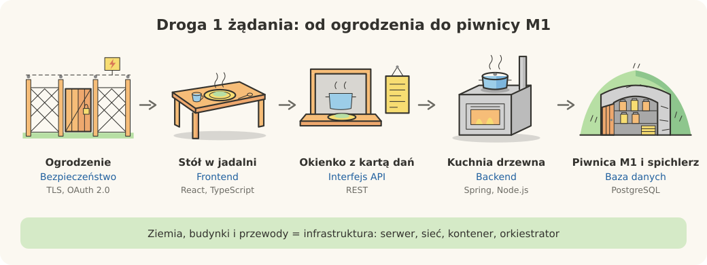
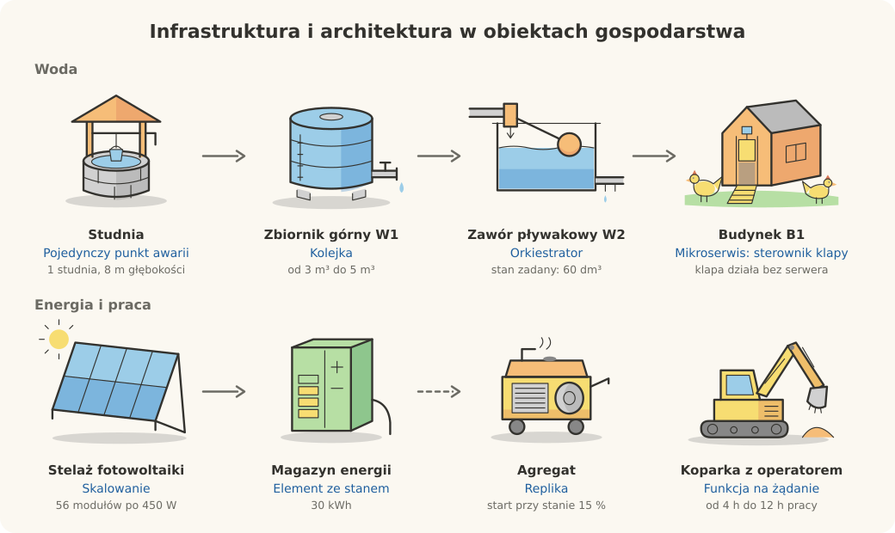
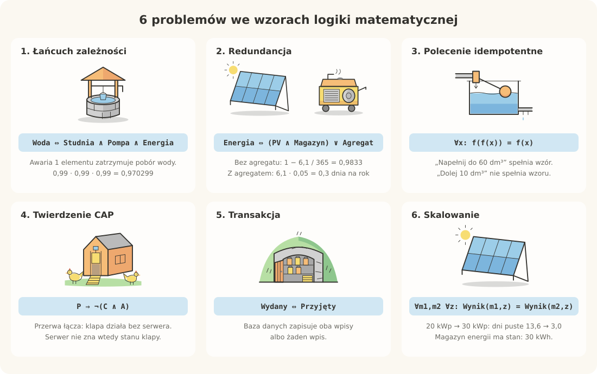

# Części programowania na przykładzie gospodarstwa

2026-11-14, Maciej Szulia

Dokument dzieli programowanie systemu webowego na 16 części w 4 grupach. Para łączy 1 część z obiektem gospodarstwa, który pełni tę samą funkcję. Sekcja 8 zapisuje 6 problemów wzorami logiki matematycznej. Obiekty pochodzą z [dokumentu projektu](../projekt/PROJEKT.md) i z [dokumentu budowy wodociągu](../operations/poultry-water-line.md).

## 1. Wynik w skrócie

Tabela zawiera 16 par w 4 grupach: droga żądania, infrastruktura, utrzymanie, architektura.

| Nr | Część programowania | Obiekt gospodarstwa | Wspólna funkcja | Liczba albo reguła | Znacznik |
| --- | --- | --- | --- | --- | --- |
| 1 | Bezpieczeństwo (TLS, OAuth 2.0) | Ogrodzenie z elektryzatorem i woliera z siatką | Bariera zatrzymuje wejście bez uprawnienia. | Elektryzator: co najmniej 1 J. Oczko siatki: co najwyżej 19 mm. | `[źródło: sekcja 8 dokumentu projektu]` |
| 2 | Frontend (React, TypeScript) | Stół w jadalni | Użytkownik składa żądanie i odbiera wynik. | Brak. | `[założenie: obiekt przykładowy]` |
| 3 | Interfejs API (REST) | Okienko z kartą dań | Lista wymienia żądania, które backend przyjmuje. | Brak. | `[założenie: obiekt przykładowy]` |
| 4 | Backend (Spring, Node.js) | Kuchnia drzewna | Wykonawca przetwarza zapasy według przepisów. | Tryb zimowy: gotowanie na kuchni drzewnej albo na gazie LPG. | `[źródło: sekcja 13 dokumentu projektu]` |
| 5 | Baza danych (PostgreSQL) | Magazyn żywności: piwnica M1 i spichlerz | Magazyn przechowuje zapasy trwale i w stałych miejscach. | 2 604 kg zapasów. Piwnica M1: 17,6 m³. Spichlerz: 6 m³. | `[źródło: sekcja 12 dokumentu projektu]` |
| 6 | Serwer (AWS EC2) | Budynek B1 i dom | Budynek daje miejsce pracy i zasilanie. | Budynek B1 stoi 132 m od domu. | `[źródło: sekcja 7 dokumentu projektu]` |
| 7 | Sieć (Ethernet, DNS) | Przewód L1, sieć Ethernet i radio LoRa | Łącze przenosi wodę albo dane między obiektami. | Przewód L1: 27 m. Sieć Ethernet: co najwyżej 100 m. | `[źródło: sekcja 16 dokumentu projektu; sekcja 1 dokumentu budowy wodociągu]` |
| 8 | Kontener (Docker) | Skrzynia z piaskiem | Paczka zawiera produkt razem z otoczeniem produktu. | 201 kg: marchew, burak, seler, pietruszka, brukiew. | `[źródło: sekcja 12 dokumentu projektu]` |
| 9 | Orkiestrator (Kubernetes) | Zawór pływakowy zbiornika W2 | Regulator doprowadza stan rzeczywisty do stanu zadanego. | Zbiornik W2: 60 dm³. | `[źródło: sekcja 8 dokumentu projektu]` |
| 10 | Wdrożenie (GitHub Actions) | Budowa wodociągu | Zmiana przechodzi bramki przed punktem bez powrotu. | 9 operacji, w tym 4 bramki i 1 punkt bez powrotu. | `[obliczenie: skrypt]` |
| 11 | Test (JUnit, Playwright) | Kryterium odbioru | Pomiar z liczbą graniczną zamyka operację. | Po 60 min manometr pokazuje co najmniej 5,8 bar. | `[źródło: sekcja 6 dokumentu budowy wodociągu]` |
| 12 | Monitoring (Prometheus, Grafana) | Alarmy układów automatycznych | Czujnik zgłasza przekroczenie granicy. | 10 alarmów w 11 układach. | `[obliczenie: skrypt]` |
| 13 | Monolit | Budynek B1: kurnik i koziarnia pod 1 dachem | Awaria części wspólnej zatrzymuje każdą funkcję. | 1 budynek, 2 funkcje. | `[źródło: sekcja 3 dokumentu budowy wodociągu]` |
| 14 | Mikroserwis | Węzeł ESP32 i sterownik klapy kurnika | Każdy element wykonuje logikę lokalnie. | Awaria serwera nie zatrzymuje węzłów. Klapa działa bez serwera. | `[źródło: sekcja 16 dokumentu projektu]` |
| 15 | Kolejka (Kafka, RabbitMQ) | Zbiornik górny W1 | Bufor rozdziela czas dostawy od czasu poboru. | Od 3 m³ do 5 m³. Wymóg: zapas wody na co najmniej 3 doby bez prądu. | `[źródło: sekcje 15 i 16 dokumentu projektu]` |
| 16 | Funkcja na żądanie (AWS Lambda) | Koparka z operatorem | Właściciel płaci za czas pracy i czeka na przyjazd. | Od 4 h do 12 h po cenie od 140 PLN do 190 PLN za 1 h. | `[źródło: sekcja 8 dokumentu budowy wodociągu]` |

## 2. Legenda i słownik

> Legenda: „lub” znaczy co najmniej 1 z członów. „Albo” znaczy dokładnie 1 z członów. Znacznik w nawiasie kwadratowym podaje źródło informacji. Znacznik `[źródło: Zn]` z numerem co najmniej 55 odsyła do sekcji 10. Znacznik `[obliczenie: skrypt]` odsyła do pliku `figures.py`. Znacznik `[DO USTALENIA: …]` oznacza brak danych. Nazwy w nawiasach w kolumnie „Część programowania” to przykłady narzędzi (lista niepełna).

Dokument używa terminów ze słownika dokumentu projektu i ze słownika dokumentu budowy wodociągu. Tabela zawiera tylko terminy nowe.

| Termin | Definicja | Nie pisz |
| --- | --- | --- |
| system webowy | Zbiór programów, który odpowiada na żądania użytkowników przez sieć. | aplikacja |
| część programowania | Jedno z 16 zagadnień pracy nad systemem webowym z tabeli sekcji 1. | dziedzina |
| para | Jedna część programowania i jeden obiekt gospodarstwa, który pełni tę samą funkcję. | analogia |
| użytkownik | Osoba albo program, który wysyła żądanie. | klient |
| programista | Osoba, która pisze albo zmienia program. | autor |
| żądanie | Jedno polecenie użytkownika dla systemu webowego. | zapytanie |
| komunikat | Porcja danych, którą nadawca wysyła do odbiorcy. | wiadomość |
| element | Obiekt gospodarstwa albo program, który ma 2 stany: działa, nie działa. | komponent |
| frontend | Program, który działa u użytkownika: pokazuje dane i wysyła żądania. | interfejs |
| backend | Program, który wykonuje żądania według reguł. | serwer aplikacji |
| interfejs API | Lista żądań, które backend przyjmuje, razem z formatem odpowiedzi. | końcówka |
| baza danych | Program, który przechowuje dane trwale. Przykład: baza z katalogu `database`. | magazyn danych |
| serwer | Komputer, który wykonuje programy systemu webowego. Serwer gospodarstwa to serwer Home Assistant. | maszyna |
| dostawca chmury | Firma, która wynajmuje serwery na czas pracy programu. | hosting |
| kontener | Paczka, która zawiera program razem z każdą zależnością programu. | obraz |
| stan zadany | Stan, który właściciel zapisał jako cel. | stan docelowy |
| orkiestrator | Program, który doprowadza stan rzeczywisty do stanu zadanego. | zarządca |
| wdrożenie | Przejście zmiany od programisty do działającego systemu webowego. | instalacja |
| kolejka | Bufor, który przechowuje komunikat od nadania do odbioru. | bufor komunikatów |
| replika | Drugi egzemplarz elementu, który przejmuje pracę po awarii pierwszego egzemplarza. | kopia |
| dostępność | Udział czasu, w którym element działa. Zakres: od 0 do 1 włącznie. | niezawodność |
| pojedynczy punkt awarii | Element bez repliki, którego awaria zatrzymuje wynik. | wąskie gardło |
| limit czasu | Czas, po którym wykonawca przerywa polecenie bez wyniku. | timeout |
| polecenie idempotentne | Polecenie, którego drugie wykonanie nie zmienia stanu po pierwszym wykonaniu. | polecenie bezpieczne |
| transakcja | Zbiór zmian, który baza danych zapisuje w całości albo odrzuca w całości. | operacja atomowa |
| podział sieci | Stan, w którym 2 części systemu webowego nie wymieniają komunikatów. | awaria sieci |
| monolit | System webowy, który programista wdraża jako 1 program. | blok |
| mikroserwis | Program, który programista wdraża osobno od pozostałych programów systemu webowego. | usługa |
| funkcja na żądanie | Program, który dostawca chmury uruchamia tylko na czas żądania. | serverless |
| element bez stanu | Element, którego wynik zależy tylko od bieżącego żądania. | element bezstanowy |

## 3. Zakres

Dokument opisuje system webowy: frontend, backend i bazę danych. Dokument pomija 4 rodzaje programów: aplikacje mobilne, programy urządzeń, gry i uczenie maszynowe. Para pokazuje wspólną funkcję, a nie budowę obiektu.

2 obiekty są przykładowe: stół w jadalni i okienko z kartą dań `[założenie]`. Dokument projektu nie opisuje wnętrza domu.

2 katalogi rozwijają 2 części programowania:

- Katalog [`operations`](../operations/poultry-water-line.md) rozwija wdrożenie: operacja, bramka, kryterium odbioru, cofnięcie.
- Katalog [`database`](../database/README.md) rozwija bazę danych: 13 tabel, 12 kluczy FOREIGN KEY i 8 zapytań.

## 4. Droga żądania



Rysunek 1. Droga 1 żądania przez 5 par `[źródło: tabela sekcji 1]`.

Żądanie przechodzi 5 par w tej kolejności:

1. Ogrodzenie zatrzymuje wejście bez uprawnienia. System webowy wykonuje 2 kroki: uwierzytelnianie sprawdza tożsamość, a autoryzacja sprawdza uprawnienie.
2. Użytkownik siada przy stole i zamawia posiłek. Frontend pokazuje dane i wysyła żądanie.
3. Okienko przyjmuje tylko dania z karty dań. Interfejs API przyjmuje tylko żądania z listy.
4. Kuchnia gotuje według przepisów. Backend wykonuje żądanie według reguł.
5. Kuchnia pobiera zapasy z piwnicy M1 i ze spichlerza. Backend czyta dane z bazy danych i zapisuje dane w bazie danych.

Magazyn żywności dzieli zapasy według warunków przechowywania. Piwnica M1 mieści 918 kg ziemniaków, a spichlerz mieści 499 kg ziarna zbóż `[źródło: sekcja 12 dokumentu projektu]`. Baza danych dzieli dane w ten sam sposób: każdy fakt stoi w 1 wierszu 1 tabeli `[źródło: dokument katalogu database]`.

## 5. Infrastruktura



Rysunek 2. 8 obiektów gospodarstwa dla sekcji 5, sekcji 7 i sekcji 8 `[źródło: tabela sekcji 1]`.

- **Serwer.** Program potrzebuje serwera tak, jak stado potrzebuje budynku B1. Budynek daje miejsce pracy i zasilanie.
- **Sieć.** Przewód L1 przenosi wodę ze zbiornika W1 do budynku B1. Sieć Ethernet przenosi dane na odległość co najwyżej 100 m `[założenie: R3]`. Budynek B1 stoi 132 m od domu, więc projekt łączy budynek B1 z domem światłowodem albo mostem radiowym `[założenie]`.
- **Kontener.** Obraz kontenera zawiera kod, biblioteki i ustawienia programu `[źródło: Z58]`. Skrzynia zawiera warzywa razem z piaskiem. Właściciel przenosi skrzynię do innego magazynu bez zmiany zawartości `[założenie]`.
- **Orkiestrator.** Kubernetes utrzymuje stałą liczbę działających egzemplarzy programu `[źródło: Z57]`. Zawór pływakowy utrzymuje stały poziom wody w zbiorniku W2 `[założenie: zasada działania zaworu pływakowego]`. Oba regulatory porównują stan rzeczywisty ze stanem zadanym i usuwają różnicę.

## 6. Utrzymanie

- **Wdrożenie.** Budowa wodociągu ma 9 operacji, w tym 4 bramki i 1 punkt bez powrotu `[obliczenie: skrypt]`. Bramka tylko mierzy. Wynik pomiaru dopuszcza albo zatrzymuje kolejną operację. Potok wdrożenia działa tak samo: test zatrzymuje wadliwą zmianę przed wdrożeniem `[założenie]`. Punkt bez powrotu to operacja OP5: rów, ułożenie i zasypka. Parą operacji OP5 jest zmiana, która usuwa dane z bazy danych `[założenie]`.
- **Test.** Programista testuje program na 3 poziomach. Tabela pokazuje pary.
- **Monitoring.** Projekt ma 10 alarmów w 11 układach `[obliczenie: skrypt]`. Przykład: sterownik zgłasza alarm, gdy przepływ wody dla zwierząt wynosi 0 przez 12 h. Alarm trafia do aplikacji, do wiadomości SMS i do syreny lokalnej `[założenie: R3]`.

| Poziom testu | Zakres testu | Para w budowie wodociągu |
| --- | --- | --- |
| Test jednostkowy | 1 funkcja programu | Operacja OP4: próba rury na powierzchni. |
| Test integracyjny | Współpraca 2 programów | Operacja OP6: próba po zasypaniu rowu. |
| Test całej drogi żądania (end-to-end) | System webowy od frontendu do bazy danych | Operacja OP9: odbiór końcowy, 7 pomiarów. |

Znacznik tabeli: `[źródło: sekcja 6 dokumentu budowy wodociągu]`; pary `[założenie]`.

## 7. Architektura

- **Monolit.** Budynek B1 mieści kurnik i koziarnię. Awaria dachu budynku B1 zatrzymuje obie funkcje `[założenie]`. Monolit to 1 program, więc każda zmiana wymaga wdrożenia całego programu `[źródło: Z62]`.
- **Mikroserwis.** Węzły ESP32 wykonują logikę lokalnie, więc awaria serwera nie zatrzymuje węzłów `[źródło: sekcja 16 dokumentu projektu]`. Programista wdraża każdy mikroserwis osobno `[źródło: Z62]`. Koszt: każde łącze między mikroserwisami to nowe miejsce awarii `[założenie]`.
- **Kolejka.** Pompa napełnia zbiornik W1 w godzinach produkcji fotowoltaiki `[założenie: sekcja 15 dokumentu projektu]`. Poidła pobierają wodę po napełnieniu. Kolejka przechowuje komunikat do chwili przetworzenia, więc nadawca nie czeka na odbiorcę `[źródło: Z64]`.
- **Funkcja na żądanie.** Operator przyjeżdża koparką na czas operacji OP5. Właściciel nie utrzymuje koparki. Dostawca chmury uruchamia funkcję na żądanie w ten sam sposób. Pierwsze żądanie po przerwie ma dodatkowe opóźnienie, bo dostawca chmury tworzy nowe środowisko `[źródło: Z59]`.

## 8. Problemy w logice matematycznej

| Symbol | Znaczenie |
| --- | --- |
| ∧ | i |
| ∨ | lub |
| ¬ | nie |
| ⇒ | jeżeli …, to … |
| ⇔ | wtedy i tylko wtedy, gdy |
| ∀ | dla każdego |

Nazwa we wzorze oznacza zdanie logiczne. Przykład: nazwa „Studnia” oznacza zdanie „studnia daje wodę”.



Rysunek 3. 6 problemów: wzór i para `[obliczenie: skrypt]`.

### 8.1. Łańcuch zależności

`Woda ⇔ Studnia ∧ Pompa ∧ Energia`

- Woda: pompa głębinowa podaje wodę.
- Studnia: studnia daje wodę.
- Pompa: pompa głębinowa jest sprawna.
- Energia: falownik zasila pompę głębinową.

Gospodarstwo ma 1 studnię `[relacja: właściciel, 2026-11-11]`. Studnia jest pojedynczym punktem awarii. Dostępność łańcucha to iloczyn dostępności elementów `[źródło: Z60]`.

`D = D1 × D2 × D3 = 0,99 × 0,99 × 0,99 = 0,970299`

- D: dostępność łańcucha, liczba bez jednostki.
- D1, D2, D3: dostępność studni, pompy głębinowej i zasilania. Wartość 0,99 to przykład `[założenie]`.
- Wzór obowiązuje dla awarii niezależnych.

Zbiornik W1 osłabia zależność. Projekt wymaga zapasu wody dla zwierząt na co najmniej 3 doby bez prądu `[źródło: sekcja 16 dokumentu projektu]`.

### 8.2. Redundancja

`Energia ⇔ (Fotowoltaika ∧ Magazyn) ∨ Agregat`

- Energia: odbiorniki priorytetu 1 mają zasilanie.
- Fotowoltaika, Magazyn, Agregat: dany element działa.

Fotowoltaika i magazyn energii dają średnio 6,1 dnia pustego na rok przy zużyciu 8 kWh na dobę `[źródło: sekcja 13 dokumentu projektu]`. Agregat jest repliką: falownik uruchamia agregat przy stanie naładowania 15% `[założenie: R3]`.

`D_PV = 1 − 6,1 / 365 = 0,9833`

`D = 1 − (1 − D_PV) × (1 − D_A) = 1 − 0,0167 × 0,05 = 0,9992`

- D_PV: udział dni, które nie są dniami pustymi, liczba bez jednostki `[obliczenie: skrypt]`.
- D_A = 0,95: udział dni pustych, w których agregat startuje `[założenie]`.
- D: dostępność energii z repliką, liczba bez jednostki `[obliczenie: skrypt]`.

Wynik: 6,1 × 0,05 = 0,3 dnia bez energii na rok `[obliczenie: skrypt]`. Wzór dla elementów nadmiarowych podaje źródło Z60.

### 8.3. Limit czasu i polecenie idempotentne

Wykonawca wysyła polecenie i nie dostaje odpowiedzi. Wykonawca nie zna wtedy wyniku polecenia. Limit czasu kończy czekanie. Przykład: pompa głębinowa ma limit czasu pracy 60 min `[założenie: R3]`. Po limicie czasu wykonawca powtarza polecenie.

`∀x: f(f(x)) = f(x)`

- x: objętość wody w zbiorniku W2 w dm³.
- f: polecenie, które zmienia objętość x.

Polecenie „napełnij zbiornik W2 do 60 dm³” spełnia wzór: wynik to 60 dm³ po 1 wykonaniu i po 2 wykonaniach. Polecenie „dolej 10 dm³” nie spełnia wzoru: 2 wykonania dają x + 20 dm³. Zawór pływakowy wykonuje polecenie pierwszego rodzaju. Protokół HTTP pozwala klientowi powtórzyć automatycznie żądanie idempotentne po awarii łącza `[źródło: Z56]`.

### 8.4. Twierdzenie CAP

`P ⇒ ¬(C ∧ A)`

- P: łącze między domem a budynkiem B1 nie działa (podział sieci).
- C: serwer i sterownik klapy podają ten sam stan klapy (spójność).
- A: sterownik klapy wykonuje każde polecenie (dostępność).

Usługa nie zapewnia jednocześnie spójności, dostępności i odporności na podział sieci `[źródło: Z55]`. Projekt wybiera dostępność: klapa działa bez serwera `[założenie: R3]`. Podczas podziału sieci serwer nie zna stanu klapy `[obliczenie: wzór]`.

### 8.5. Transakcja

`Wydany ⇔ Przyjęty`

- Wydany: baza danych zmniejszyła masę zapasu w miejscu 1 o 10 kg.
- Przyjęty: baza danych zwiększyła masę zapasu w miejscu 2 o 10 kg.

Przykład opisuje przeniesienie 10 kg zapasu między 2 wierszami tabeli `stock` `[założenie]`. Transakcja łączy oba kroki w 1 polecenie typu „wszystko albo nic” `[źródło: Z61]`. Stan „Wydany ∧ ¬Przyjęty” oznacza 10 kg zapasu bez miejsca. Baza z katalogu `database` odrzuca każde z 5 poleceń, które łamią reguły danych `[źródło: sekcja 7 dokumentu katalogu database]`.

### 8.6. Skalowanie

`∀m1,m2 ∀z: Wynik(m1,z) = Wynik(m2,z)`

- m1, m2: egzemplarze elementu bez stanu.
- z: żądanie.
- Wynik(m,z): wynik, który egzemplarz m daje dla żądania z.

Stelaż ma 56 modułów po 450 W, razem 25 200 W `[obliczenie: skrypt]`. Każdy moduł daje ten sam wynik przy tym samym nasłonecznieniu `[założenie]`. Wzrost mocy z 20 kWp do 30 kWp zmniejsza liczbę dni pustych z 13,6 do 3,0 na rok `[źródło: sekcja 13 dokumentu projektu]`. Programista skaluje program bez stanu tak samo: dodaje egzemplarze programu. Dane trwałe przechowuje baza danych `[źródło: Z63]`. Magazyn energii ma stan 30 kWh, więc drugi magazyn energii wymaga uzgodnienia stanu `[założenie]`.

## 9. Decyzje i braki

| Nr | Fragment | Reguła | Znaczenia lub brak | Wybór |
| --- | --- | --- | --- | --- |
| 1 | „programowanie” w zleceniu właściciela | A4 | Termin obejmuje więcej niż 1 rodzaj programów. | Dokument opisuje system webowy. Powód: zlecenie wymienia DevOps i bazy danych. |
| 2 | „samowystarczalne gospodarstwo” w zleceniu właściciela | A2 | 2 znaczenia: gospodarstwo z dokumentu projektu; gospodarstwo wymyślone. | Dokument używa obiektów z dokumentu projektu. Powód: właściciel wskazał to repozytorium. |
| 3 | Stół w jadalni i okienko z kartą dań | F | Dokument projektu nie opisuje wnętrza domu. | Obiekty przykładowe `[założenie]`. |
| 4 | Dostępność 0,99 w sekcji 8.1 | F | Brak pomiaru dostępności studni, pompy głębinowej i zasilania. | Liczba przykładowa `[założenie]`. `[DO USTALENIA: dziennik awarii z 12 miesięcy pracy]` |
| 5 | D_A = 0,95 w sekcji 8.2 | F | Brak danych o rozruchu agregatu. | Liczba przykładowa `[założenie]`. `[DO USTALENIA: model agregatu i dane producenta]` |
| 6 | Dzień pusty jako miara dostępności | D1 | Dzień pusty nie oznacza braku energii przez 24 h. | Sekcja 8.2 liczy udział dni, a nie udział godzin. |
| 7 | Stan klapy po podziale sieci | F | Dokument projektu nie opisuje uzgodnienia stanu między sterownikiem klapy a serwerem. | `[DO USTALENIA: sposób uzgodnienia stanu po powrocie łącza]` |
| 8 | Zapas wody na 3 doby | F | Dokument budowy wodociągu podaje dla okresu mrozu zapas od 1,6 doby do 2,7 doby. | Dokument podaje wymóg z sekcji 16 dokumentu projektu. Decyzja D3 dokumentu budowy wodociągu zostaje otwarta. |
| 9 | Nazwy narzędzi w sekcji 1 | A6 | Lista narzędzi jest niepełna. | Legenda zawiera zapis „przykłady narzędzi (lista niepełna)”. |
| 10 | Słowa angielskie: frontend, backend, API | A4 | Brak polskich terminów w powszechnym użyciu. | Słownik definiuje każde słowo. |

## 10. Źródła

Pozycje od Z1 do Z47 zawiera sekcja 20 dokumentu projektu. Pozycje od Z48 do Z54 zawiera sekcja 12 dokumentu budowy wodociągu. Odczyt każdej pozycji tabeli: 2026-11-14.

| Nr | Źródło |
| --- | --- |
| Z55 | S. Gilbert, N. Lynch, [„Brewer's Conjecture and the Feasibility of Consistent, Available, Partition-Tolerant Web Services”](https://www.comp.nus.edu.sg/~gilbert/pubs/BrewersConjecture-SigAct.pdf), „ACM SIGACT News” 2002, tom 33, nr 2. Artykuł dowodzi, że usługa nie zapewnia jednocześnie 3 cech: spójności, dostępności i odporności na podział sieci. |
| Z56 | R. Fielding, M. Nottingham, J. Reschke, [RFC 9110 „HTTP Semantics”](https://www.rfc-editor.org/info/rfc9110), 2022, sekcja 9.2.2. Dokument definiuje metodę idempotentną i regułę automatycznego powtórzenia żądania. |
| Z57 | Kubernetes, [dokumentacja: ReplicaSet](https://kubernetes.io/docs/concepts/workloads/controllers/replicaset/). Obiekt ReplicaSet utrzymuje stały zbiór działających egzemplarzy. |
| Z58 | Docker, [„What is a container?”](https://www.docker.com/resources/what-container/). Obraz kontenera zawiera kod, środowisko uruchomieniowe, narzędzia, biblioteki i ustawienia. |
| Z59 | Amazon Web Services, [dokumentacja AWS Lambda: cykl życia środowiska wykonania](https://docs.aws.amazon.com/lambda/latest/dg/lambda-runtime-environment.html#cold-start-latency). Dokument opisuje zimny start: utworzenie nowego środowiska dodaje opóźnienie. |
| Z60 | Amazon Web Services, [„Reliability Pillar”, rozdział „Availability”](https://docs.aws.amazon.com/wellarchitected/latest/reliability-pillar/availability.html). Rozdział podaje wzór dla zależności twardych i wzór dla elementów nadmiarowych. |
| Z61 | PostgreSQL, [dokumentacja, sekcja 3.4 „Transactions”](https://www.postgresql.org/docs/18/tutorial-transactions.html). Transakcja łączy kroki w 1 polecenie typu „wszystko albo nic”. |
| Z62 | J. Lewis, M. Fowler, [„Microservices”](https://martinfowler.com/articles/microservices.html), 2014. Artykuł opisuje usługi wdrażane niezależnie i porównuje ten styl z monolitem. |
| Z63 | A. Wiggins, [„The Twelve-Factor App”, rozdział VI „Processes”](https://12factor.net/processes). Proces nie przechowuje stanu. Dane trwałe przechowuje baza danych. |
| Z64 | Amazon Web Services, [„What is a Message Queue?”](https://aws.amazon.com/message-queue/). Kolejka przechowuje komunikat do chwili przetworzenia. |

## 11. Obliczenia

Skrypt `figures.py` rysuje 3 rysunki i liczy każdą liczbę ze znacznikiem `[obliczenie: skrypt]`.

```sh
cd programming && python3 figures.py && python3 figures.py --check
```

Rozbicie:

- `cd programming`: przechodzi do katalogu skryptu.
- `&&`: uruchamia kolejne polecenie tylko po sukcesie polecenia z lewej strony.
- `python3 figures.py`: zapisuje 3 pliki SVG.
- `--check`: porównuje liczby skryptu z tekstem pliku `README.md`. Opcja liczy też alarmy w dokumencie projektu i operacje w dokumencie budowy wodociągu.

Wymagania: Python 3. Skrypt używa tylko biblioteki standardowej.
