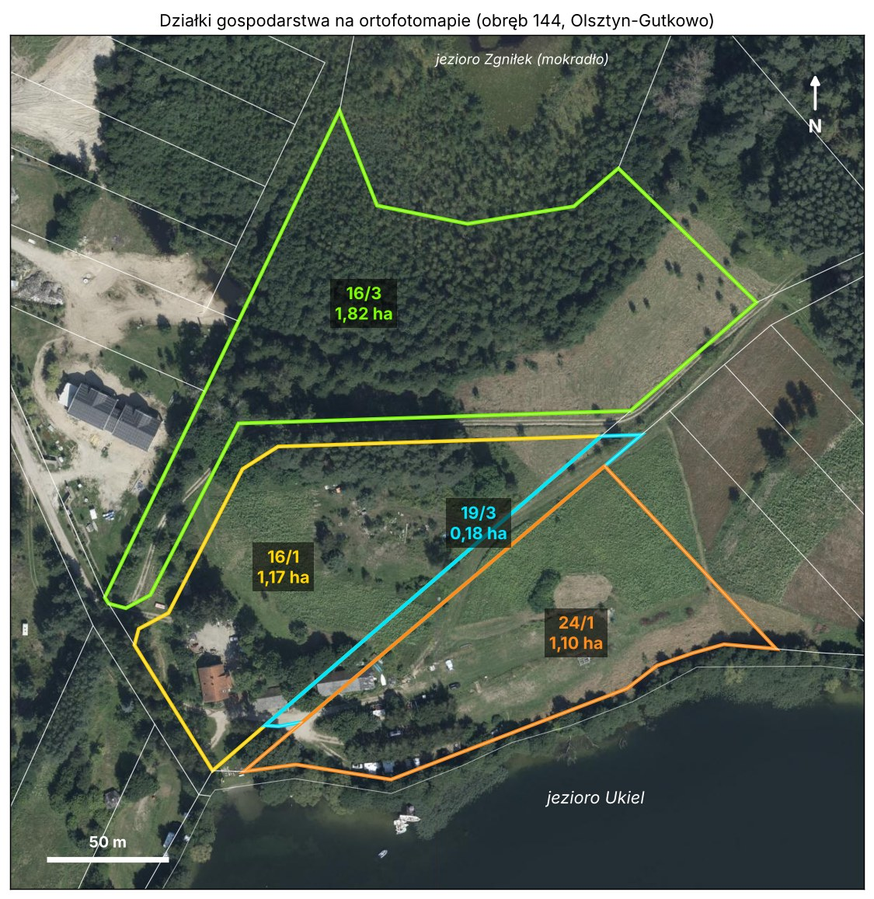
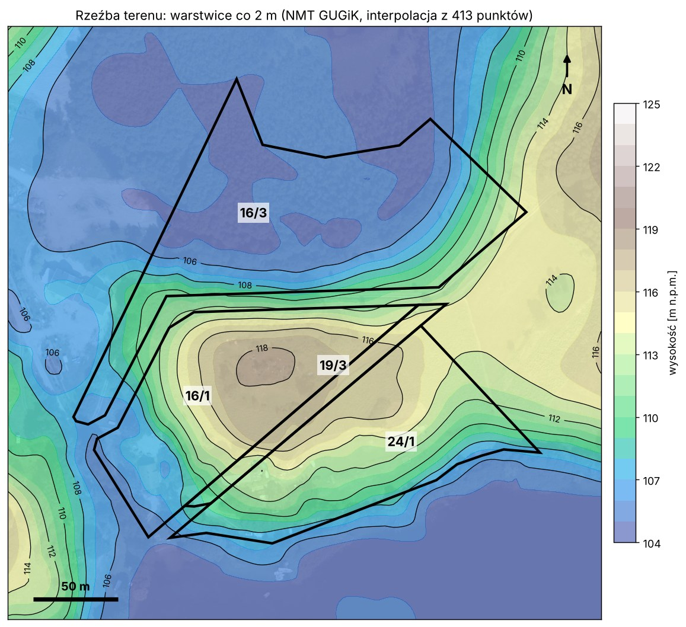
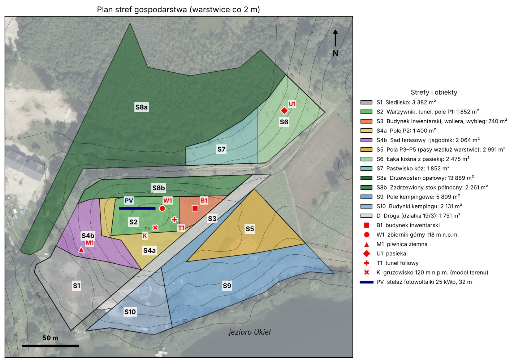
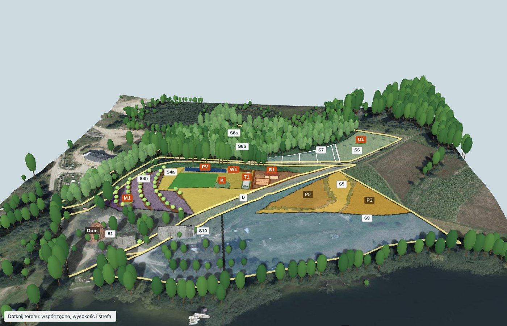
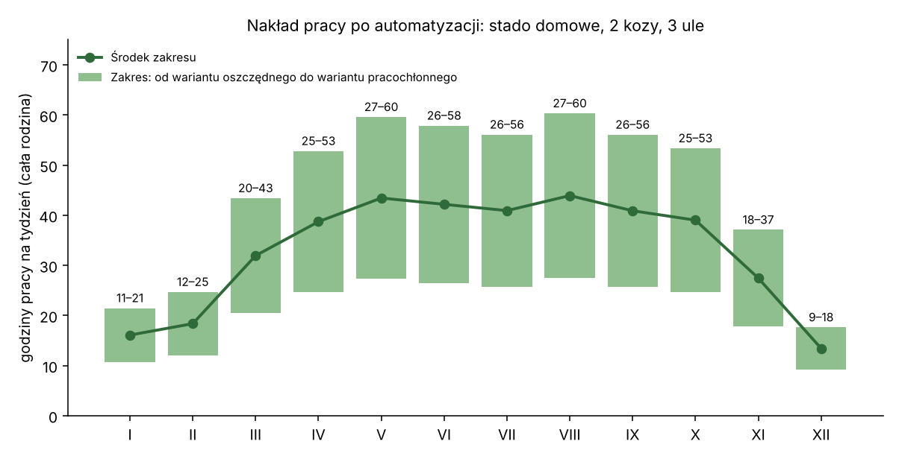
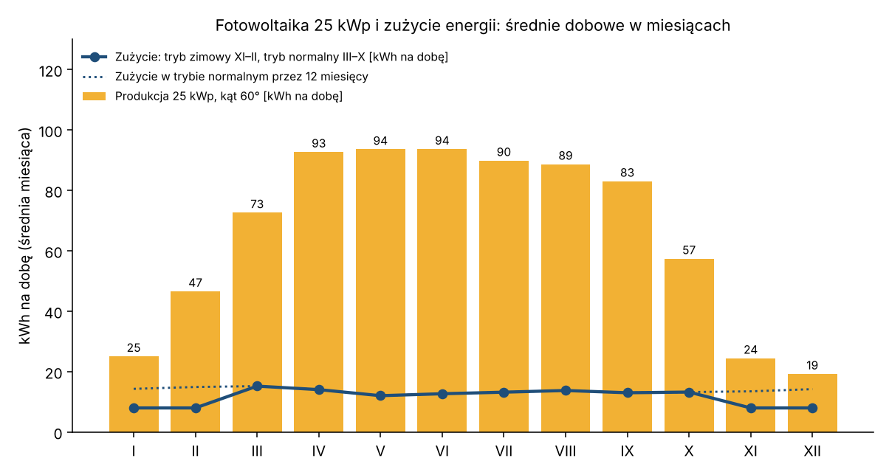

# Projekt samowystarczalnego gospodarstwa – Młodzieżowa 1, Olsztyn

2026-11-11 · Maciej Szulia

## 1. Wynik w skrócie

Gospodarstwo o powierzchni 4,27 ha pokrywa z własnego gruntu od 66% do 92% energii diety 4 osób. Pełna samowystarczalność żywnościowa wymaga dzierżawy od 0,85 ha do 2,4 ha gruntu ornego, bo grunt orny gospodarstwa ma tylko 0,65 ha. Własna pasza dla stada pełnego wymaga dodatkowo od 1,4 ha do 2,9 ha.

| Cel | Wynik projektu | Warunek |
| --- | --- | --- |
| Żywność | Od 66% do 92% energii diety 4 osób z własnego gruntu. | Wynik 92% wymaga poprawy gleby i nawadniania. Obiekty w strefie S2 zmniejszają wynik o co najwyżej 2 punkty procentowe. |
| Drób | Stado pełne: 100 sztuk w szczycie sezonu i 10 260 jaj na rok. Nadwyżka: 174 jaja na tydzień. | Stado pełne zużywa 3,4 t paszy z zakupu na rok. |
| Mleko i miód | 2 kozy dają od 1 200 kg do 2 800 kg mleka na rok. 3 ule dają od 33 kg do 51 kg miodu. | Dój trwa 250 dni w roku. |
| Ciepło | Własny drzewostan daje od 10 mp do 17 mp drewna na rok. Dom zużywa 16,0 mp. | Drzewa mają od 20 do 50 lat. Dom 160 m² o wskaźniku EU 100 jest założeniem. |
| Magazyn ciepła | Bufory 2000 dm³ mieszczą 102,9 kWh ciepła. | Połączenie szeregowe z zaworem ładującym. |
| Energia elektryczna | Fotowoltaika 25 kWp, magazyn energii 30 kWh i agregat. Średnio 6,1 dnia pustego na rok. | Tryb zimowy: 8 kWh na dobę od listopada do lutego. |
| Woda pitna | Gospodarstwo pobiera 2,0 m³ wody na dobę ze studni o głębokości 8 m. Zbiornik W1 daje 1,06 bar bez prądu. | Badanie wody i pomiar wydajności studni. |
| Magazyn żywności | Piwnica M1 (17,6 m³) i spichlerz (6 m³) mieszczą 2 604 kg zapasów. | Budowa przed pierwszym pełnym sezonem. |
| Zajęcie | Od 1 099 h do 2 354 h pracy na rok dla całej rodziny. | Zwierzęta wymagają przeglądu 1 raz na dobę. |
| Kemping | Strefy S9 i S10 zostają bez zmian. | Brak. |
| Koszt | Od 230 800 PLN do 565 000 PLN w 7 etapach. | Ceny są założeniem. |
| Model 3D | Model w katalogu `model-3d` pokazuje teren, strefy, obiekty i cień Słońca. | Drzewa pochodzą z pomiaru z 2018 r. |

Znaczniki źródeł stoją w sekcjach od 3 do 18.

Decyzje właściciela z 2026-11-11:

- Stado pełne: 100 sztuk w szczycie sezonu.
- 2 kozy mleczne.
- Studnia stoi przed domem i ma 8 m głębokości.
- Kocioł: Atmos DC18S.
- Zasięg kempingu nie ogranicza projektu. Działka 19/3 jest gruntem właściciela.
- Część prawna dostaje połowę poprzedniej objętości.

Dane, których brakuje:

- [ ] Przekaż wyniki analizy gleby z 2025-04-08.
- [ ] Podaj powierzchnię ogrzewaną domu.
- [ ] Podaj typ i średnicę studni. Zmierz wydajność studni i zbadaj wodę.
- [ ] Zleć inwentaryzację drzewostanu w strefie S8a.
- [ ] Zmierz kąty przeszkód na południe od stelaża.

## 2. Legenda, słownik i dane wejściowe

Dokument stosuje zapis Polszczyzny Kontrolowanej. Znacznik w nawiasie kwadratowym podaje źródło informacji.

> Legenda: „lub” znaczy co najmniej 1 z członów. „Albo” znaczy dokładnie 1 z członów. MUSI to wymóg. NIE WOLNO to zakaz. POWINIEN to zalecenie. MOŻE to zezwolenie. Znacznik \[źródło: Zn\] odsyła do pozycji Zn w sekcji 20. Znacznik \[DO USTALENIA: …\] oznacza brak danych.

### Słownik

| Termin | Definicja | Nie pisz |
| --- | --- | --- |
| gospodarstwo | Działki 16/1, 24/1, 16/3 i 19/3 w obrębie 144 miasta Olsztyn. | farma |
| teren otwarty | Grunt gospodarstwa bez drzewostanu, bez budynków i poza polem kempingowym. | pole (jako nazwa ogólna) |
| pole kempingowe | Część działki 24/1, którą zajmują stanowiska kempingu. | kemping (jako nazwa gruntu) |
| drzewostan | Grunt gospodarstwa pokryty drzewami o zwartych koronach. | las |
| grunt orny | Teren otwarty o spadku mniejszym niż 15%. | pole (jako nazwa ogólna) |
| gruzowisko | Kopiec gruzu o wymiarach 7 m × 6 m w strefie S2. | kopiec |
| off-grid | Instalacja elektryczna bez połączenia z siecią operatora. | wyspa |
| magazyn energii | Akumulator LiFePO4, który zasila gospodarstwo przez falownik. | bateria |
| bufor | Zbiornik wody grzewczej, który przechowuje ciepło z kotła. | zasobnik |
| dzień pusty | Dzień kalendarzowy, w którym magazyn energii osiąga dolną granicę rozładowania 20%. | blackout |
| tryb zimowy | Praca instalacji od listopada do lutego ze zużyciem 8 kWh na dobę. | oszczędzanie |
| tryb normalny | Praca instalacji od marca do października bez ograniczeń odbiorników. | brak |
| odbiornik priorytetu 1 | Odbiornik, który ma zasilanie przez całą dobę. Przykłady (lista niepełna): zamrażarka, pompy kotła, pompa głębinowa. | odbiornik krytyczny, odbiornik klasy 1 |
| odbiornik priorytetu 2 | Odbiornik, który ma zasilanie tylko w 2 przypadkach: od 10:00 do 15:00 lub przy stanie naładowania większym niż 70%. | brak |
| odbiornik priorytetu 3 | Odbiornik, który falownik wyłącza przy stanie naładowania mniejszym niż 30%. | brak |
| mp | Metr przestrzenny drewna: stos o wymiarach 1 m × 1 m × 1 m. | kubik |
| kWp | Moc modułów fotowoltaicznych przy napromieniowaniu 1000 W/m² i temperaturze ogniwa 25 °C. | kW (dla modułów) |
| stado | Zbiór ptaków z gatunków drobiu, które żyją w gospodarstwie. | ferma |
| stado pełne | Stado, które liczy co najwyżej 100 sztuk w szczycie sezonu. | duże stado |
| stado domowe | Stado, które pokrywa tylko potrzeby 4 osób: 47 sztuk w szczycie sezonu. | małe stado |
| plon ostrożny | Plon gleby średniej pomnożony przez współczynnik od 0,50 do 0,60. | niski plon |
| plon dobry | Plon z tabeli w sekcji 7, który wymaga poprawy gleby i nawadniania. | wysoki plon |

### Dane wejściowe od właściciela

| Dane | Wartość | Znacznik |
| --- | --- | --- |
| Liczba osób | Od 3 do 4 włącznie. Projekt liczy 4 osoby dorosłe. | \[relacja: właściciel, 2026-11-11\] |
| Działki | 16/1, 24/1, 16/3, 19/3. Każda działka jest gruntem właściciela. | \[relacja: właściciel, 2026-11-11\] |
| Gleba | Lekka, piaszczysta. Ewidencja podaje klasy V i VI. Wyniki analizy chemicznej z 2025-04-08: \[DO USTALENIA: przekazanie wyników\]. | \[relacja: właściciel, 2026-11-11\]; \[źródło: Z4\] |
| Woda | Własna studnia przed domem. Głębokość: 8 m. | \[relacja: właściciel, 2026-11-11\] |
| Ciepło | Kocioł zgazowujący drewno Atmos DC18S. Bufory 1 × 1000 L i 2 × 500 L stoją niepodłączone. | \[relacja: właściciel, 2026-11-11\] |
| Drzewa | Wiek od 20 do 50 lat. | \[relacja: właściciel, 2026-11-11\] |
| Kopiec w strefie S2 | Gruzowisko. | \[relacja: właściciel, 2026-11-11\] |
| Fotowoltaika | Brak instalacji. | \[założenie\] |
| Zwierzęta | Drób: 100 sztuk. Pszczoły. Kozy. | \[relacja: właściciel, 2026-11-11\] |
| Energia elektryczna | Off-grid przez 12 miesięcy w roku. | \[relacja: właściciel, 2026-11-11\] |
| Kemping | Zostaje. Zasięg kempingu nie ogranicza projektu. | \[relacja: właściciel, 2026-11-11\] |
| Prawo | Część prawna dostaje połowę poprzedniej objętości. | \[relacja: właściciel, 2026-11-11\] |
| Cele | Żywność, ciepło, woda pitna, zajęcie, magazyn żywności, magazyn ciepła, magazyn energii. | \[relacja: właściciel, 2026-11-11\] |

## 3. Teren i działki

Gospodarstwo ma 42 689 m² (4,27 ha), a grunt orny ma tylko 6 450 m² ± 650 m² \[obliczenie: geometria działek Z1, model terenu Z2\]. Powierzchnia gruntu ornego ogranicza wielkość stada i bilans paszy.

| Działka | Powierzchnia z geometrii \[m²\] | Użytki w ewidencji (odczyt z mapy) | Pokrycie terenu na ortofotomapie | Wysokość \[m n.p.m.\] | Średni spadek \[%\] |
| --- | --- | --- | --- | --- | --- |
| 16/1 | 11 699 | R VI, Ps VI, Ls V, Br | Siedlisko w narożniku SW. Ugór na wierzchowinie. Zadrzewiony stok N. | od 105,3 do 118,6 | 14,6 |
| 24/1 | 11 022 | Ps V, Ps VI, R VI, Br | Pole kempingowe w części S i W. Ugór w części N. Budynki w narożniku W. | od 105,9 do 117,1 | 14,9 |
| 16/3 | 18 217 | N, Lzr-Ps V, Ps V, R V, Ls V | Drzewostan na płaskim dnie: 13 889 m². Łąka kośna na stoku: 4 327 m². | od 104,4 do 114,4 | 8,8 |
| 19/3 | 1 751 | dr | Droga gruntowa. | od 108,4 do 117,5 | 11,4 |

Znaczniki tabeli: powierzchnia \[obliczenie: Z1\]; użytki \[źródło: Z4\]; pokrycie \[obserwacja: ortofotomapa Z3 z 2025-08-14, odczyt 2026-11-11\]; wysokość i spadek \[obliczenie: Z2, interpolacja z 413 punktów\].

Rysunek 1. Działki 16/1, 24/1, 16/3 i 19/3 na ortofotomapie \[źródło: Z1, Z3\].

Rysunek 2. Rzeźba terenu: warstwice co 2 m \[obliczenie: Z2\].

Ustalenia, które kształtują projekt:

1. Działka 16/1 jest pagórkiem. Szczyt ma 118,6 m n.p.m., a dom stoi na 107,3 m n.p.m. \[źródło: Z2\]. Gruzowisko o wymiarach 7 m × 6 m w strefie S2 sięga 120,2 m n.p.m. \[źródło: Z46; relacja: właściciel, 2026-11-11\].
2. Lustro jeziora Ukiel ma w modelu terenu 104,8 m n.p.m. \[źródło: Z2\]. Ekofizjografia podaje 103 m n.p.m. \[źródło: Z7\].
3. Stok działki 24/1 ma ekspozycję S i SE. Ten stok otrzymuje najwięcej promieniowania słonecznego w gospodarstwie \[obliczenie: ekspozycja i spadek z Z2\].
4. Północna część działki 16/3 jest płaskim dnem na wysokości od 104,4 m do 105,2 m n.p.m. Dno łączy się z mokradłem jeziora Zgniłek \[źródło: Z2, Z7\].
5. Zimne powietrze spływa na dno działki 16/3 i do doliny drogi po zachodniej stronie siedliska. Te 2 miejsca mają największe ryzyko przymrozku \[założenie: rzeźba terenu; Z7 potwierdza zastoiska chłodu w obniżeniach\].
6. Działki 16/1 i 24/1 nie stykają się z jeziorem Ukiel. Gminna działka 25 oddziela działkę 24/1 od wody pasem o szerokości 6 m ± 2 m \[źródło: Z4\].
7. Użytek ekologiczny „Jezioro Zgniłek” graniczy z gospodarstwem i nie obejmuje działek gospodarstwa \[źródło: Z14\].
8. Ewidencja nie klasyfikuje działki 16/3 jako lasu. Główny kontur działki 16/3 ma użytek N, czyli nieużytek \[źródło: Z4\]. Ortofotomapa z 2025-08-14 pokazuje na tym konturze zwarte korony drzew \[obserwacja: Z3, Z46\]. Drzewa mają od 20 do 50 lat \[relacja: właściciel, 2026-11-11\].

Właściciel potwierdza, że działka 19/3 jest gruntem gospodarstwa \[relacja: właściciel, 2026-11-11\]. Mapa ewidencyjna podaje dla tej działki użytek „dr” \[źródło: Z4\].

## 4. Klimat i okres wegetacyjny

Okres wegetacyjny w Olsztynie trwa 218 dni: od 31 marca do 4 listopada \[obliczenie: normy miesięczne IMGW 1991–2020 z Z5, próg 5 °C średniej dobowej\]. Ekofizjografia Olsztyna podaje 200 dni \[źródło: Z7\]. Projekt przyjmuje 200 dni dla dna działki 16/3 i 218 dni dla stoku działki 24/1 \[założenie\].

| Miesiąc | Temperatura średnia \[°C\] | Średnia temperatura maksymalna \[°C\] | Średnia temperatura minimalna \[°C\] | Opad \[mm\] | Dni z pokrywą śnieżną |
| --- | --- | --- | --- | --- | --- |
| I | −2,0 | 0,4 | −4,4 | 42,1 | 18,4 |
| II | −1,1 | 1,8 | −3,8 | 33,1 | 17,6 |
| III | 2,2 | 6,2 | −1,5 | 39,4 | 9,6 |
| IV | 7,9 | 13,3 | 2,6 | 37,5 | 1,3 |
| V | 12,9 | 18,6 | 7,1 | 59,8 | 0,0 |
| VI | 16,1 | 21,7 | 10,7 | 70,1 | 0,0 |
| VII | 18,3 | 23,8 | 13,2 | 88,0 | 0,0 |
| VIII | 17,8 | 23,4 | 12,7 | 63,8 | 0,0 |
| IX | 13,2 | 18,1 | 8,9 | 58,5 | 0,0 |
| X | 8,0 | 11,8 | 4,8 | 57,7 | 0,5 |
| XI | 3,3 | 5,5 | 1,2 | 47,0 | 4,1 |
| XII | −0,4 | 1,7 | −2,6 | 45,4 | 12,5 |
| Rok | 8,0 | 12,2 | 4,1 | 642,4 | 64,0 |

Znacznik tabeli: \[źródło: Z5, stacja Olsztyn, normy 1991–2020\].

Przymrozki wyznaczają terminy sadzenia. Dane pochodzą z lat 1971–2000 \[źródło: Z6\].

| Wskaźnik | 200 cm nad gruntem | 5 cm nad gruntem |
| --- | --- | --- |
| Średnia data końcowego przymrozku wiosennego | 4 maja | 24 maja |
| Średnia data pierwszego przymrozku jesiennego | 9 października | 20 września |
| Średni okres bez przymrozku \[dni\] | 157 | 118 |

Wnioski dla projektu:

1. Sadź rośliny wrażliwe na mróz najwcześniej 15 maja na stoku działki 24/1 \[założenie: Z6 i rzeźba terenu\].
2. Sadź rośliny wrażliwe na mróz najwcześniej 25 maja na dnie działki 16/3 \[założenie: Z6 i rzeźba terenu\].
3. Opad od kwietnia do września włącznie wynosi 377,7 mm \[obliczenie: Z5\].
4. Gleba gospodarstwa powstała z piasków słabo gliniastych \[źródło: Z7\]. Taka gleba ma kategorię I podatności na suszę w klasyfikacji IUNG \[założenie\]. Warzywnik i sad wymagają nawadniania.
5. Okres aktywnego wzrostu przy progu 10 °C trwa 159 dni: od 28 kwietnia do 4 października \[obliczenie: Z5\].

## 5. Gleba i plan poprawy gleby

Każdy kontur gospodarstwa ma klasę V albo klasę VI \[źródło: Z4\]. Plon dobry z sekcji 7 wymaga poprawy gleby przed pierwszym siewem.

| Cecha | Wartość | Znacznik |
| --- | --- | --- |
| Typ gleby | Gleba brunatna z piasków słabo gliniastych. | \[źródło: Z7\] |
| Kompleks przydatności rolniczej | 6 (żytni słaby) i 7 (żytni bardzo słaby). | \[źródło: Z7\] |
| Spadek gruntów ornych | Od 6% do 15%. | \[obliczenie: Z2\] |
| Odczyn pH, próchnica, fosfor, potas, magnez | \[DO USTALENIA: analiza w Okręgowej Stacji Chemiczno-Rolniczej w Olsztynie\] | brak |
| Dane właściciela o glebie | Analiza chemiczna z 2025-04-08 istnieje. \[DO USTALENIA: przekazanie wyników\] | \[relacja: właściciel, 2026-11-11\] |

Wykonaj każdy krok w tej kolejności:

1. Sprawdź, które strefy obejmuje analiza z 2025-04-08. Pobierz próbkę zbiorczą z każdej strefy bez wyniku: S2, S4a, S4b, S5.
2. Zleć analizę pH, próchnicy, fosforu, potasu i magnezu.
3. Zwapnuj glebę dawką z wyniku analizy. Optymalne pH wynosi 5,1 dla gleby bardzo lekkiej i 5,6 dla gleby lekkiej \[źródło: Z35\]. Warzywa wymagają pH od 6 do 7 \[źródło: Z33\].
4. Rozłóż kompost w warzywniku jesienią: od 5 kg/m² do 6 kg/m² \[źródło: Z33\].
5. Stosuj obornik drobiowy w dawce od 10 t/ha do 15 t/ha \[źródło: Z35\]. Limit azotu z nawozów naturalnych wynosi 170 kg N/ha na rok \[źródło: Z34\].
6. Siej międzyplon po każdym zbiorze: łubin, seradelę, facelię, gorczycę albo żyto. Przyorany międzyplon bobowaty zostawia 50 kg N/ha \[źródło: Z34\].
7. Ściółkuj zagony skoszoną trawą z pola kempingowego \[założenie\].
8. Prowadź zagony i pasy pól wzdłuż warstwic. Zostaw pas trawy o szerokości 2 m między pasami pól \[założenie\].

OSTRZEŻENIE: Utrzymuj okrywę gleby od października do marca. Goła gleba piaszczysta na spadku od 6% do 15% traci glebę i azot \[założenie\].

## 6. Zapotrzebowanie 4 osób na żywność

Projekt przyjmuje 3000 kcal na osobę na dobę, czyli 4,38 mln kcal na rok dla 4 osób \[założenie: R2\]. Dieta modelowa z własnych produktów daje 3037 kcal, 110 g białka i 103 g tłuszczu na osobę na dobę \[obliczenie: R2, wartości odżywcze z Z25\].

PAL oznacza współczynnik aktywności fizycznej: iloraz dobowego wydatku energii i podstawowej przemiany materii.

| Osoba | Masa ciała \[kg\] | Energia przy PAL 1,8 \[kcal na dobę\] | Energia przy PAL 2,0 \[kcal na dobę\] |
| --- | --- | --- | --- |
| Mężczyzna, wiek od 30 do 59 lat | 69,7 | 2911 | 3235 |
| Kobieta, wiek od 30 do 59 lat | 59,9 | 2351 | 2612 |

Znacznik tabeli: \[źródło: Z24\]. Norma białka wynosi 0,83 g na 1 kg masy ciała na dobę \[źródło: Z24\]. Norma tłuszczu wynosi od 30% do 40% energii diety \[źródło: Z24\].

### Dieta roczna 1 osoby dorosłej

| Grupa | Produkty \[kg na rok\] | Razem \[kg na rok\] |
| --- | --- | --- |
| Zboża | żyto 58; owies nagi 28; pszenica 10; gryka 8; proso 8 | 112 |
| Ziemniaki | ziemniaki 170 | 170 |
| Strączkowe suche | fasola 9; groch 9; bób 3 | 21 |
| Olej | olej lniankowy tłoczony na zimno 10 | 10 |
| Nasiona oleiste | siemię lniane 2; słonecznik 4; pestki dyni 3; mak 2 | 11 |
| Orzechy w łupinie | orzechy włoskie 4; orzechy laskowe 4 | 8 |
| Warzywa | kapusta 45; marchew 30; pomidor 25; burak 20; dynia 20; cebula 18; ogórek 15; pozostałe 65 | 238 |
| Owoce | jabłka 60; śliwki 10; gruszki 8; truskawki 8; pozostałe 26 | 112 |
| Jaja | 300 sztuk | brak |
| Mięso drobiowe (tuszki) | kurczęta 22; kaczki 5; gęsi 4,5 | 31,5 |
| Mleko kozie | mleko 250 | 250 |
| Miód | miód 8 | 8 |

Znacznik tabeli: \[obliczenie: R2\].

### Składniki, których gospodarstwo nie pokrywa

1. Sól i jod: gospodarstwo nie produkuje soli. Kup sól jodowaną \[obliczenie: R2\].
2. Witamina D: dieta daje 0,7 µg z normy 15 µg na dobę \[obliczenie: R2\].
3. Witamina B12: dieta bez mleka daje 0,9 µg z normy 2,4 µg na dobę \[obliczenie: R2\].
4. Kwasy EPA i DHA: dieta bez ryb nie pokrywa normy \[obliczenie: R2\].
5. Sposób uzupełnienia witaminy D oraz kwasów EPA i DHA: \[DO USTALENIA: lekarz albo dietetyk\].

## 7. Strefy gospodarstwa i plan upraw

Gospodarstwo pokrywa od 66% do 92% energii diety 4 osób \[obliczenie: R2, powierzchnie stref z Z1 i Z2\]. Wartość 66% dotyczy plonu ostrożnego, a wartość 92% dotyczy plonu dobrego.

### Strefy

| Kod | Strefa | Działka | Powierzchnia \[m²\] | Wysokość \[m n.p.m.\] | Średni spadek \[%\] | Funkcja |
| --- | --- | --- | --- | --- | --- | --- |
| S1 | Siedlisko | 16/1 | 3 382 | od 105,3 do 115,9 | 13,0 | Dom, kotłownia z buforami, magazyn energii, warsztat, studnia. |
| S2 | Warzywnik, tunel, pole P1 | 16/1 | 1 852 | od 116,4 do 118,6 | 7,6 | Warzywnik 811 m², tunel foliowy T1 90 m², pole P1, kompost, zbiornik górny W1, stelaż fotowoltaiki. |
| S3 | Budynek inwentarski | 16/1 | 740 | od 114,1 do 117,5 | 6,0 | Budynek B1 z kurnikiem i z koziarnią, woliera, wybieg stały. |
| S4a | Pole P2 | 16/1 | 1 400 | od 115,0 do 117,9 | 7,8 | Pole płodozmianu. |
| S4b | Sad tarasowy i jagodnik | 16/1 | 2 064 | od 106,8 do 117,4 | 20,3 | Drzewa owocowe, krzewy jagodowe, leszczyna. Piwnica ziemna M1 w dolnej części stoku. |
| S5 | Pola P3, P4, P5 | 24/1 | 2 991 | od 111,2 do 116,9 | 9,6 | 3 pasy pól wzdłuż warstwic. |
| S6 | Łąka kośna z pasieką | 16/3 | 2 475 | od 105,6 do 114,4 | 17,5 | Siano dla kóz. Pasieka U1. |
| S7 | Pastwisko kóz | 16/3 | 1 852 | od 105,3 do 110,8 | 17,1 | Pastwisko kwaterowe. |
| S8a | Drzewostan opałowy | 16/3 | 13 889 | od 104,4 do 110,8 | 6,1 | Drewno opałowe. Osłona mokradła. |
| S8b | Zadrzewiony stok północny | 16/1 | 2 261 | od 111,9 do 117,0 | 24,7 | Osłona od wiatru. Drewno opałowe. |
| S9 | Pole kempingowe | 24/1 | 5 899 | od 106,5 do 117,1 | 17,0 | Kemping bez zmian. |
| S10 | Budynki kempingu | 24/1 | 2 131 | od 105,9 do 116,2 | 16,6 | Budynki kempingu bez zmian. |
| D | Droga | 19/3 | 1 751 | od 108,4 do 117,5 | 11,4 | Droga gruntowa. |

Znacznik tabeli: \[obliczenie: podział stref na ortofotomapie Z3; wysokość i spadek z Z2\]. Granice stref mają dokładność ± 3 m \[założenie\].

Rysunek 3. Plan stref i obiektów: B1, W1, M1, U1, T1, gruzowisko K i stelaż fotowoltaiki \[obliczenie: Z1, Z2, Z3, Z46\].

Rysunek 4. Widok 3D gospodarstwa od południa: teren, strefy, pola i obiekty projektu \[obliczenie: Z1, Z3, Z46\]. Drzewa pochodzą z pomiaru z 2018 r., a drzewostan strefy S8a jest schematem. Model interaktywny: katalog [`model-3d`](../model-3d/README.md).

Uzasadnienie układu:

1. Grunt o spadku mniejszym niż 15% dostaje uprawy jednoroczne: strefy S2, S4a i S5.
2. Stok o spadku większym niż 15% dostaje trwałą okrywę: sad w strefie S4b, łąkę w strefie S6 i pastwisko w strefie S7.
3. Budynek B1 stoi 132 m od domu \[obliczenie: Z1\]. Wybieg leży wtedy dalej niż 70 m od studni, która stoi przed domem \[relacja: właściciel, 2026-11-11\].
4. Zbiornik górny W1 stoi 10,8 m wyżej niż dom \[obliczenie: Z46\]. Zbiornik zasila poidła i linie kroplowe bez prądu.
5. Stelaż fotowoltaiki stoi na wierzchowinie, na wysokości od 117,6 m do 118,2 m n.p.m. Horyzont na południe od stelaża ma co najwyżej 6,0° \[obliczenie: sekcja 13\].

### Przydział gruntu ornego

Uprawy jednoroczne dostają 5 788 m²: 1 732 m² w strefie S2, 1 400 m² w strefie S4a i 2 656 m² w strefie S5 \[obliczenie: części stref o spadku mniejszym niż 15%\]. Stelaż z pasem cienia, zbiornik W1 i kompost zajmują 200 m² ± 30 m² tej powierzchni \[założenie\]. Przydział upraw nie odejmuje tych obiektów: pokrycie diety spada wtedy o co najwyżej 2 punkty procentowe \[obliczenie\]. Usuń gruzowisko ze strefy S2: gruz nadaje się na podbudowę drogi technologicznej \[założenie\].

`A = m / w × (1 + z) / y`

- A: powierzchnia uprawy \[m²\]. m: spożycie produktu \[kg na rok\]. w: współczynnik przerobu \[kg produktu z 1 kg zbioru\].
- z = 0,25: zapas na straty, nieurodzaj i materiał siewny. y: plon \[kg/m²\].

| Grupa upraw | Potrzeba przy plonie ostrożnym \[m²\] | Przydział \[m²\] | Pokrycie \[%\] | Potrzeba przy plonie dobrym \[m²\] | Przydział \[m²\] | Pokrycie \[%\] |
| --- | --- | --- | --- | --- | --- | --- |
| Warzywnik | 811 | 811 | 100 | 427 | 427 | 100 |
| Tunel foliowy | 90 | 90 | 100 | 45 | 45 | 100 |
| Ziemniaki | 779 | 779 | 100 | 425 | 425 | 100 |
| Strączkowe | 1 346 | 1 346 | 100 | 637 | 637 | 100 |
| Zboża | 7 848 | 2 761 | 35 | 3 639 | 3 639 | 100 |
| Oleiste | 4 401 | 0 | 0 | 2 076 | 615 | 30 |
| Sad i jagodnik w strefie S4b | 1 482 | 1 482 | 100 | 766 | 766 | 100 |

Znacznik tabeli: \[obliczenie: R2 dla diety z sekcji 6 i dla 4 osób\].

| Uprawa | Plon ostrożny \[t/ha\] | Plon dobry \[t/ha\] |
| --- | --- | --- |
| Ziemniak | 12 | 22 |
| Żyto | 1,2 | 2,5 |
| Owies nagi | 0,7 | 1,5 |
| Gryka | 0,5 | 1,2 |
| Łubin słodki | 0,7 | 1,5 |
| Lnianka | 0,7 | 1,5 |

Plon ostrożny jest założeniem: plon gleby średniej zmniejszony o 40% do 50% \[założenie: R2\]. Źródła nie podają plonów ekologicznych dla gleby klasy V i klasy VI.

### Zakup na rok

| Pozycja | Przy plonie ostrożnym | Przy plonie dobrym |
| --- | --- | --- |
| Ziarno zbóż | 324 kg | 0 kg |
| Olej | 40 kg | 28 kg |
| Nasiona oleiste | 44 kg | 31 kg |
| Pasza treściwa dla stada pełnego | 3,4 t | 3,4 t |
| Pasza treściwa dla 2 kóz | 0,2 t | 0,2 t |

Znacznik tabeli: \[obliczenie: R2\]. Dzierżawa od 0,85 ha do 2,4 ha gruntu ornego zamyka bilans żywności 4 osób i paszy stada domowego \[obliczenie: R2\]. Własna pasza dla stada pełnego wymaga dodatkowo od 1,4 ha do 2,9 ha gruntu ornego \[obliczenie: R2\].

### Płodozmian

Pola P1, P2, P3, P4 i P5 mają średnio po 977 m² \[obliczenie: (5 788 m² − 901 m²) / 5\]. Pole P1 ma 831 m², pole P2 ma 1 400 m², a pola P3, P4 i P5 mają po 885 m² \[obliczenie\]. Każde pole przechodzi 5 lat w tej kolejności:

| Rok | Roślina główna | Po zbiorze |
| --- | --- | --- |
| 1 | Ziemniaki na oborniku i na kompoście | Żyto jako międzyplon ozimy |
| 2 | Owies nagi i proso | Gorczyca albo facelia |
| 3 | Łubin słodki, groch, fasola | Żyto ozime od 23 września |
| 4 | Żyto ozime | Łubin albo seradela jako międzyplon ścierniskowy |
| 5 | Gryka albo lnianka | Obornik; okrywa do wiosny |

Znacznik tabeli: \[obliczenie: R2\]. Warzywnik ma 4 kwatery w zmianowaniu: bobowate, kapustne, korzeniowe, cebulowe \[źródło: Z33\].

### Sad i jagodnik w strefie S4b

| Gatunek | Powierzchnia dla 4 osób przy plonie ostrożnym \[m²\] |
| --- | --- |
| Jabłoń | 300 |
| Orzech włoski | 200 |
| Leszczyna | 200 |
| Porzeczka | 150 |
| Śliwa | 125 |
| Wiśnia | 100 |
| Truskawka | 100 |
| Malina | 83 |
| Grusza | 67 |
| Winorośl | 67 |
| Borówka wysoka | 50 |
| Aronia | 40 |

Znacznik tabeli: \[obliczenie: R2\]. Sadź drzewa na tarasach wzdłuż warstwic, na wysokości większej niż 109 m n.p.m. \[założenie: zastoisko chłodu w dolinie drogi\].

## 8. Drób

Właściciel wybrał stado pełne: 100 sztuk w szczycie sezonu \[relacja: właściciel, 2026-11-11\]. Stado pełne zużywa 3,37 t paszy treściwej na rok \[obliczenie: R2\]. Grunt gospodarstwa nie żywi stada: pasza pochodzi z zakupu albo z dzierżawy od 2,0 ha do 4,2 ha gruntu ornego.

| Cecha | Stado domowe | Stado pełne |
| --- | --- | --- |
| Nioski i koguty | 9 niosek, 1 kogut | 54 nioski, 4 koguty |
| Młode kury z wylęgu na rok | 10 | 10 |
| Kurczęta rzeźne na rok | 34 | 24 |
| Kaczki na rok | 9 | 16 |
| Gęsi na rok | 5 | 12 |
| Stan w szczycie \[sztuk\] | 47 | 100 |
| Jaja \[sztuk na rok\] | 1 440 | 10 260 |
| Tuszki \[kg na rok\] | 134 | 157 |
| Pasza treściwa \[t na rok\] | 1,01 | 3,37 |
| Grunt orny dla tej paszy \[ha\] | od 0,6 do 1,3 | od 2,0 do 4,2 |
| Obornik \[t na rok\]; azot \[kg N na rok\] | 0,58; 12 | 2,03; 42 |

Znacznik tabeli: \[obliczenie: R2\]. Stado pełne daje nadwyżkę 174 jaj na tydzień na sprzedaż \[obliczenie: R2\].

### Rasy i wydajność

| Ptak | Wydajność | Znacznik |
| --- | --- | --- |
| Kura zielononóżka kuropatwiana | Od 180 do 190 jaj w sezonie. Jajo waży od 55 g do 58 g. | \[źródło: Z28\] |
| Kurczę rasy wolno rosnącej | Masa od 2,6 kg do 3,5 kg w wieku 81 dni. Pasza: od 6,1 kg do 6,5 kg. | \[źródło: Z28\] |
| Kaczka pekin | Masa 3,35 kg w wieku 8 tygodni. Pasza: 11,1 kg. | \[źródło: Z28\] |
| Gęś biała kołudzka | Masa 6,96 kg w wieku 17 tygodni. Tuszka: 4,47 kg. | \[źródło: Z28\] |

Gęś jest źródłem tłuszczu w diecie i zjada 1 kg zielonki na dobę \[źródło: Z28\].

### Budynek B1 w strefie S3

| Element | Wymiar dla 100 sztuk | Znacznik |
| --- | --- | --- |
| Kurnik | 17,5 m²: co najwyżej 6 kur na 1 m² | \[źródło: Z31\]; \[obliczenie: R2\] |
| Wybieg | 506 m²: co najmniej 4 m² na kurę | \[źródło: Z31\]; \[obliczenie: R2\] |
| Woliera z dachem i z siatką | 100 m²; oczko siatki co najwyżej 19 mm | \[założenie\] |
| Grzędy | Od 15 m do 18 m | \[obliczenie: R3\] |
| Gniazda | 15 gniazd z rynną na jaja wewnątrz kurnika | \[obliczenie: R3\]; \[źródło: Z10\] |
| Światło | Doświetlanie do 14 h na dobę; 908 h na rok; lampa LED 20 W | \[obliczenie: R2\] |
| Woda | Co najwyżej 47 dm³ na dobę | \[obliczenie: R2\] |
| Wentylacja | Od 70 m³/h przy −23 °C do 1 200 m³/h przy 32 °C | \[obliczenie: R3\] |

Woliera pozwala utrzymać stado w zamknięciu, gdy lekarz weterynarii ogłosi taki nakaz \[źródło: Z10\].

### Automatyka kurnika

| Funkcja | Rozwiązanie | Moc |
| --- | --- | --- |
| Klapa | Sterownik z czujnikiem światła i z zegarem, z własną baterią. | mniej niż 2 W |
| Pasza | Zasobnik 0,6 m³ z paszociągiem: zapas na 30 dni. | 0,37 kW przez 5 min na dobę |
| Woda | Zbiornik 60 dm³ z zaworem pływakowym i linia 10 smoczków. Zasilanie grawitacyjne ze zbiornika W1. | 0 W |
| Mróz | Skrzynia ocieplona, grzałka 50 W z termostatem. | od 30 W do 150 W w mróz |
| Jaja | Gniazda z rynną na jaja: jajo stacza się do zamkniętej rynny. | 0 W |
| Odchody | Ruszt pod grzędami albo głęboka ściółka. | 0 W |
| Ogrodzenie | Siatka zgrzewana, fartuch 0,5 m w gruncie, siatka górna, elektryzator co najmniej 1 J. | 5 W |
| Monitoring | 2 kamery, waga zasobnika paszy, przepływomierz wody, czujniki temperatury, wilgotności, CO₂ i NH₃. | 15 W |

Znacznik tabeli: \[założenie: R3\]. Sterownik wysyła alarm, gdy klapa jest otwarta 45 min po zachodzie Słońca \[założenie: R3\].

OSTRZEŻENIE: Przeglądaj stado osobiście 1 raz na dobę i zapisuj objawy chorób \[źródło: Z10\].

## 9. Kozy i pszczoły

Projekt zaleca 2 kozy mleczne i 3 rodziny pszczele \[obliczenie: R2\]. Owce mleczne wymagają od 12 do 28 sztuk dla tej samej ilości mleka.

| Cecha | Koza mleczna | Owca mleczna |
| --- | --- | --- |
| Mleko na sztukę na rok | Od 600 kg do 1 400 kg | Od 37 kg do 84 kg w okresie doju |
| Liczba samic dla 1 000 kg mleka | 2 | Od 12 do 28 |
| Znacznik | \[źródło: Z29\] | \[obliczenie: R2\] |

### Kozy

| Pozycja | Wartość | Znacznik |
| --- | --- | --- |
| Mleko z 2 kóz | Od 1 200 kg do 2 800 kg na rok. Potrzeba 4 osób: 1 000 kg. | \[źródło: Z29\]; \[obliczenie: R2\] |
| Siano | Potrzeba: 1 262 kg na rok. Strefy S6 i S7 dają od 1 320 kg do 2 420 kg. | \[obliczenie: R2\] |
| Pasza treściwa | 200 kg na rok. | \[założenie: R2\] |
| Pastwisko | Kwatera od 40 m² do 80 m² na kozę na co najwyżej 3 dni. | \[źródło: Z29\] |
| Kojec w budynku B1 | Co najmniej 1,5 m² na kozę i 0,3 m² na koźlę. Wybieg: co najmniej 4 m² na kozę. | \[źródło: Z32\] |
| Obsługa | Karmienie co najmniej 2 razy na dobę. Doglądanie co najmniej 1 raz na dobę. | \[źródło: Z32\] |
| Praca | Od 250 h do 500 h na rok, bez przerobu mleka. | \[obliczenie: R3\] |

Kozy są najbardziej pracochłonnym elementem projektu. Dój trwa 250 dni w roku \[założenie: R2\].

1. Właściciel wybrał kozy \[relacja: właściciel, 2026-11-11\].
2. Dieta bez mleka traci 473 kcal na osobę na dobę \[obliczenie: R2\].

OSTRZEŻENIE: Ogrodź sad w strefie S4b przed wypuszczeniem kóz. Koza zgryza korę i pędy drzew \[założenie\].

### Pszczoły

| Pozycja | Wartość | Znacznik |
| --- | --- | --- |
| Miód z 3 rodzin | Od 33 kg do 51 kg na rok. Potrzeba 4 osób: 32 kg. | \[źródło: Z27\]; \[obliczenie: R2\] |
| Praca | Od 45 h do 100 h na rok. | \[założenie: R3\] |
| Położenie pasieki U1 | Strefa S6. Pasieka leży 247 m od domu i 74 m od granicy strefy S9. | \[obliczenie: Z1\] |
| Osłona | Żywopłot o wysokości co najmniej 2 m między ulami a drogą. | \[założenie\] |
| Pożytek | Gryka i facelia w płodozmianie dają pożytek dla pszczół. | \[źródło: Z30\] |
| Waga ula | 4 belki tensometryczne, moduł ESP32 z radiem LoRa, panel 5 W. | \[założenie: R3\] |

## 10. Kalendarz kwartalny

Zboża jare idą do gruntu od 12 marca, ziemniaki od 11 kwietnia, a rośliny wrażliwe na mróz najwcześniej 25 maja \[źródło: Z26, Z6; zestawienie R2\]. Żyto ozime idzie do gruntu od 23 września do 27 września włącznie \[źródło: Z26\].

| Kwartał | Miesiąc | Rozsada w domu albo w tunelu | Pola P1–P5 | Warzywnik i tunel T1 | Sad, zwierzęta, zapasy |
| --- | --- | --- | --- | --- | --- |
| I | Styczeń | brak | brak | Zbiór roszponki i szpinaku w tunelu. | Przegląd piwnicy. Plan zmianowania. Ścinka drewna. Doświetlanie kur 5,9 h na dobę. |
| I | Luty | Od 15 lutego: por, seler, sałata, kalarepa. | brak | Od 15 lutego w tunelu: rzodkiewka, sałata. | Cięcie jabłoni i grusz. Ścinka drewna najpóźniej 28 lutego. |
| I | Marzec | Od 11 do 20 marca: pomidor. Papryka, kapusta, kalafior. | Od 1 marca: obornik i kompost. Od 12 marca: owies, jęczmień, pszenica jara. Od 26 marca: groch, bobik, łubin, lnianka jara. | Bób, cebula, marchew wczesna, pietruszka, szpinak, koper. | Sadzenie drzew i krzewów. Wylęg 1 kurcząt. |
| II | Kwiecień | Ogórek, dynia, cukinia. | Owies najpóźniej 10 kwietnia. Ziemniaki od 11 do 25 kwietnia. Słonecznik. | Kapusta i cebula z rozsady. Groch. Zbiór sałaty i rzodkiewki w tunelu. | Zakup gąsiąt i kacząt. Przegląd wiosenny uli. |
| II | Maj | Jarmuż. | Gryka od 7 do 20 maja. Proso od 16 do 31 maja. Fasola po 25 maja. | Marchew na przechowanie, burak, seler, por. Pomidor do tunelu od 1 do 10 maja. Po 25 maja: ogórek, dynia, cukinia. | Pokos 1 siana. Partia 1 kurcząt rzeźnych. Kozy na pastwisko. |
| II | Czerwiec | Brukiew. | Pielenie i obredlanie ziemniaków. | Fasola szparagowa. Zbiór sałaty, szpinaku, grochu zielonego. | Truskawki. Miodobranie. |
| III | Lipiec | Sałata na jesień. | Zbiór lnianki ozimej od 1 do 15 lipca. Zbiór grochu od 16 lipca. Żniwa żyta od 22 lipca. Międzyplon po żniwach. | Zbiór czosnku, cebuli, ogórków. Siew rzepy. Zbiór pomidorów od 21 lipca. | Wiśnie, porzeczki, maliny. Partia 2 kurcząt rzeźnych. Pokos 2 siana. |
| III | Sierpień | brak | Żniwa owsa najpóźniej 19 sierpnia. Zbiór łubinu, bobiku, prosa. Międzyplony. | Siew szpinaku. Sadzenie truskawek. Zbiór fasoli. | Śliwki. Karmienie zimowe pszczół. Doświetlanie kur od 27 sierpnia. |
| III | Wrzesień | brak | Lnianka ozima od 10 do 20 września. Żyto od 23 do 27 września. Zbiór gryki i ziemniaków. | Czosnek od 15 września. Zbiór fasoli suchej i dyni przed 20 września. Siew sałaty, szpinaku, roszponki w tunelu. | Jabłka, gruszki, orzechy. Słoiki. |
| IV | Październik | brak | Obornik najpóźniej 31 października. Międzyplon ozimy zostaje na polu do wiosny. | Zbiór marchwi od 16 do 31 października. Zbiór buraka, selera, pora, kapusty. Kiszenie kapusty. | Sadzenie drzew i krzewów. Ubój gęsi i kaczek. Zapasy do piwnicy. |
| IV | Listopad | brak | Koniec wegetacji 4 listopada. | Siew przedzimowy marchwi. Kompost od 5 kg/m² do 6 kg/m². | Nawozy stałe w sadzie najpóźniej 30 listopada. Zabezpieczenie uli. |
| IV | Grudzień | brak | brak | Jarmuż z gruntu. Roszponka z tunelu. | Tłoczenie oleju. Przegląd zapasów. Doświetlanie kur 6,5 h na dobę. |

Znacznik tabeli: \[źródło: Z26, Z33, Z34; zestawienie R2\]. Kalendarz stosuje termin 25 maja w każdej strefie. Termin 15 maja z sekcji 4 jest dozwolony tylko na stoku działki 24/1. Terminy bez źródła w raporcie R2 mają status \[założenie\].

Zasady kalendarza:

1. Trzymaj włókninę na roślinach wrażliwych na mróz do 5 czerwca \[założenie: R2\].
2. Zbierz fasolę suchą i dynię przed 20 września. Średni pierwszy przymrozek przy gruncie wypada 20 września \[źródło: Z6\].
3. Zachowaj co najmniej 4 lata przerwy w uprawie marchwi i cebuli na tej samej kwaterze \[źródło: Z33\].
4. Wykonaj ścinkę drewna od 16 października do 28 lutego, poza okresem lęgowym ptaków \[założenie: R1\].

## 11. Grafik prac

Gospodarstwo wymaga od 1 099 h do 2 354 h pracy na rok po automatyzacji \[obliczenie: R3\]. Na 1 osobę z 4 przypada od 5 h do 11 h pracy na tydzień w średniej rocznej.

| Miesiąc | Praca całej rodziny \[h na tydzień\] | Główne prace |
| --- | --- | --- |
| I | od 11 do 21 | Obsługa zwierząt, kocioł, ścinka drewna, plan sezonu. |
| II | od 12 do 25 | Ścinka i łupanie drewna, cięcie sadu, rozsada. |
| III | od 20 do 43 | Siew zbóż i strączkowych, obornik, rozsada, początek doju. |
| IV | od 25 do 53 | Sadzenie ziemniaków, warzywnik, pisklęta, ule. |
| V | od 27 do 60 | Warzywnik, siew gryki i prosa, pokos 1, pielenie. |
| VI | od 26 do 58 | Pielenie, obredlanie, miodobranie, ubój partii 1. |
| VII | od 26 do 56 | Żniwa, zbiór warzyw, pokos 2, słoiki. |
| VIII | od 27 do 60 | Żniwa, przetwórstwo, ubój partii 2, międzyplony. |
| IX | od 26 do 56 | Wykopki, siew żyta, zbiór owoców, suszenie. |
| X | od 25 do 53 | Zbiór korzeniowych, kiszenie, ubój gęsi, zapasy. |
| XI | od 18 do 37 | Zabezpieczenie na zimę, drewno, przegląd instalacji. |
| XII | od 9 do 18 | Obsługa zwierząt, kocioł, tłoczenie oleju. |

Znacznik tabeli: \[obliczenie: nakłady roczne z R3; rozkład na miesiące: założenie\]. Zakres obejmuje stado do 100 sztuk, 2 kozy i 3 ule. Sprzedaż 174 jaj na tydzień zajmuje dodatkowo 1 h na tydzień \[założenie\]. Bez kóz i bez pszczół suma wynosi od 724 h do 1 554 h na rok \[obliczenie: R3\].

Rysunek 5. Praca całej rodziny w miesiącach \[obliczenie: R3; rozkład: założenie\].

### Rozkład doby

| Godzina | Czynność | Czas \[min\] |
| --- | --- | --- |
| 06:30 | Przegląd stada drobiu i zapis w dzienniku. | 10 |
| 06:40 | Dój i karmienie kóz. | 30 |
| 07:10 | Odczyt panelu sterowania: woda, energia, alarmy. | 5 |
| 17:30 | Załadunek kotła w sezonie grzewczym. | 10 |
| 18:00 | Dój i karmienie kóz. | 30 |
| 18:30 | Zbiór jaj. Kontrola paszy i wody. | 10 |

Rozkład doby zajmuje 95 min w sezonie grzewczym z dojem i 85 min poza sezonem grzewczym \[założenie\].

### Tydzień od marca do października

| Dzień | Blok pracy | Czas \[h\] |
| --- | --- | --- |
| Poniedziałek | Warzywnik: pielenie, siew, zbiór. | 3 |
| Wtorek | Pola: uprawa, obredlanie, zbiór. | 2 |
| Środa | Przetwórstwo: ser, kiszenie, słoiki. | 3 |
| Czwartek | Warzywnik i sad. | 3 |
| Piątek | Zbiór na kuchnię i na sprzedaż. Przegląd uli co 14 dni. | 3 |
| Sobota | Praca całej rodziny: sianokosy, żniwa, ubój, budowa. | 6 |
| Niedziela | Tylko rozkład doby. | 0 |

Bloki zajmują 20 h, a rozkład doby 10 h: razem 30 h na tydzień \[założenie\].

### Tydzień od listopada do lutego

| Dzień | Blok pracy | Czas \[h\] |
| --- | --- | --- |
| Poniedziałek | Drewno: ścinka, łupanie, układanie. | 2 |
| Środa | Zapasy: przegląd piwnicy, przetwórstwo. | 2 |
| Sobota | Konserwacja instalacji, plan sezonu, rozsada od 15 lutego. | 3 |

Bloki zajmują 7 h, a rozkład doby od 5 h do 11 h: razem od 12 h do 18 h na tydzień \[założenie\].

Zasady grafiku:

1. Automatyka przejmuje czynności powtarzalne: klapę kurnika, paszę, wodę, nawadnianie i wentylację.
2. Rodzinie zostają: przegląd zwierząt, dój, siew, zbiór, przetwórstwo, drewno i naprawy.
3. Nieobecność dłuższa niż 24 h wymaga osoby zastępczej \[źródło: Z10, Z32\].

## 12. Magazyn żywności

Zapas żywności na 12 miesięcy dla 4 osób waży 2 604 kg i zajmuje 4,5 m³ netto \[obliczenie: R2\]. Projekt stawia metody bez prądu przed mrożeniem.

| Zapas | Masa dla 4 osób \[kg\] | Miejsce i warunki |
| --- | --- | --- |
| Ziarno zbóż | 499 | Spichlerz. Wilgotność ziarna co najwyżej 14%. Temperatura co najwyżej 15 °C. |
| Strączkowe suche | 88 | Spichlerz. Worki. Temperatura od 4 °C do 10 °C. |
| Nasiona oleiste | 211 | Spichlerz. Tłoczenie oleju co 1 do 2 miesięcy. |
| Orzechy w łupinie | 32 | Spichlerz. Skrzynki z przewiewem. |
| Ziemniaki jadalne i sadzeniaki | 918 | Piwnica M1. Od 4 °C do 6 °C. Wilgotność powietrza od 90% do 95%. |
| Marchew, burak, seler, pietruszka, brukiew | 201 | Piwnica M1. Od 0 °C do 1 °C. Skrzynie z piaskiem. |
| Kapusta świeża i kiszona | 160 | Piwnica M1. Beczka albo kamionka. |
| Jabłka i gruszki | 163 | Piwnica M1, osobna komora. Od −1 °C do 4 °C. |
| Cebula i czosnek | 60 | Komora sucha. 0 °C. Wilgotność powietrza od 65% do 75%. |
| Dynia zimowa | 60 | Komora sucha. Od 10 °C do 13 °C. |
| Przetwory w słoikach | 160 | Piwnica M1. Pasteryzacja pomidorów, ogórków i owoców. |
| Susz i miód | 52 | Spichlerz. Temperatura mniejsza niż 18 °C. |

Znacznik tabeli: \[obliczenie: R2\]; warunki przechowywania \[źródło: Z37\].

### Obiekty

| Obiekt | Parametry | Znacznik |
| --- | --- | --- |
| Piwnica ziemna M1 | Wnętrze 2,5 m × 3,2 m × 2,2 m (17,6 m³). Piwnica wchodzi w stok strefy S4b, 42 m od domu. Podłoga leży na wysokości co najmniej 108 m n.p.m. | \[obliczenie: R3, Z2\] |
| Wentylacja piwnicy M1 | 2 kanały grawitacyjne z przepustnicami. Sterownik otwiera przepustnice nocą, gdy powietrze zewnętrzne jest chłodniejsze niż piwnica. | \[założenie: R3\] |
| Spichlerz suchy | 6 m³. Beczki albo skrzynie szczelne dla gryzoni. | \[obliczenie: R2\] |
| Zamrażarka | 100 dm³ na 50 kg mięsa w szczycie. Zużycie energii: od 227 kWh do 295 kWh na rok. Zamrażarka trzyma temperaturę 40 h bez zasilania. | \[obliczenie: R2\]; \[źródło: R3\] |
| Suszarnia słoneczna i wędzarnia | Jabłka, śliwki, zioła, grzyby, mięso. | \[założenie\] |

Grunt na głębokości 2 m ma 12,3 °C w październiku \[obliczenie: R3\]. Dlatego piwnica M1 wymaga wentylacji nocnej jesienią.

### Metody bez prądu

1. Kiszenie: kapusta, ogórki, buraki. Dodaj od 1,5% do 2,0% soli \[źródło: R2\].
2. Suszenie: zioła w temperaturze od 25 °C do 45 °C, owoce w temperaturze od 60 °C do 80 °C \[źródło: R2\].
3. Pasteryzacja w słoikach: pomidory, ogórki, owoce, soki.
4. Ubój drobiu co tydzień (2,4 kg tuszek) eliminuje mrożenie mięsa \[obliczenie: R2\].

OSTRZEŻENIE: Nie pasteryzuj mięsa ani warzyw niekwaśnych w temperaturze 100 °C. Bakterie jadu kiełbasianego przeżywają taką obróbkę \[założenie: R2\]. Parametry sterylizacji: \[DO USTALENIA: źródło urzędowe\].

## 13. Energia elektryczna off-grid

Projekt zaleca fotowoltaikę 25 kWp pod kątem 60°, magazyn energii 30 kWh i agregat rezerwowy \[obliczenie: symulacja PVGIS, Z8\]. Ten układ daje średnio 6,1 dnia pustego na rok przy zużyciu 8 kWh na dobę.

### Zużycie

| Tryb | Okres | Zużycie \[kWh na dobę\] | Zasada |
| --- | --- | --- | --- |
| Tryb normalny | od marca do października | od 12,1 do 15,2 | Każdy odbiornik pracuje bez ograniczeń. |
| Tryb zimowy | od listopada do lutego | 8,0 | Gotowanie na kuchni drzewnej albo na gazie LPG. Zmywarka pobiera ciepłą wodę z bufora. Czajnik elektryczny jest wyłączony. |

Znacznik tabeli: \[obliczenie: R3\]. Zużycie roczne wynosi 4 248 kWh \[obliczenie: R3\]. Bez trybu zimowego zużycie wynosi 5 000 kWh na rok i 14,2 kWh na dobę w grudniu \[założenie: R3\]. Rzeczywiste zużycie: \[DO USTALENIA: pomiar każdego obwodu licznikiem przez 12 miesięcy\].

### Wynik symulacji

Symulacja liczy bilans godzinowy z lat 2005–2023 dla punktu 53,7875° N, 20,402° E \[źródło: Z8\]. Parametry: azymut południowy, kąt 60°, dolna granica rozładowania 20%. Symulacja używa profilu horyzontu stelaża z modelu pokrycia terenu \[obliczenie: Z46\].

| Fotowoltaika \[kWp\] | Magazyn energii \[kWh\] | Zużycie \[kWh na dobę\] | Dni puste na rok | Dni puste w grudniu \[%\] | Energia z agregatu \[kWh na rok\] |
| --- | --- | --- | --- | --- | --- |
| 15 | 30 | 8 | 25,9 | 40,8 | 84 |
| 20 | 30 | 8 | 13,6 | 28,5 | 38 |
| 25 | 30 | 8 | 6,1 | 14,1 | 16 |
| 30 | 30 | 8 | 3,0 | 8,2 | 8 |
| 20 | 40 | 8 | 7,9 | 17,5 | 24 |
| 25 | 40 | 8 | 3,1 | 8,0 | 9 |
| 30 | 60 | 8 | 0,4 | 1,0 | 1 |
| 40 | 60 | 8 | 0,0 | 0,0 | 0 |
| 20 | 30 | 14 | 67,1 | 70,5 | 403 |

Znacznik tabeli: \[źródło: Z8, usługa SHScalc\]; energia z agregatu \[obliczenie: dni puste × średni brak energii w dniu pustym\]. Wiersz 40 kWp ma kąt 65°.

Rysunek 6. Średnia dobowa produkcja 25 kWp i zużycie energii w miesiącach \[źródło: Z8; obliczenie: R3, Z46\].

Wnioski:

1. Tryb zimowy jest warunkiem układu. Zużycie 14 kWh na dobę daje 67,1 dnia pustego na rok.
2. Wzrost mocy z 20 kWp do 30 kWp zmniejsza liczbę dni pustych z 13,6 do 3,0 na rok.
3. Magazyn energii o pojemności 30 kWh nie wymaga formalności budowlanych \[źródło: Z11\].
4. Wynik jest średnią z 19 lat. Seria 11 dób bez słońca wymaga 60,5 kWh z agregatu: 25 h pracy i 31 dm³ benzyny \[obliczenie: R3\].
5. Stacje IMGW zanotowały taką serię od 21 grudnia do 31 grudnia 2024 r. \[źródło: Z42\].

### Elementy

| Element | Parametr | Znacznik |
| --- | --- | --- |
| Fotowoltaika | 25 kWp: 56 modułów po 450 W. Stelaż 1-rzędowy o długości 32 m i wysokości 3,0 m. Kąt 60°, azymut południowy. | \[założenie\] |
| Położenie stelaża | Strefa S2, od 8 m do 10 m na południe od północnej granicy strefy. Grunt: od 117,6 m do 118,2 m n.p.m. Odległość od domu: 95 m \[obliczenie: Z46\]. | \[obliczenie: Z1, Z2\] |
| Produkcja roczna | 23 982 kWh. | \[obliczenie: 25 kWp × 959,3 kWh/kWp z Z8\] |
| Magazyn energii | LiFePO4 30 kWh. Pomieszczenie o temperaturze od 5 °C do 25 °C. | \[założenie: R3\] |
| Falownik | Falownik wyspowy. Moc: \[DO USTALENIA: pomiar mocy szczytowej odbiorników\]. | brak |
| Agregat | Od 3 kVA do 5 kVA. Automatyczny start przy stanie naładowania 15%. | \[założenie: R3\] |
| Nadwyżka | 19 734 kWh na rok. Nadwyżka zasila grzałkę ciepłej wody, pompę nawadniania i odbiorniki kempingu. | \[obliczenie: 23 982 kWh − 4 248 kWh\] |

### Zacienienie

`h = 90° − φ − 23,44°`

- h: wysokość Słońca nad horyzontem 21 grudnia w południe słoneczne \[°\]. φ = 53,79°: szerokość geograficzna gospodarstwa.
- Wynik: h = 12,8°. Drzewo o wysokości 20 m rzuca wtedy cień o długości 88 m \[obliczenie: 20 m / tg 12,8°\].

1. Słońce stoi 21 grudnia co najmniej 8,5° nad horyzontem od 10:00 do 14:00 czasu słonecznego \[obliczenie\].
2. Profil horyzontu stelaża pochodzi z modelu pokrycia terenu z 2018-03-21 \[obliczenie: Z46\]. Punkt obserwacji leży 0,5 m nad gruntem, na dolnej krawędzi modułów.
3. Horyzont w azymucie od 150° do 210° włącznie ma od 3,8° do 6,0° \[obliczenie: Z46\]. Słońce świeci 21 grudnia na cały stelaż od 09:01 do 14:59 czasu słonecznego \[obliczenie: Z46\].
4. Najwyższe przeszkody w tym sektorze to gruzowisko w strefie S2 i drzewa od 62 m do 74 m na południe od stelaża \[obliczenie: Z46\]. Te drzewa miały w 2018 r. od 10 m do 15 m.
5. Drzewa przy siedlisku dają horyzont od 6,6° do 10,3° w azymucie od 225° do 245° włącznie \[obliczenie: Z46\]. Słońce zachodzi 21 grudnia w azymucie 228°.
6. Obliczenie zakłada usunięcie krzewów i drzew ze stref S2 i S4a. Te rośliny miały w 2018 r. co najwyżej 10,1 m \[obliczenie: Z46\].
7. Model z 2018 r. nie zawiera przyrostu drzew z 8 lat. Symulacja z roślinnością wyższą o 5 m daje 11,7 dnia pustego na rok zamiast 6,1 \[obliczenie: Z8, Z46\].
8. Utrzymuj każdą przeszkodę w azymucie od 150° do 210° pod kątem mniejszym niż 8° ze stelaża.
9. Kąty przeszkód w 2026 r.: \[DO USTALENIA: pomiar klinometrem z linii stelaża\].
10. Drzewa strefy S8b o wysokości od 16 m do 21 m stoją od 12 m do 21 m na północ od stelaża \[obliczenie: Z46\]. Drzewo o wysokości 20 m, które stoi bliżej niż 20 m, sięga stelaża przy upadku na południe.
11. Oceń stan drzew w pasie 20 m na północ od stelaża przed montażem \[założenie\].

Zachowaj przyłącze sieci przez pierwsze 12 miesięcy pracy off-grid. Wypowiedz umowę po sprawdzeniu bilansu grudnia i stycznia \[założenie: R1\].

## 14. Ciepło i magazyn ciepła

Drzewostan gospodarstwa daje trwale od 10 mp do 17 mp drewna na rok \[obliczenie: 1,62 ha stref S8a i S8b, R3\]. Dom o powierzchni 160 m² i wskaźniku EU 100 kWh/(m²·rok) zużywa 16,0 mp na rok \[obliczenie: R3\].

`D = I × u / k`

- D: trwały pozysk drewna \[mp/ha na rok\]. I: przyrost roczny drzewostanu, od 6,0 m³/ha do 9,94 m³/ha \[źródło: Z39; wartość 6,0: założenie\].
- u = 0,70: udział przyrostu, który właściciel pozyskuje \[założenie\]. k = 0,65 m³ drewna litego w 1 mp \[założenie\].
- Wynik: od 6,5 mp/ha do 10,7 mp/ha na rok.

Podstawa zakresu pozysku:

1. Właściciel podaje wiek drzew: od 20 do 50 lat \[relacja: właściciel, 2026-11-11\].
2. Ortofotomapa z 2025-08-14 pokazuje zwarte korony w całej strefie S8a \[obserwacja: Z3, Z46\].
3. Dolna granica 10 mp przyjmuje przyrost 6,0 m³/ha na rok \[założenie\]. Górna granica 17 mp przyjmuje przyrost 9,94 m³/ha na rok \[źródło: Z39\].
4. Model pokrycia terenu z 2018-03-21 pokazuje wysokość co najmniej 5 m tylko na 13% powierzchni strefy S8a \[obliczenie: Z46\]. Ten model pochodzi z okresu bez liści i zaniża korony drzew liściastych \[założenie\].
5. Zleć inwentaryzację drzewostanu przed pierwszą ścinką: gatunki, liczba drzew, pierśnice, wysokości.
6. Przy pozysku 10 mp na rok dom o wskaźniku EU 100 wymaga zakupu 6 mp drewna na rok \[obliczenie: 16,0 mp − 10 mp\].

EU oznacza roczne zapotrzebowanie domu na ciepło do ogrzewania na 1 m² powierzchni.

| Wskaźnik EU \[kWh/(m²·rok)\] | Ciepło na ogrzewanie i ciepłą wodę \[kWh na rok\] | Drewno \[mp na rok\] |
| --- | --- | --- |
| 60 | 12 089 | 10,5 |
| 80 | 15 289 | 13,3 |
| 100 | 18 489 | 16,0 |
| 120 | 21 689 | 18,8 |
| 150 | 26 489 | 23,0 |

Znacznik tabeli: \[obliczenie: R3 dla domu 160 m² i 4 osób\]. Dane domu: \[DO USTALENIA: powierzchnia ogrzewana, wskaźnik EU, skład drzewostanu\].

### Kocioł

Gospodarstwo ma kocioł zgazowujący drewno Atmos DC18S \[relacja: właściciel, 2026-11-11\].

| Parametr | Wartość | Znacznik |
| --- | --- | --- |
| Moc i sprawność | 20 kW; 90,1% | \[źródło: Z38\] |
| Temperatura wody powrotnej | Co najmniej 65 °C | \[źródło: Z38\] |
| Drewno | Wilgotność od 12% do 20%. Sezonowanie co najmniej 2 lata. | \[źródło: Z38\] |
| Zawór bezpieczeństwa | 2,5 bar, na zasilaniu kotła, bez armatury odcinającej | \[źródło: Z38\] |

### Bufory: A = 1000 dm³, B = 500 dm³, C = 500 dm³

Wykonaj każdy krok w tej kolejności:

1. Połącz bufory szeregowo: A, potem B, potem C \[założenie: R3; schematy producenta w Z38\].
2. Poprowadź zasilanie z kotła przez zawór ładujący Laddomat 22 z wkładką 78 °C do górnego króćca bufora A \[źródło: Z38\].
3. Połącz dolny króciec bufora A z górnym króćcem bufora B.
4. Połącz dolny króciec bufora B z górnym króćcem bufora C.
5. Poprowadź dolny króciec bufora C do zaworu ładującego i do kotła.
6. Podłącz obiegi grzewcze do górnego króćca bufora A przez zawór mieszający. Podłącz powrót obiegów do dolnego króćca bufora C.
7. Zamontuj naczynie przeponowe 300 dm³ na rurze powrotnej przy buforze C \[obliczenie: R3\].
8. Zamontuj czujniki temperatury: góra bufora A, środek bufora B, dół bufora C.

| Stan instalacji | Nadciśnienie \[bar\] | Ciśnienie absolutne \[bar\] |
| --- | --- | --- |
| Ciśnienie wstępne naczynia przeponowego | 1,00 | 2,00 |
| Instalacja zimna, 20 °C | 1,08 | 2,08 |
| Instalacja gorąca, 90 °C | 1,80 | 2,80 |

Znacznik tabeli: \[obliczenie: R3\].

`Q = m × c × ΔT / 3600`

- Q: pojemność cieplna buforów \[kWh\]. m = 1 964 kg: masa wody w 2000 dm³. c = 4,19 kJ/(kg·K): ciepło właściwe wody.
- ΔT = 45 K: schłodzenie od 85 °C do 40 °C. Wynik: Q = 102,9 kWh, czyli 2,5 ładunku kotła \[obliczenie: R3\].

| Temperatura zewnętrzna | Czas pracy domu z buforów przy grzejnikach \[h\] | Czas przy schłodzeniu od 85 °C do 40 °C \[h\] |
| --- | --- | --- |
| −5 °C | 15,3 | 19,9 |
| −20 °C | 6,3 | 13,1 |

Znacznik tabeli: \[obliczenie: R3 dla domu 160 m² i EU 100\].

OSTRZEŻENIE: Nie dokładaj drewna, gdy dół bufora C ma więcej niż 70 °C. Kocioł bez odbioru ciepła przegrzewa wodę \[założenie: R3\].

OSTRZEŻENIE: Podłącz pompę ładującą do zasilacza awaryjnego. Brak prądu podczas palenia zatrzymuje odbiór ciepła z kotła \[założenie: R3\].

### Środki, które zmniejszają zużycie drewna

| Środek | Oszczędność \[mp na rok\] |
| --- | --- |
| Docieplenie domu z EU 150 do EU 100 | 6,9 |
| Docieplenie domu z EU 100 do EU 60 | 5,6 |
| Ciepła woda z grzałki od maja do września, z nadwyżki fotowoltaiki | 2,1 |
| Grzałki bufora z nadwyżki fotowoltaiki w marcu, kwietniu i październiku | 1,7 |

Znacznik tabeli: \[obliczenie: R3\]. Pompa ciepła nie pasuje do układu off-grid: zużywa 1 042 kWh w styczniu \[obliczenie: R3\].

## 15. Woda pitna, deszczówka i nawadnianie

Gospodarstwo pobiera ze studni 2,01 m³ wody na dobę w roku przeciętnym i 2,39 m³ na dobę w roku suchym \[obliczenie: R3\]. Limit poboru bez pozwolenia wynosi 5 m³ na dobę \[źródło: Z12\].

Studnia stoi przed domem i ma 8 m głębokości \[relacja: właściciel, 2026-11-11\]. Brakujące dane studni: \[DO USTALENIA: typ studni, średnica, głębokość lustra wody, wydajność, wynik badania wody\].

### Układ

| Element | Parametr | Znacznik |
| --- | --- | --- |
| Pompa głębinowa | Wydajność 2,5 m³/h przy wysokości podnoszenia od 51 m do 61 m. Moc od 0,87 kW do 1,04 kW. Łagodny rozruch. | \[obliczenie: R3\]; \[źródło: Z43\] |
| Energia pompowania | Od 0,35 kWh do 0,42 kWh na 1 m³ wody. | \[obliczenie: R3\] |
| Zbiornik górny W1 | Od 3 m³ do 5 m³, na wysokości 118,2 m n.p.m., 110 m od domu, przy wschodnim końcu stelaża. | \[obliczenie: Z46\]; \[założenie: R3\] |
| Uzdatnianie | Lampa UV 16 W na linii wody pitnej. Odżelaziacz po wyniku badania wody. | \[założenie: R3\] |
| Rury w gruncie | Głębokość co najmniej 1,2 m. Źródła podają przemarzanie od 1,0 m do 1,4 m. | \[założenie: R3\] |

`H = H_geo + 10,2 × p + h_f + h_uzd`

- H: wysokość podnoszenia pompy \[m\]. H\_geo = 8 m: głębokość studni \[relacja: właściciel, 2026-11-11\]. Lustro wody leży co najwyżej 8 m pod terenem.
- p: nadciśnienie w zbiorniku przeponowym przy domu, od 3,0 bar do 4,0 bar \[założenie: R3\]. Liczba 10,2 przelicza 1 bar na metry słupa wody.
- h\_f = 4,4 m: strata w rurze. h\_uzd = 8 m: strata na filtrach \[założenie: R3\]. Wynik: H od 51 m do 61 m.

Pompa głębinowa Grundfos SQ ma średnicę 74 mm \[źródło: Z43\]. Jeżeli studnia ma średnicę wewnętrzną mniejszą niż 76 mm, to wybierz pompę powierzchniową \[założenie\]. Pompa powierzchniowa zasysa wodę z głębokości co najwyżej 7 m \[założenie\].

`p = ρ × g × Δh / 100 000`

- p: nadciśnienie hydrostatyczne przy domu \[bar\]. ρ = 1000 kg/m³: gęstość wody. g = 9,81 m/s².
- Δh = 10,8 m: różnica wysokości między zbiornikiem W1 a domem \[obliczenie: Z46\]. Wynik: p = 1,06 bar.

Zbiornik W1 zasila poidła i linie kroplowe bez prądu. Pompa napełnia zbiornik W1 w godzinach produkcji fotowoltaiki \[założenie\]. Projekt nie stawia zbiornika W1 na gruzowisku w strefie S2: luźny gruz osiada nierówno \[założenie\].

### Nawadnianie

| Pozycja | Wartość | Znacznik |
| --- | --- | --- |
| Potrzeba wody na piasku gliniastym | 256 mm na sezon. Rok suchy: 324 mm. | \[obliczenie: R3, metoda z Z41\] |
| Dawka | Od 11 mm do 16 mm co 2,3 doby do 3,5 doby. | \[obliczenie: R3\] |
| Szczyt poboru | 4,8 m³ na dobę na 1 000 m² uprawy. | \[obliczenie: R3\] |
| System | Linie kroplowe w 3 sekcjach. Elektrozawory zamknięte bez napięcia. | \[założenie: R3\] |

Dawka 25 mm 1 raz na tydzień przesiąka pod korzenie na glebie lekkiej \[obliczenie: R3\].

### Deszczówka i jakość wody

1. Dach daje 463 dm³ wody z 1 m² na rok przy opadzie 642 mm \[obliczenie: R3\].
2. Deszczówka zasila podlewanie sadu. Projekt nie używa deszczówki do pojenia drobiu: woda z dachu ma kontakt z odchodami dzikich ptaków \[założenie\].
3. Studnia o głębokości 8 m pobiera płytką wodę gruntową. Zbadaj wodę przed uruchomieniem układu: bakteriologia, żelazo, mangan, azotany \[założenie\].
4. Studnia, która zasila kemping, podlega obowiązkowi badań wody \[źródło: Z40; odczyt R3\].

## 16. Automatyzacja

Pełna pasywność nie jest osiągalna: drób wymaga przeglądu 1 raz na dobę, a kozy wymagają karmienia 2 razy na dobę \[źródło: Z10, Z32\]. Automatyka zmniejsza pracę do zakresu z sekcji 11.

### Układy automatyczne

| Układ | Rozwiązanie | Zachowanie przy awarii |
| --- | --- | --- |
| Woda dla zwierząt | Zbiornik W1 i zbiornik 60 dm³ zasilają poidła grawitacyjnie. | Zapas wody na co najmniej 3 doby bez prądu. Alarm: przepływ 0 przez 12 h. |
| Klapa kurnika | Sterownik z własną baterią, czujnik światła i zegar. | Klapa działa bez serwera. Alarm: klapa otwarta 45 min po zachodzie Słońca. |
| Pasza | Zasobnik 0,6 m³ z paszociągiem i z wagą. | Zapas na 30 dni. Alarm: zapas mniejszy niż 7 dni. |
| Nawadnianie | Sterownik liczy bilans wody z ewapotranspiracji i z prognozy opadu. | Elektrozawory zamknięte bez napięcia. Alarm: przepływ większy niż 130% wartości sekcji. |
| Tunel T1 | Siłowniki woskowe otwierają okna bez prądu. | Układ nie zależy od zasilania. |
| Pompa głębinowa | Ochrona silnika i limit czasu pracy 60 min. | Pompa wyłącza się przy suchobiegu. Alarm: praca dłuższa niż 60 min. |
| Kocioł i bufory | Czujniki temperatury w buforach A, B i C. | Zasilacz awaryjny pompy ładującej. Alarm: góra bufora A cieplejsza niż 92 °C. |
| Magazyn energii | Falownik odłącza odbiorniki priorytetu 3 przy stanie naładowania 30% i uruchamia agregat przy stanie naładowania 15%. | Alarm: stan naładowania mniejszy niż 20%. |
| Zamrażarka | Odbiornik priorytetu 1. | Zamrażarka trzyma temperaturę 40 h. Alarm: temperatura wyższa niż −15 °C. |
| Piwnica M1 | Przepustnice wentylacji z siłownikiem. | Sprężyna zamyka przepustnice. Alarm: temperatura mniejsza niż 1 °C albo większa niż 10 °C. |
| Ule | Waga ula mierzy masę co 15 min. | Alarm: spadek masy o więcej niż 1 kg w czasie 1 h. |

Znacznik tabeli: \[założenie: R3\].

### Architektura sterowania

1. Serwer Home Assistant pracuje na komputerze o mocy 10 W \[założenie: R3\].
2. Węzły ESP32 z oprogramowaniem ESPHome wykonują logikę lokalnie. Awaria serwera nie zatrzymuje węzłów \[źródło: Z44\].
3. Sieć Ethernet z zasilaniem PoE łączy budynki w odległości co najwyżej 100 m \[założenie: R3\].
4. Budynek B1 leży 132 m od domu. Połącz budynek B1 z domem światłowodem albo mostem radiowym \[założenie\].
5. Radio LoRa łączy pasiekę U1, zbiornik W1 i wybieg \[źródło: Z44\].
6. Akumulator LiFePO4 12,8 V 100 Ah zasila serwer i sieć o mocy 36 W przez 35 h \[obliczenie: 1 280 Wh / 36 W\].
7. Alarm trafia do aplikacji, do wiadomości SMS z modemu LTE i do syreny lokalnej \[założenie: R3\].

### Czynności bez automatyzacji

- przegląd zdrowia zwierząt 1 raz na dobę;
- dój i karmienie kóz;
- siew, sadzenie i zbiór;
- ubój i obróbka drobiu;
- przetwórstwo: kiszenie, słoiki, ser;
- ścinka, łupanie i załadunek kotła;
- przeglądy uli;
- naprawy i czyszczenie instalacji.

## 17. Formalności

Sekcja 17 podaje tylko formalności, które właściciel załatwia przed startem etapu. Pełny opis przepisów zawiera raport R1.

| Temat | Formalność | Źródło |
| --- | --- | --- |
| Drób | Zgłoś miejsce utrzymywania drobiu Powiatowemu Lekarzowi Weterynarii (PLW) w Olsztynie. Karm i pój drób pod dachem. Przeglądaj stado 1 raz na dobę. | \[źródło: Z10\] |
| Sprzedaż jaj | Uzyskaj weterynaryjny numer identyfikacyjny od PLW przed pierwszą sprzedażą. Limit sprzedaży bezpośredniej wynosi 2 450 jaj na tydzień. | \[źródło: Z10, Z15\] |
| Kozy | Zarejestruj zakład u PLW przed zakupem kóz. Zarejestruj siedzibę stada w Agencji Restrukturyzacji i Modernizacji Rolnictwa (ARiMR). Oznakuj każdą kozę najpóźniej w dniu 180 życia. | \[źródło: Z16\] |
| Pszczoły | Zarejestruj pasiekę u PLW. | \[źródło: Z16\] |
| Budynek B1, tunel T1, piwnica M1 | Uzyskaj pisemne stanowisko Wydziału Urbanistyki i Architektury przed budową. | \[założenie\] |
| Fotowoltaika 25 kWp | Uzgodnij projekt z rzeczoznawcą do spraw zabezpieczeń przeciwpożarowych. Zawiadom Państwową Straż Pożarną. | \[źródło: Z11\] |
| Magazyn energii 30 kWh | Magazyn o pojemności co najwyżej 30 kWh nie wymaga zgłoszenia. | \[źródło: Z11\] |
| Studnia | Pobór co najwyżej 5 m³ na dobę ze studni o głębokości co najwyżej 30 m nie wymaga pozwolenia wodnoprawnego. | \[źródło: Z12\] |
| Wycinka w strefie S8a | Zgłoś zamiar wycinki Prezydentowi Olsztyna przed pierwszą ścinką. Organ nadzoru cechuje drewno z gruntu o użytku Ls. | \[źródło: Z18, Z19\]; \[założenie\] |
| Odległości od studni | Budynek B1 i kompost stoją co najmniej 15 m od studni. Wybieg leży co najmniej 70 m od studni. | \[założenie: standard higieniczny, Z13\] |
| Ule | Ule stoją co najmniej 15 m od granicy gospodarstwa i co najmniej 30 m od budynków sąsiada. | \[źródło: Z9\]; \[założenie\] |

Dotacje:

1. Nabór ARiMR dla pasiek trwa od 2026-10-23 do 2026-11-27 włącznie \[źródło: Z22\].
2. Nabór ARiMR na fotowoltaikę z magazynem energii zakończył się 2026-11-03 \[źródło: Z22\]. Termin kolejnego naboru: \[DO USTALENIA: data\].
3. Narodowy Fundusz Ochrony Środowiska i Gospodarki Wodnej (NFOŚiGW) zapowiedział część 2 programu „Przydomowe magazyny energii” na IV kwartał 2026 r. \[źródło: Z23\].

## 18. Etapy wdrożenia i koszty

Cała infrastruktura kosztuje od 230 800 PLN do 565 000 PLN brutto w cenach 2026 r. \[założenie: R3\]. Bufory i studnia istnieją, więc kosztorys nie zawiera zakupu buforów ani wiercenia studni.

| Etap | Zakres | Koszt od \[PLN\] | Koszt do \[PLN\] | Termin |
| --- | --- | --- | --- | --- |
| E1 | Pomiary i formalności: badanie wody, pomiar wydajności studni, pomiar zużycia energii, zgłoszenia do PLW. Inwentaryzacja drzewostanu. Pomiar kątów przeszkód dla stelaża. | 1 300 | 4 500 | IV kwartał 2026 r. |
| E2 | Ciepło: podłączenie buforów 2000 dm³, naczynie przeponowe 300 dm³, zasobnik ciepłej wody 300 dm³ z grzałką, wiata na drewno, łuparka. | 17 000 | 37 500 | IV kwartał 2026 r. |
| E3 | Woda: pompa z łagodnym rozruchem, uzdatnianie, zbiornik górny W1, zbiornik na deszczówkę. | 12 700 | 41 000 | I kwartał 2027 r. |
| E4 | Energia off-grid: fotowoltaika 25 kWp, magazyn energii 30 kWh, falownik wyspowy, agregat. | 116 500 | 239 500 | II kwartał 2027 r. |
| E5 | Uprawy: usunięcie gruzowiska K, wapnowanie, kompost, warzywnik, tunel T1, nawadnianie, czujniki, serwer i sieć. | 19 000 | 48 000 | II kwartał 2027 r. |
| E6 | Zwierzęta: budynek B1, woliera, wybieg, wyposażenie, pasieka U1, kozy. | 39 800 | 122 000 | od II kwartału 2027 r. do II kwartału 2028 r. |
| E7 | Magazyn żywności: piwnica M1, regały, beczki, zamrażarka, suszarnia, wędzarnia. | 24 500 | 72 500 | III kwartał 2027 r. |

Znacznik tabeli: \[założenie: R3\]. Koszt etapu E4 obejmuje wariant R3: 15 kWp i 30 kWh. Projekt dodaje 10 kWp po cenie od 2 700 PLN do 6 300 PLN za 1 kWp \[założenie: Z45\]. Koszt etapu E1 nie zawiera inwentaryzacji drzewostanu. Ceny wykonawców: \[DO USTALENIA: 3 oferty dla każdego etapu\].

Koszt etapu E5 nie zawiera usunięcia gruzowiska K. Gruzowisko K ma objętość 60 m³ ± 5 m³ \[obliczenie: model terenu w siatce 1 m, Z46\]. Koszt etapu E6 nie zawiera zakupu drobiu. Brakujące ceny: \[DO USTALENIA: koszt przemieszczenia gruzu, cena stada pełnego\].

Kolejność ma uzasadnienie:

1. Etap E1 poprzedza zakupy. Wyniki pomiarów zmieniają dobór każdego urządzenia.
2. Etap E2 korzysta z buforów, które stoją na miejscu. Bufor zmniejsza zużycie drewna o 20% do 30% \[źródło: Z38\].
3. Etap E3 poprzedza etap E4. Pompa z łagodnym rozruchem jest warunkiem pracy off-grid.
4. Etap E7 kończy się przed zbiorami pierwszego pełnego sezonu.
5. Posadź sad w strefie S4b w październiku 2027 r. Drzewa owocowe dają pełny plon po 5 latach do 8 lat \[założenie\].
6. Kup kozy najwcześniej w II kwartale 2028 r., po pierwszym sezonie siana ze stref S6 i S7 \[założenie\].
7. Kup nioski po ukończeniu budynku B1 i woliery. Kup gąsięta i kaczęta w kwietniu 2028 r. Kup kurczęta rzeźne w maju 2028 r. \[założenie: kalendarz R2\].

## 19. Ryzyka oraz decyzje i braki

Plon na glebie klasy V i klasy VI jest największym ryzykiem projektu: decyduje o różnicy między 66% a 92% pokrycia diety.

| Ryzyko | Skutek | Środek |
| --- | --- | --- |
| Plon ostrożny zamiast plonu dobrego | Pokrycie energii diety spada z 92% do 66%. | Popraw glebę według sekcji 5. Nawadniaj. Wydzierżaw grunt orny. |
| Seria dób bez słońca w grudniu | Magazyn energii osiąga dolną granicę 20%. | Stosuj tryb zimowy. Trzymaj zapas 40 dm³ paliwa do agregatu \[założenie\]. |
| Nakaz zamknięcia drobiu przy grypie ptaków | Stado zostaje w kurniku i w wolierze. | Zbuduj wolierę 100 m² z dachem. Jeziora Ukiel i Zgniłek leżą przy gospodarstwie. |
| Cena paszy dla stada pełnego | Gospodarstwo kupuje 3,4 t paszy na rok. | Wydzierżaw grunt orny na paszę albo zmniejsz stado do stada domowego. |
| Susza od maja do sierpnia | Plon spada. | Nawadniaj kroplowo. Utrzymuj zapas w zbiorniku W1. Ściółkuj zagony. |
| Wydajność studni mniejsza niż 2,4 m³ na dobę | Studnia nie pokrywa poboru w roku suchym. | Zmierz wydajność studni przed zakupem pompy. Podlewaj sad deszczówką. |
| Przymrozek po 15 maja | Rozsada ginie. | Sadź rośliny wrażliwe najwcześniej 25 maja. Trzymaj włókninę do 5 czerwca. |
| Erozja pól o spadku od 6% do 15% | Pole traci glebę. | Prowadź pasy wzdłuż warstwic. Utrzymuj okrywę zimą. |
| Pozysk w strefie S8a mniejszy niż 10 mp na rok | Dom wymaga zakupu więcej niż 6 mp drewna na rok. | Zleć inwentaryzację drzewostanu. Dociepl dom. |
| Nieobecność rodziny dłuższa niż 24 h | Zwierzęta zostają bez przeglądu. | Umów osobę zastępczą. |
| Awaria falownika | Gospodarstwo traci zasilanie. | Zasil odbiorniki priorytetu 1 z agregatu przez przełącznik ręczny \[założenie\]. |

### Decyzje i braki

| Nr | Fragment | Reguła | Znaczenia lub brak | Wybór |
| --- | --- | --- | --- | --- |
| 1 | „3–4 osoby” | D2 | Liczba osób ma 2 wartości. | Projekt liczy 4 osoby dorosłe. |
| 2 | „100% samowystarczalne” | A5 | Brak miary. | Miarą jest udział własnych zasobów w energii diety, w cieple, w wodzie i w energii elektrycznej. |
| 3 | „pełna pasywność” | A5 | Brak miary. Drób wymaga przeglądu 1 raz na dobę \[źródło: Z10\]. | Miarą jest liczba godzin pracy na tydzień z sekcji 11. |
| 4 | „kozy lub owce mleczne” | C1 | Wybór gatunku. | Kozy \[relacja: właściciel, 2026-11-11\]. 2 kozy zastępują od 12 do 28 owiec. |
| 5 | „najmądrzejsze zwierzęta” | A5 | Brak kryterium i brak źródła. | \[DO USTALENIA: kryterium właściciela\] |
| 6 | Działka 19/3 | F | Mapa ewidencyjna podaje użytek „dr”. Właściciel podaje: „to mój grunt”. | Projekt traktuje działkę 19/3 jako grunt właściciela \[relacja: właściciel, 2026-11-11\]. |
| 7 | Dane o glebie | F | Właściciel ma wyniki analizy chemicznej gleby z kwietnia 2025 r. Projekt nie otrzymał pliku z wynikami. | Projekt używa klas V i VI z ewidencji. \[DO USTALENIA: plik z wynikami analizy\] |
| 8 | Studnia | F | Właściciel podaje: studnia stoi przed domem i ma 8 m głębokości. Brak wydajności i brak badania wody. | Projekt liczy pompę dla głębokości 8 m. \[DO USTALENIA: typ studni, średnica, głębokość lustra wody, wydajność, wynik badania wody\] |
| 9 | Dom: powierzchnia, wskaźnik EU, kocioł | F | Właściciel potwierdził kocioł Atmos DC18S. Brak powierzchni i brak wskaźnika EU. | Projekt przyjmuje 160 m² i EU 100 kWh/(m²·rok). \[DO USTALENIA: powierzchnia ogrzewana, wskaźnik EU\] |
| 10 | Zasięg pola kempingowego | F | Projekt odczytał zasięg z ortofotomapy. Właściciel podaje: zasięg kempingu nie jest ważny. | Strefa S9 zostaje w granicach z ortofotomapy: 5 899 m². |
| 11 | Skład i wiek drzewostanu w strefie S8a | F | Właściciel podaje wiek drzew: od 20 do 50 lat. Brak składu gatunków. | Projekt przyjmuje 40% olszy, 30% sosny i 30% brzozy. \[DO USTALENIA: inwentaryzacja drzewostanu\] |
| 12 | Plony na glebie klasy V i klasy VI | F | Brak źródła dla uprawy ekologicznej. | Plon ostrożny: plon gleby średniej zmniejszony o 40% do 50%. |
| 13 | „może być 100 sztuk” | D2 | 2 znaczenia: dokładnie 100 sztuk; co najwyżej 100 sztuk. | Stado pełne: co najwyżej 100 sztuk w szczycie sezonu. |
| 14 | Fotowoltaika | F | Właściciel nie wskazał instalacji. | Projekt przyjmuje brak instalacji. |
| 15 | Zapotrzebowanie energii | F | Normy podają od 2351 kcal do 3235 kcal na dobę. | Projekt przyjmuje 3000 kcal na osobę na dobę. |
| 16 | Położenie stelaża fotowoltaiki | F | Model pokrycia terenu pochodzi z 2018 r. i nie zawiera przyrostu drzew z 8 lat. | Linia od 8 m do 10 m od północnej granicy strefy S2. \[DO USTALENIA: pomiar kątów przeszkód klinometrem\] |
| 17 | Gruzowisko K w strefie S2 | F | Model terenu pokazuje wzniesienie o wysokości 2,2 m i objętości 60 m³ ± 5 m³. Właściciel podaje: to gruzowisko. | Usuń gruz przed budową stelaża. \[DO USTALENIA: skład gruzu, pomiar objętości\] |
| 18 | Obiekty w strefie S2 | F | Przydział upraw nie odejmuje 200 m² ± 30 m² pod stelaż, zbiornik W1 i kompost. | Pokrycie diety spada o co najwyżej 2 punkty procentowe. |
| 19 | „bierz o 50% mniejszą uwagę do prawa” | A5 | Brak miary uwagi. | Sekcja 17 ma 11 pozycji zamiast 24 pozycji. Pełny opis przepisów zawiera raport R1. |
| 20 | „klasa 1, krytyczna” (raport R3) | A1, A4 | Słowo „klasa” oznacza w elektrotechnice klasę ochronności urządzenia: 0, I, II albo III \[źródło: Z47\]. Czytelnik odczyta nazwę „odbiornik klasy 1” na 2 sposoby. | Projekt używa nazw: odbiornik priorytetu 1, odbiornik priorytetu 2, odbiornik priorytetu 3. Raport R3 używa słowa „klasa”. |

## 20. Źródła

Autor i 3 agenci badawczy odczytali źródła 2026-11-11. Raporty R1, R2 i R3 zawierają pełne obliczenia i pełne listy źródeł. Raport R4 zawiera obliczenia horyzontu stelaża i pokrycia koron.

| Kod | Źródło |
| --- | --- |
| R1 | Raport agenta 1: teren, klimat, gleba, prawo. Plik: [`raporty/R1-teren-klimat-gleba-prawo.md`](../raporty/R1-teren-klimat-gleba-prawo.md). |
| R2 | Raport agenta 2: żywienie, uprawy, kalendarz, drób. Plik: [`raporty/R2-zywnosc-uprawy-drob.md`](../raporty/R2-zywnosc-uprawy-drob.md). |
| R3 | Raport agenta 3: energia, ciepło, woda, magazyny, automatyzacja. Plik: [`raporty/R3-energia-cieplo-woda-automatyka.md`](../raporty/R3-energia-cieplo-woda-automatyka.md). |
| Z1 | [GUGiK, usługa ULDK: geometria działek ewidencyjnych](https://uldk.gugik.gov.pl/) |
| Z2 | [GUGiK, numeryczny model terenu: wysokości punktów](https://services.gugik.gov.pl/nmt/) |
| Z3 | [GUGiK, ortofotomapa (usługa WMS)](https://mapy.geoportal.gov.pl/wss/service/PZGIK/ORTO/WMS/StandardResolution) |
| Z4 | [Urząd Miasta Olsztyna, usługa WMS ewidencji gruntów: użytki, klasy, grupy rejestrowe](https://webewidwms.olsztyn.eu/iip/ows) |
| Z5 | [IMGW-PIB, normy klimatyczne 1991–2020](https://klimat.imgw.pl/pl/climate-normals/TSR_AVE) |
| Z6 | [Dragańska, Rynkiewicz, Panfil 2004: przymrozki w Olsztynie 1971–2000, Acta Agrophysica 3(1)](https://agro.icm.edu.pl/agro/element/bwmeta1.element.agro-article-84600007-6ae0-4ed5-b644-406a4a557084/c/Frost_frequency_and.pdf) |
| Z7 | [Opracowanie ekofizjograficzne Gutkowo-Południe, 2023](https://olsztyn.eu/fileadmin/katalogi_wydzialowe/gospodarka/planowanie/Gutkowo_poludnie/Ekofizjografia_Gutkowo_tekst.pdf) |
| Z8 | [Komisja Europejska JRC, PVGIS 5.3: usługi SHScalc i PVcalc](https://re.jrc.ec.europa.eu/pvg_tools/en/) |
| Z9 | [Regulamin utrzymania czystości i porządku w Olsztynie, uchwała XVI/231/25](https://edzienniki.olsztyn.uw.gov.pl/WDU_N/2025/3868/oryginal/akt.pdf) |
| Z10 | [Rozporządzenie MRiRW z 2026-03-11 o środkach zwalczania chorób u drobiu, Dz.U. 2026 poz. 335](https://eli.gov.pl/api/acts/DU/2026/335/text/I/D20260335.pdf) |
| Z11 | [Prawo budowlane, art. 29](https://arslege.pl/prawo-budowlane/k36/a7956/) |
| Z12 | [Wody Polskie: zwykłe korzystanie z wód a pozwolenie wodnoprawne](https://www.gov.pl/web/wody-polskie-szczecin/pobor-wod-w-ramach-zwyklego-korzystania-a-wymog-posiadania-pozwolenia-wodnoprawnego) |
| Z13 | [Warunki techniczne z 2002 r., § 31: usytuowanie studni](https://arslege.pl/usytuowanie-studni/k218/a23178/) |
| Z14 | [Użytek ekologiczny „Jezioro Zgniłek”, uchwała VII/96/24](https://edzienniki.olsztyn.uw.gov.pl/eli/POL_WOJ_WM/2024/5581/ogl/pol/pdf) |
| Z15 | [Rozporządzenie o sprzedaży bezpośredniej, Dz.U. 2015 poz. 1703](https://eli.gov.pl/api/acts/DU/2015/1703/text.html) |
| Z16 | [Ustawa o zdrowiu zwierząt, Dz.U. 2025 poz. 1795](https://eli.gov.pl/eli/DU/2025/1795/ogl/pol/pdf); [rozporządzenie o zwolnieniach z rejestracji, Dz.U. 2026 poz. 292](https://api.sejm.gov.pl/eli/acts/DU/2026/292/text.pdf); [ARiMR: rejestracja i znakowanie zwierząt](https://www.gov.pl/web/arimr/od-6-stycznia-zmiany-w-zasadach-rejestrowania-i-znakowania-zwierzat) |
| Z17 | [Enerad.pl: instalacja fotowoltaiczna bez zgłoszenia](https://enerad.pl/instalacja-fotowoltaiczna-bez-zgloszenia-i-pozwolenia-kiedy/) |
| Z18 | [Ustawa o lasach, Dz.U. 2025 poz. 567](https://api.sejm.gov.pl/eli/acts/DU/2025/567/text.pdf) |
| Z19 | [Ustawa o ochronie przyrody, art. 83f](https://arslege.pl/ustawa-o-ochronie-przyrody/k452/a86169/) |
| Z20 | [Krajowa Integracja Miejscowych Planów Zagospodarowania Przestrzennego](https://mapy.geoportal.gov.pl/wss/ext/KrajowaIntegracjaMiejscowychPlanowZagospodarowaniaPrzestrzennego) |
| Z21 | [Plan ogólny Olsztyna, Dz. Urz. Woj. Warm.-Maz. 2026 poz. 2447](https://edzienniki.olsztyn.uw.gov.pl/legalact/2026/2447) |
| Z22 | [ARiMR, harmonogram naborów 2026](https://www.gov.pl/web/arimr/harmonogram-naborow-wnioskow-ps-wpr-na-lata-2023-2027) |
| Z23 | [Gramwzielone.pl, 2026-09-17: plany naborów NFOŚiGW](https://www.gramwzielone.pl/trendy/20377434/nfosigw-szykuje-nowe-nabory-miliardy-zlotych-na-oze-magazyny-i-cieplownictwo) |
| Z24 | [NIZP PZH-PIB, Normy żywienia dla populacji Polski, 2024](https://ncez.pzh.gov.pl/wp-content/uploads/2024/12/normy-02.01.pdf) |
| Z25 | [FAO, Food Balance Sheets: A Handbook, Annex I](https://www.fao.org/3/X9892E/X9892E05.htm) |
| Z26 | COBORU, ekologiczne doświadczenia odmianowe 2025: [zboża ozime](https://coboru.gov.pl/Publikacje_COBORU/Wyniki_PDO/WEDO_236_Zboza_ozime_2025.pdf); [zboża jare](https://coboru.gov.pl/Publikacje_COBORU/Wyniki_PDO/WEDO_229_Zboza_jare_2025.pdf); [ziemniak](https://coboru.gov.pl/Publikacje_COBORU/Wyniki_PDO/WEDO_226_Ziemniak_2025.pdf) |
| Z27 | [GUS, Rocznik Statystyczny Rolnictwa 2024](https://publikacje.new.stat.gov.pl/sites/default/files/2025-10/statistical_yearbook_of_agriculture_2024_2.pdf) |
| Z28 | Parametry drobiu: [zielononóżka](https://www.wodr.poznan.pl/images/2022/sir/publikacje-i-filmy/hodowla-i-uzytkowanie-zielononozek-kuropatwianych/hodowla_i_użytkowanie_zielononóżek_kuropatwianych.pdf); [kurczęta rzeźne](https://wz.iz.edu.pl/files/WZ_2015_3_art14.pdf); [kaczki](https://asp.zut.edu.pl/pdf/asp-2009-8-3-81.pdf); [gęsi](https://wydawnictwo.pttz.org/wp-content/uploads/2017/02/03_Adamski.pdf); [chów gęsi](https://www.wodr.poznan.pl/images/2022/sir/publikacje-i-filmy/hodowla-i-chow-gesi-artykul/hodowla_i_chów_gęsi.pdf) |
| Z29 | [Kański 2017: żywienie kóz, Wiadomości Zootechniczne nr 2](https://wz.iz.edu.pl/files/WZ_2017_2_art12.pdf) |
| Z30 | [Semkiw 2023: stan pszczelarstwa w Polsce](https://www.inhort.pl/wp-content/uploads/2024/01/11.3_Raport_stan_pszczelarstwa_2023.pdf) |
| Z31 | [Rozporządzenie (UE) 2018/848: produkcja ekologiczna](https://eur-lex.europa.eu/legal-content/PL/TXT/HTML/?uri=CELEX:32018R0848) |
| Z32 | [Rozporządzenie MRiRW o minimalnych warunkach utrzymywania zwierząt, Dz.U. 2019 poz. 1966](https://api.sejm.gov.pl/eli/acts/DU/2019/1966/text.html) |
| Z33 | [Łozowicka 2022: ABC ekologicznego ogródka przydomowego](https://podlaskie.ksow.pl/files/podlaskie/2023/wlasne/ABC_warzywniaka.pdf) |
| Z34 | [Program azotanowy, Dz.U. 2023 poz. 244](https://api.sejm.gov.pl/eli/acts/DU/2023/244/text.pdf) |
| Z35 | [IUNG-PIB, Instrukcja upowszechnieniowa nr 251: nawozy naturalne i wapnowanie](https://www.iung.pl/wp-content/uploads/2025/04/IU251.pdf) |
| Z36 | [Kwaśniewski i in. 2013: nakłady pracy w gospodarstwach ekologicznych](https://yadda.icm.edu.pl/baztech/element/bwmeta1.element.baztech-1aff90fa-a008-4709-b1f3-ae465373be67/c/Kwasniewski.pdf) |
| Z37 | [University of Maine, Bulletin 4135: warunki przechowywania warzyw i owoców](https://extension.umaine.edu/publications/4135e/) |
| Z38 | Atmos: [kotły zgazowujące drewno](https://atmos.eu/en/product/gasification-boilers-for-wood-drevoplyn); [schemat z zaworem Laddomat](https://www.atmos.eu/wp-content/uploads/2023/05/Zapojeni-ATMOS-F12-Laddomat-s-akumulacni-bez-akumulacni-nadrze_PL.pdf); [zbiorniki akumulacyjne](https://www.atmos.eu/en/accessories/accumulation-tanks/) |
| Z39 | [Wielkoobszarowa inwentaryzacja stanu lasów 2020–2024](https://bdl.lasy.gov.pl/portal/Media/Default/Publikacje/WISL2020-2024.pdf) |
| Z40 | [Rozporządzenie Ministra Zdrowia z 2026-05-22 o jakości wody, Dz.U. 2026 poz. 748](https://api.sejm.gov.pl/eli/acts/DU/2026/748/text.pdf) |
| Z41 | [FAO Irrigation and Drainage Paper 56](https://www.fao.org/4/x0490e/x0490e0b.htm) |
| Z42 | [IMGW-PIB, Biuletyn PSHM, grudzień 2024](<https://danepubliczne.imgw.pl/data/dane_pomiarowo_obserwacyjne/Biuletyn_PSHM/Biuletyn_PSHM_2024_12_(grudzien).pdf>) |
| Z43 | [Grundfos, pompy SQ i SQE](https://www.grundfos.com/content/dam/global/activity-assets/isolutions-wu/documents-and-cases/brochures/4014270%20WU_Submersible_Content_SQ_SQE_Brochure_GPL.pdf) |
| Z44 | ESPHome: [komponent sprinkler](https://esphome.io/components/sprinkler/); [radio SX127x](https://esphome.io/components/sx127x/); [Smart Irrigation](https://github.com/jeroenterheerdt/HAsmartirrigation) |
| Z45 | [GLOBEnergia, 2026-03-21: ceny fotowoltaiki z magazynem energii](https://globenergia.pl/ile-kosztuje-fotowoltaika-z-magazynem-energii-na-wiosne-2026-roku-analizujemy-ceny/) |
| Z46 | GUGiK, numeryczny model pokrycia terenu i numeryczny model terenu w siatce 1 m, usługi WCS: mapy.geoportal.gov.pl/wss/service/PZGIK/NMPT/GRID1/WCS/DigitalSurfaceModel oraz mapy.geoportal.gov.pl/wss/service/PZGIK/NMT/GRID1/WCS/DigitalTerrainModel. Skorowidze arkusza N-34-77-D-b-3-1: model pokrycia terenu z 2018-03-21, ortofotomapa z 2025-08-14. |
| R4 | Raport koordynatora: profil horyzontu stelaża, pokrycie koron, symulacja PVGIS z profilem horyzontu. Plik: [`raporty/R4-horyzont-drzewostan-pvgis.md`](../raporty/R4-horyzont-drzewostan-pvgis.md). |
| Z47 | Lena Lighting, baza wiedzy, „Klasa ochronności”: klasy 0, I, II i III według normy PN-EN 61140. https://lenalighting.pl/o-nas/baza-wiedzy/2106-klasa-ochronnosci |
